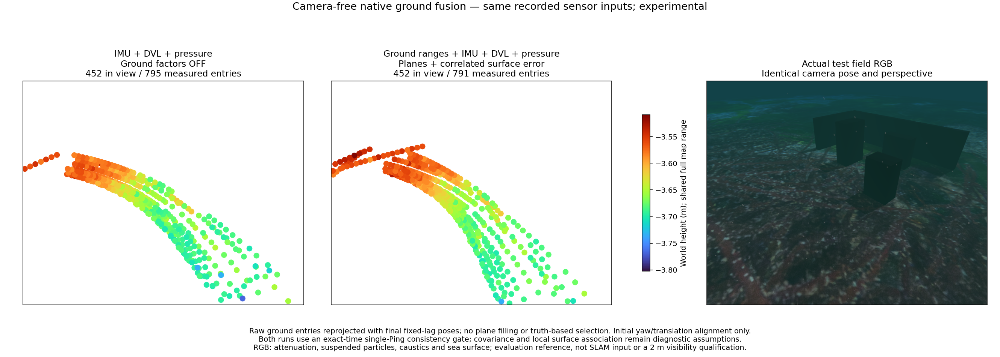
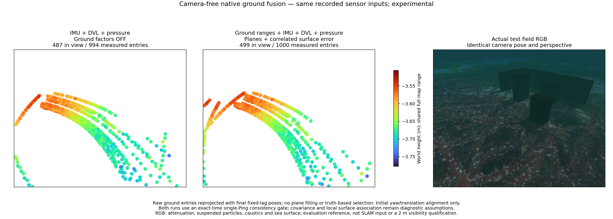
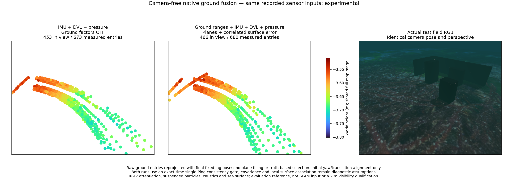
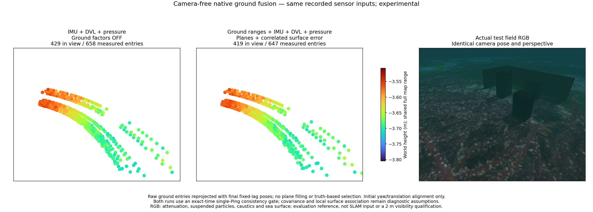

# Spatial surface uncertainty / 공간적으로 연관된 해저 오차

The experimental ground worker can account for nearby rays sharing the same
surface approximation error. It retains raw ranges, unknown local planes and
IMU/DVL/pressure fusion. The option defaults to off. **All four recorded trials
still have greater position error than the no-ground control.**

실험용 해저 작업자는 가까운 빔들이 공유하는 표면 근사 오차를 반영할 수 있습니다.
원래 거리 관측, 미지 국소 평면, IMU·DVL·수압 융합을 유지합니다. 기본값은 꺼짐입니다.
**네 기록 모두 해저 제약 없는 대조군보다 위치 오차가 큽니다.**

For results after correcting the initial bias-weight mapping, see
[initial IMU bias prior](imu-initial-prior.md).
초기 바이어스 가중치 연결을 수정한 후의 결과는
[초기 IMU 바이어스 사전정보](imu-initial-prior.md)에 있습니다.

## Model / 모델

The range covariance adds `K(i,j)/(a_i*a_j)`, where
`K(i,j) = sigma² exp(-||p_i-p_j||²/(2 length²))` and `a_i = n·ray_i`.
Measured footprints and incidence use the estimated pose when each frame is
admitted and the group's initial normal. They stay fixed through optimization
and marginalization; the covariance grows only when a frame is appended.
The original independent/frame-common/time-common 3/2/1 cm assumptions remain.

거리 공분산에 `K(i,j)/(a_i*a_j)`를 더합니다.
`K(i,j) = sigma² exp(-||p_i-p_j||²/(2 length²))`이고 `a_i = n·ray_i`입니다.
관측점과 입사각은 각 프레임을 받아들일 때의 추정 자세와 그룹의 초기 법선으로
계산합니다. 최적화·주변화 중에는 고정하고 새 프레임을 연결할 때만 공분산을
확장합니다. 독립·프레임 공통·시간 공통 잡음 3·2·1 cm 가정은 유지합니다.

This is a conditional Gaussian error model, not a known terrain map. It does
not create horizontal position or yaw information on a uniform plane. It does
not include pose uncertainty in the kernel or calibrate the acoustic frontend.
[Python](../../src/posim_slam/ground_surface_noise.py),
[native covariance](../../native/basalt/ground_surface_noise.hpp),
[observation ownership](../../native/basalt/sonar_ground_store.hpp).

이 모델은 조건부 가우시안 오차 모델이며 사전 지형 지도를 사용하지 않습니다.
균일한 평면에서 수평 위치나 방위각 정보를 새로 만들지 않습니다. 커널에 자세
불확실성을 포함하거나 음향 관측 추출기를 보정한 결과도 아닙니다.
[Python](../../src/posim_slam/ground_surface_noise.py),
[네이티브 공분산](../../native/basalt/ground_surface_noise.hpp),
[관측 관리](../../native/basalt/sonar_ground_store.hpp).

## Parameter selection / 설정 선택

Record A alone selects sigma 0.08 m and length 2 m by leave-one-frame-out
predictive negative log density, including the covariance log-determinant.
The settings are frozen for B/C/D. This offline calculation uses no-ground
estimated poses and frozen raw selections; it does not read reference poses,
the terrain mesh or trajectory scores. It is not causal online calibration.
Both values lie at the grid boundary, so they are not identified hardware
parameters or product defaults. All recordings share one simulated terrain family.

A 기록에서 프레임 하나씩을 제외한 거리 예측의 음의 로그 확률밀도로
sigma 0.08 m, 길이 2 m를 선택했습니다. 공분산의 로그 행렬식도 점수에 포함합니다.
B·C·D에는 설정을 고정합니다. 이 오프라인 계산은 대조군의 추정 자세와 고정한
원본 관측 선택을 사용하며 정답 자세·지형 메시·궤적 점수를 읽지 않습니다.
인과적 온라인 보정은 아닙니다. 두 값 모두 탐색 범위 끝에 있으므로 식별된
하드웨어 매개변수나 제품 기본값으로 해석하지 않습니다. 기록들은 같은 시뮬레이션
지형 계열입니다.

The excluded frame still contributes its measured footprint to the fixed
covariance geometry; the first frame also defines the reference linearization.
Thus these are conditional diagnostic scores, not leakage-free out-of-sample
prediction. The separate B/C/D trajectory replays use the frozen settings
without trajectory-based retuning.

제외한 프레임의 측정 거리도 고정 공분산의 관측점 위치에 반영되며 첫 프레임은
기준 선형화에도 쓰입니다. 따라서 조건부 진단 점수이며 완전히 분리된 외부 표본
예측은 아닙니다. 별도 B·C·D 궤적 재생에서는 설정을 고정하고 궤적에 맞춰
다시 조정하지 않았습니다.

Held-out range prediction RMSE, baseline → spatial model / 제외한 프레임의 거리 예측 RMSE, 기본 → 공간 모델:

- A: 5.40 → 3.52 cm (selection record / 설정 선택 기록).
- B: 5.02 → 3.26 cm.
- C: 4.86 → 4.57 cm.
- D: 4.63 → 4.27 cm.

## Recorded trajectory and views / 기록 궤적과 비교 영상

[Full metrics](sonar-ground-spatial.json). Online position RMSE in metres:
no-ground control / original ground covariance / spatial ground covariance.
The kernel settings are unchanged across all four replays. No camera is input.

[전체 수치](sonar-ground-spatial.json). 온라인 위치 RMSE 단위는 m이며
해저 없는 대조군 / 기존 해저 공분산 / 공간 해저 공분산 순서입니다.
네 재생에서 커널 설정은 같고 카메라를 입력하지 않습니다.

| Record / 기록 | Control / 대조군 | Ground / 기존 해저 | Spatial / 공간 해저 |
| --- | ---: | ---: | ---: |
| A | 0.055 | 1.085 | 0.667 |
| B | 0.019 | 0.356 | 0.347 |
| C | 0.016 | 1.389 | 0.540 |
| D | 0.043 | 0.197 | 0.072 |

All four controls and the default-off C ground regression reproduce the previous
state sequences byte-for-byte. Seventeen mathematical tests and sixteen native
fusion tests pass, including explicit latent-field elimination equivalence,
native/Python agreement and repeated retirement with missing ground frames.
These checks do not qualify the recorded SLAM accuracy.

네 대조군과 옵션을 끈 C 해저 회귀 검사의 상태열은 이전 결과와 바이트 단위로
같습니다. 잠재 표면 변수를 명시적으로 소거한 결과와의 일치, 네이티브·Python
일치, 해저 관측 누락을 포함한 반복 주변화를 검사합니다. 수학 검사 17개와
네이티브 융합 검사 16개가 통과했으며 기록 SLAM 정확도 통과를 뜻하지 않습니다.

Each comparison uses the same camera pose and perspective, 64 pt² markers,
10 cm voxels and a shared full-range Turbo height scale. Points are measured
aperture-boundary samples reprojected with final owned poses, without plane
filling or truth-based selection. RGB includes attenuation, particles, caustics
and sea surface; it is a post-mission reference. Explicit 2 m RGB visibility,
independent terrain, obstacle reconstruction and DVL loss remain unqualified.

각 비교는 같은 카메라 위치·원근, 점 면적 64 pt², 10 cm 복셀, 전체 높이 범위를
공유하는 Turbo 색상을 사용합니다. 점은 관측한 개구 경계 거리를 최종 추정
자세로 재투영하며 평면 채우기나 정답 기반 선택을 하지 않습니다. RGB에는 감쇠·
입자·집광무늬·수면이 포함되며 임무 후 참조 영상입니다. 명시적 RGB 가시거리
2 m, 독립 지형, 장애물 복원, DVL 손실 조건은 아직 검증하지 않았습니다.

