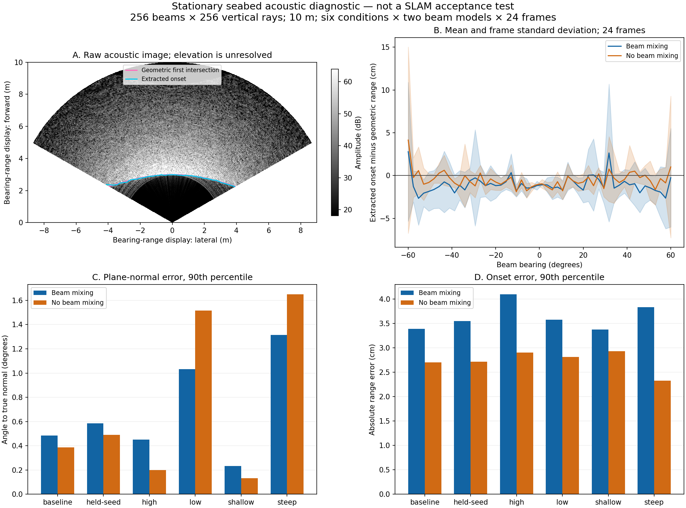

# Stationary sonar ground observations / 정지 소나의 해저 관측

[Exact range-transform comparison](sonar-exact-range.md) repeats these conditions
with a corrected simulator transform and retains the original measurements below.
[정확한 거리 변환 비교](sonar-exact-range.md)는 센서 변환을 수정해 같은 조건을
반복하며, 아래의 기존 측정값을 함께 보존합니다.

The experimental ground frontend receives repeated acoustic images of a stationary
plane, generated by the WGPU sonar backend. No pose estimator runs in this test.
Analytic geometry supplies synthetic ray depths and incidence to the acoustic
generator; only intensity, fan calibration and gravity enter the frontend.
True intersections and plane normals are used separately for evaluation.

실험용 해저 추출기에 WGPU 소나 계산기가 만든 정지 평면의 반복 영상을 입력합니다.
자세 추정기는 실행하지 않습니다. 해석 기하는 음향 생성기의 합성 광선 거리와
입사각을 만들며, 추출기는 강도·시야 보정값·중력만 받습니다. 참 교차 거리와
평면 법선은 별도로 평가에 사용합니다.

The test has 256 horizontal beams, 256 vertical rays, a 120° × 20° fan and a
10 m cap. There are 24 frames per condition and two angular response models:
the backend's beam mixing and an identity-matrix control. Range spacing is
2.508 cm. Hamming weighting and constant reflectivity are used. This is a
simulator diagnostic, not a calibrated Sonoptix hardware model.

수평 256빔·수직 256광선·120° × 20° 시야·최대 10 m를 사용합니다. 조건당
24프레임이며, 빔 사이 신호 혼합이 있는 모델과 단위행렬 대조군을 비교합니다.
거리 간격은 2.508 cm입니다. Hamming 가중과 일정한 반사율을 사용하며,
Sonoptix 실측 보정 모델이 아닌 시뮬레이터 진단입니다.

- **baseline:** altitude 1.5 m, downward pitch 20.05°, seed 41.
- **held-seed:** baseline geometry, seed 97.
- **high / low:** altitude 2.5 / 0.75 m, otherwise baseline.
- **shallow / steep:** downward pitch 10 / 35°, otherwise baseline.

기준 조건은 고도 1.5 m·하향각 20.05°·시드 41입니다. held-seed는 시드 97,
high/low는 고도 2.5/0.75 m, shallow/steep은 하향각 10/35°이며 나머지는 같습니다.

The image uses a distance-based bearing/range display, with near range below.
Its axes do not resolve elevation or represent a measured 3D seabed. Shading in
panel B is frame standard deviation, not a confidence interval.

영상은 아래가 가까운 거리 기반 방위각·거리 표시입니다. 이 좌표로 고각이
해결되거나 3D 해저가 측정되는 것은 아닙니다. B 패널의 음영은 프레임 표준편차이며
신뢰구간이 아닙니다.

[Measurements](sonar-ground-speckle.json): with beam mixing, onset absolute-error
p90 is 3.37–4.10 cm across the six conditions, but plane-normal error p90 is
0.23–1.32°. All 144 mixed-beam frames pass the frontend's conditional plane fit.
The range between onsets extracted with 4/6/8 dB thresholds contains the true
intersection in only 12.6–35.0% of entries. Threshold sensitivity is therefore
not a calibrated uncertainty bound. Removing beam mixing does not consistently
improve the plane normal, despite reducing range-error p90 in every condition.

[측정값](sonar-ground-speckle.json): 빔 혼합 모델의 시작 거리 절대 오차 p90은
여섯 조건에서 3.37–4.10 cm지만 평면 법선 오차 p90은 0.23–1.32°입니다.
144프레임 모두 추출기의 조건부 평면 적합을 통과했습니다. 4/6/8 dB 임계값으로
추출한 거리 사이에 참 교차점이 포함된 비율은 12.6–35.0%입니다. 임계값 민감도를
보정된 불확실성 범위로 사용할 수 없습니다. 빔 혼합을 제거하면 모든 조건에서
거리 오차 p90은 줄지만 법선 오차가 항상 줄지는 않습니다.

These results motivate geometry-dependent acoustic uncertainty and multi-view
surface validation. They neither establish the cause of the
[recorded trajectory regressions](sonar-ground-live.md) nor calibrate covariance
from 24 stationary frames. The current estimator weights remain unchanged.
Motion, clutter, reflectivity variation, multipath, independent terrain and
hardware accuracy are outside this test. RGB is absent; visibility ≤2 m with
camera fusion remains a separate acceptance test.

이 결과는 관측 기하에 따른 음향 불확실성과 다중 시점 표면 검증의 필요성을
보여줍니다. [기록에서의 궤적 악화](sonar-ground-live.md) 원인을 확정하거나
정지 24프레임으로 공분산을 보정한 결과는 아닙니다. 추정기 가중치는 그대로입니다.
이동·복잡한 물체·반사율 변화·다중 경로·독립 지형·하드웨어 정확도는 시험 범위
밖입니다. RGB는 입력하지 않았으며, 가시거리 2 m 이하에서의 카메라 융합은
별도 검증 대상입니다.
