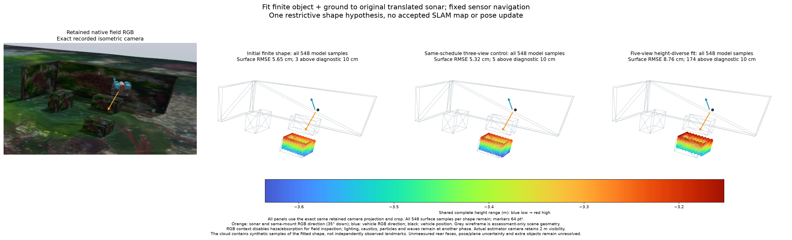
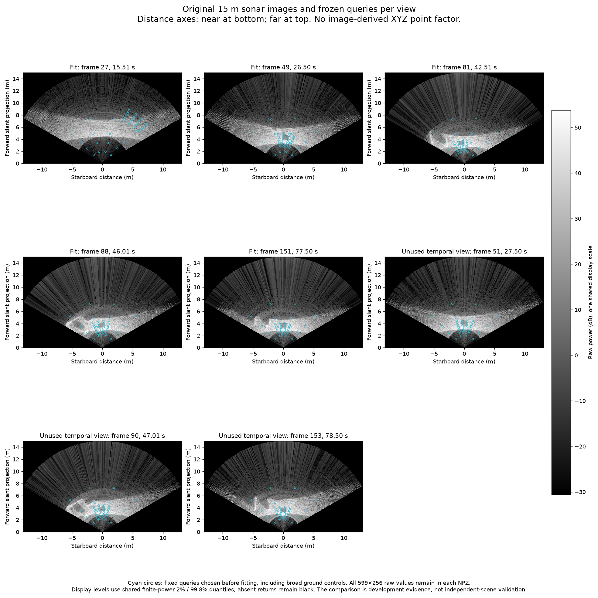
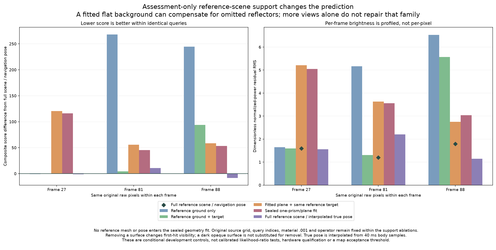

# 높이 차가 큰 관측과 장면 범위 대조군

[English](README.md)



현재의 고정 자세·직육면체 하나·해저 평면 모델에서는 높은 시점 관측을 추가해도
형상이 좋아지지 않습니다. 이전에 봉인한 결과에서 같은 4회 좌표 탐색을 수행하면
원래 3시점 대조군의 전체 표면 RMSE는 **5.32 cm**, 5시점은 **8.76 cm**입니다.
초기는 5.65 cm입니다. 보이지 않는 뒷면까지 형상당 **548개 전체**를 보존합니다.
[초기](initial_prism-complete.ply)·[3시점 대조군](three_view_control-complete.ply)·
[5시점](height_diverse_fit-complete.ply) 점은 모델 표면에서 만든 값이며 독립적으로
관측한 랜드마크나 수용된 SLAM 지도가 아닙니다. 항법 자세는 갱신하지 않습니다.

5시점 모델의 복합 평균 점수는 1846.007→1780.432, 미사용 시간 시점 점수는
1152.789→1121.144로 줄어듭니다. 같은 탐색의 3시점 대조군은 학습 점수가
1005.652로 좋아지지만 시간 비교 점수는 1168.634로 나빠집니다. 영상 점수 개선이
형상 개선을 입증하지 않으며 제한된 탐색이 전역 최적해를 입증하지도 않습니다.

## 사전 고정한 관측 비교



[절차](protocol.json)는 새 원본 확인과 적합 전에 고정했습니다. 기존 학습
49/88/151 프레임의 고도 차는 0.18 m입니다. 같은 소스의 27/81 프레임을 추가해
약 1.31 m로 늘립니다. 항법 높이의 양 끝 중 봉인한 형상 중심이 원래 소나 시야에
든다고 예측되는 시점입니다. 형상 가설에 조건부인 검사이며 실제 반사체 식별을
보증하지 않습니다. 초기 10변수·경계·탐색 순서는 같지만 경계에서 후보가 생략되면
실제 평가 횟수·시간은 달라질 수 있습니다. 평가 165회·520.7초와 모든 제안을 남깁니다.

높은 시점은 모델 물체에 닿는 광선이 471개이고 선택 평균 전력의 1.36%가 물체에
배정됩니다. 낮은 시점은 5,893개·62.10%입니다. 측정된 물체 에너지나 정보 순위가
아닌 전방 모델 예측입니다. 새 원본 2개만 보존하고 이전 6개는 해시로 공유합니다.
프레임마다 고정된 48픽셀과 599×256 원본 전체를 유지합니다. 잡음·범위·신선도·지도
수용 기준·센서 물리는 바꾸지 않습니다.

## 장면 범위가 중요한 이유



별도의 [평가용 전방 검사](field-forward-audit.json)는 고정한 시점 3개에서 보존된
전체 참조 장면을 사용합니다. **항법 자세를 그대로 두어도** 정규화 잔차 RMS는
봉인한 유한 모델의 **5.048/3.557/3.042**에서 **1.594/1.202/1.787**로 줄어듭니다.
이득은 28.07/2.50/4.93에서 1.24/1.11/1.81로 바뀝니다. 참조 형상은 추정에
넣지 않습니다. 전체 장면과 보간한 실제 자세 대조군의 RMS는 1.559/2.202/1.142입니다.
실제 기체 자세의 40 ms 양옆 기록에서 위치 선형 보간과 quaternion Slerp를 쓰고
시간 오프셋을 맞추지 않습니다. 단일 영상 대조군이 장비·래스터화·정확한 시각이나
보정된 영상 우도를 입증하지는 않습니다.

봉인 이후 적응적으로 정한 [장면 범위 비교](scene-support-ablation.json)는 자세·
균일 반사율·연산·쿼리를 고정합니다. 27/81 프레임에서 참조 해저와 같은 참조 물체의
점수는 215.717/327.686입니다. 적합 평면과 같은 물체를 쓰면 336.111/378.984입니다.
88 프레임의 해저+물체 점수는 **452.764**, 전체 장면은 **358.840**입니다.
잘못된 평면은 **417.134**로 누락한 다른 반사체를 일부 대신 설명합니다.
표면 제거는 첫 교차 가림을 바꾸므로 반사율 0으로 대체하지 않습니다. 이 대조군은
봉인 이후 평가용이며 독립 장면이나 보편적인 오차 기준을 주장하지 않습니다.

높이의 양 끝을 선택하는 것만으로 현재의 불완전한 장면 모델을 고칠 수는 없습니다.
다음에는 측정한 국소 해저와 여러 반사체를 함께 표현하고 미지 영역·공통 자세
불확실성을 다룬 뒤 네이티브 제약을 선택해야 합니다. 잡음을 조정하거나 표면 점을
독립 고정 XYZ 측정으로 바꾸지 않습니다. 모든 실패 가설·이전 지도를 보존하며
독립 장면과 실제 DVL 손실·부재에서의 이득은 운영 수용 조건으로 남깁니다.

## 소스·자료·재현

소스는 미병합 #6/#31–36을 포함한 POSIM **ffecee9b**입니다. 15 m·599 거리 빈·
256빔·수직 광선 256개이며 원본 IMU·수압·DVL을 쓰고 Ping은 없습니다. 조사용
아래 35° 장착과 실제 추정 RGB의 가시거리 2 m는 유지합니다. 비교 패널은 기록된
같은 등각 카메라 투영·잘라낸 범위, 64 pt² 점, 전체 공통 Turbo 높이와 기체·센서
방향을 사용합니다. 현장 확인 RGB만 안개·흡수를 끄고 조명·해저 집광무늬·입자·
파도는 다른 위상으로 유지합니다. 장면·RGB·정답 자세는 평가용입니다. 새 촬영·
SDK 변경·GitHub Actions Artifacts는 사용하지 않습니다.

공개 생성기는 이전 유한 표면 탐색·평가·그림 함수를 재사용합니다. 여러 가설과
공유 원본을 받는 함수 인터페이스만 일반화하고 이전 기본값·과학 결과는 보존합니다.
라이브러리의 `research,diagnostics` 의존성으로 실행합니다.

```sh
python docs/diagnostics/sonar-height-diversity-fit-20261031/verify.py
```

검증기는 최종 전력·공분산·전체 PLY·평가·장면 범위 대조군을 다시 계산하며 최적화를
반복하지 않습니다. 새 `run_fit.py prepare`/`support`/`fit` 명령은 생성기·절차가
있는 새 폴더에서 `--records`/`--raw`를 받고 기존 탐색 기록을 덮어쓰지 않습니다.
`assess`/`render`는 봉인 후 사용합니다. 네이티브 소스 검증·설치형 앱 수용은 별도이며
WWW-POSIM 구현을 가져오지 않습니다.

장면·자세 최적화는 기존 연구입니다. [Qadri 등 2023](https://www.cs.cmu.edu/~kaess/pub/Qadri23icra.pdf)은
암시적 음향 표면을, [Lin 등 2025](https://www.cs.cmu.edu/~kaess/pub/Lin25iros.html)는 장면과
자세의 동시 최적화를 다룹니다. 본 진단은 논문 신규성을 주장하지 않습니다.
[NeuSIS 구현](https://github.com/rpl-cmu/neusis)의 [라이선스는 MIT](https://github.com/rpl-cmu/neusis/blob/main/LICENSE)이며
공개 학습 절차는 NVIDIA 3090을 사용합니다. 검토할 오프라인 대조군이고 현재 설치한
의존성이나 실증한 실시간 지도화 기능은 아닙니다.
