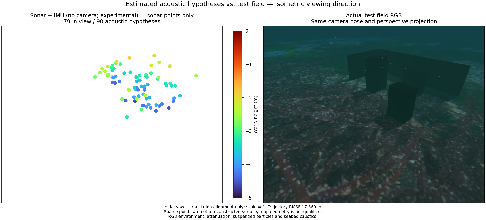

# Camera-free sonar clock / 카메라 없는 소나 시계

The native research worker accepts sonar events from startup without camera
calibration, image packets or an optical frontend. IMU propagation, acoustic
optimization and state marginalization share the same clock. A caller-estimated
gravity direction seeds attitude; initial velocity and biases are zero. This
does not establish correct initialization for an already moving vehicle.

The analytic sensor fixture supplies no poses or point seeds. It emits 61
states, with active acoustic constraints in 54 states, at most 15 retained
states after acoustic startup, and maximum position error 1.25 mm. A separate
featureless fixture fails at the initialization budget. These controlled tests
prove worker ownership and state management, not field accuracy.

The measured Gazebo recording uses causal OpenCV 4.13.0 corner/Lucas–Kanade
tracks and the pinned Basalt joint optimizer. All 156 original sonar timestamps
over 77.5 seconds are processed with zero camera/Ping packets. The bounded queue
peaks at one pending event. Its explicit 1.25-second sonar gap contract matches
the existing acoustic frontend; the recorded 2 Hz sonar includes 0.49–0.51 s
intervals. Camera timing remains separate.

**The navigation and map result fails acceptance.** Position RMSE is 17.36 m,
maximum position error 59.85 m. Only 21 of 90 acoustic hypotheses lie within
10 cm of a physical surface; median/p90/maximum surface distances are
0.266/6.105/6.771 m. The final 24 seconds have no active acoustic track. The
input stream staying alive does not imply an observed or reliable pose.

The figure aligns only initial yaw and translation, with scale fixed at one.
It uses the same isometric perspective for hypotheses and RGB. RGB contains
attenuation, suspended particles, seabed caustics and sea surface, and enters
only the independent comparison. No pressure, DVL or terrain factors enter this
worker path. This is a camera-absent test, not a calibrated 2 m optical-visibility
experiment. The app mode remains unavailable. [Evidence](sonar-inertial-clock.json).

실험용 네이티브 워커는 시작부터 카메라 보정값·영상·광학 추적기 없이 소나
이벤트를 처리합니다. IMU 전파, 음향 최적화와 상태 정리는 같은 시계를 사용합니다.
추정 중력 방향으로 자세를 시작하고 초기 속도·바이어스는 0으로 둡니다.
이동 중인 차량의 초기화가 정확하다는 뜻은 아닙니다.

해석적으로 생성한 센서 시험은 참 자세나 점 초기값을 전달하지 않습니다.
61개 상태 중 54개에 음향 제약이 있고, 음향 초기화 뒤 최대 15개 상태를 유지하며
최대 위치 오차는 1.25 mm입니다. 별도 무특징 시험은 초기화 한도에서 실패합니다.
이는 워커의 상태 관리 검증이며 실제 장면의 정확도 검증이 아닙니다.

실제 Gazebo 녹화 재생은 OpenCV 4.13.0 코너·Lucas–Kanade 추적과 고정된 Basalt
공동 최적화기를 사용합니다. 카메라·Ping 패킷 없이 77.5초의 소나 시각 156개를
모두 처리하며 대기 이벤트는 최대 1개입니다. 소나 시간 간격 한도 1.25초는
기존 음향 추적기와 같습니다. 2 Hz 기록의 실제 간격은 0.49–0.51초입니다.

**항법과 지도 결과는 불합격입니다.** 위치 RMSE는 17.36 m, 최대 오차는
59.85 m입니다. 음향 가설 90개 중 표면 10 cm 이내인 점은 21개이며, 표면 거리의
중앙값·90백분위·최댓값은 0.266/6.105/6.771 m입니다. 마지막 24초에는 활성
음향 트랙이 없습니다. 센서가 계속 발행된다고 자세 관측이 유지되지는 않습니다.

그림은 최초 방위각·위치만 정렬하고 축척은 1로 유지합니다. RGB와 점군은 같은
등각 방향 원근 투영이며, RGB의 수중 감쇠·입자·집광무늬·수면은 평가용입니다.
수압·DVL·지형 제약은 이 경로에 포함되지 않습니다. 카메라가 없는 시험이며
가시거리 2 m를 보정한 시험은 아닙니다. 앱 모드는 아직 사용할 수 없습니다.
