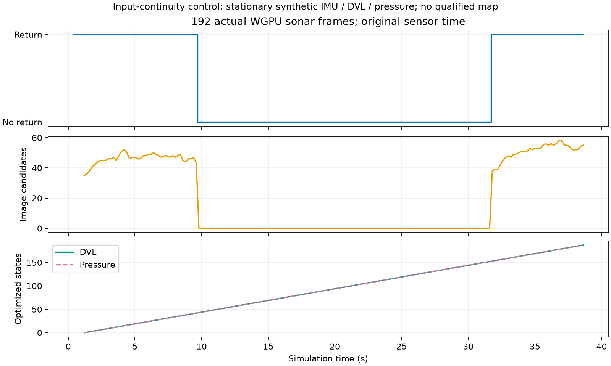

# 소나 무반사·거리 표본 입력 규약

[English](README.md)

이 개발 검증 기록은 POSIM 통합 소스
`7afd71e7b7a1a13eca8c4b8deb9c6e8461285cd5`의 소비 경로를 검사합니다.
현재 main과 #6, #31–36을 별도 브랜치에 통합했으며, 해당 PR들을 #6이나 원격
main으로 병합하지 않았습니다. 소스별 역할과 15 m Orca5 기준 기록은
[앞선 기록](../sonar-pr31-36-20261030/README.md)에 보존합니다.

전력 0의 `-inf`는 정상 관측입니다. 공유 검사는 원본 배열을 보존하며 NaN·양의
무한대, 잘못된 형상·시각은 계속 거부합니다. 영상 필터의 유한 작업 배열과 원본
측정을 분리하고, 후보 픽셀의 실제 거리·빔 표본에 유한 반사가 있어야 추적합니다.
정량적인 반사 경계·해저 진입·그림자 계산은 근거 없는 유한 잡음 바닥을 만들지
않고 잡음 근거가 없음을 표시합니다. 완전 무반사 프레임은 음향 랜드마크를 만들지
않지만 수신 시각을 갱신하고 유효한 IMU·DVL·압력 처리를 계속 허용합니다.

보정 검사는 장착 모델의 대역폭 B·음속 c를 사용합니다. 거리 간격은 c/(2B),
표본 수는 ceil(2RB/c)+1이며 전체 거리·방위각 벡터를 검사합니다.
10 m / 29.9 kHz / 1500 m/s에서는 400개 표본의 마지막 실제 좌표가
10.00836086 m입니다. 이 좌표를 보존하면서 실제 점의 거리·시야각은 센서의
물리 범위로 제한합니다. 양의 유한 잡음 측정값과 미지 점의 감지 범위를 구분하며
Python·네이티브 요인에 같은 규칙을 적용합니다. 거리 허용 오차, 잡음, 최신성,
지도 수용 기준과 물리 절단 범위는 늘리지 않았습니다. ceil 경계에서 근삿값
비교가 표본 수를 바꿀 수 있으므로 앱은 ray·변환의 최대 거리 설정값이 수치상
같아야 시작합니다.

## 실제 입력 검사

- 원본 CPU·WGPU/Metal 회귀 검사는 각각 시각이 같은 원본·거리 좌표 미리보기
  125쌍을 통과하고 서버가 정상 종료했습니다. 추가 관찰기는 CPU 190개,
  WGPU 192개의 전체 도착 프레임을 받았으며 무반사는 각각 108·110개입니다.
  두 특징 추적 경로 모두 원본 바이트를 보존하고 반사 복귀 후 다시 시작합니다.
- `inputs.npz`에는 WGPU 192프레임 전체와 CPU 다섯 단계의 원본 표본을 시각·해시와
  함께 담았습니다. 이 평판 검사용 설정은 32빔·400거리·900 kHz·130° × 12°이며
  **Sonoptix 데모 설정과 다릅니다.** 별도의 정규 15 m·256빔·599거리 Orca5
  기록은 95프레임 모두 보정 검사를 통과합니다.
- 정규 기록의 모든 값이 유한한 95프레임에서는 영상, 강도·반사 경계 추적,
  정량 경계·해저·그림자 배열과 영역 결과가 라이브러리
  `c96dff1b9f40753684b39cf78e19168529f793fa`와 같습니다.
  네이티브 요인 전체나 지도 출력까지 같다는 검사는 아닙니다.
- SDK Python 검사는 543개 중 521개 통과·선택적 환경 22개 제외이며,
  별도 Python OpenCV 4.10 연구용 부분집합은 21/21 통과입니다.
  앱의 관련 검사 세 개와 네이티브 소나 시각 검사 일곱 개도 통과했습니다.
- 네이티브 수정 전·후 대조는 정상 근거리·원거리 잡음 표본을 각각 0/2·2/2
  수용합니다. 실제 물리 범위 밖의 점 두 개는 양쪽 모두 거부합니다.
  최종 네이티브 기하 검사도 통과합니다.

최종 격리 빌드는 원래 시각의 WGPU 192프레임을 **합성 정지 IMU·DVL·압력**과
함께 처리합니다. 실제 차량 운동이나 기본 물리 센서 주기 검사가 아닙니다.
필수 1초 IMU 초기 이력을 받은 뒤 상태 188개와 DVL·압력 최적화 각각 187회를
확인했으며 무반사 구간을 포함해 마지막 입력 38.6초까지 도달했습니다.
유효한 지도·항법 결과는 생성하지 않았습니다. 공개 클라이언트의 종료 요청은
SIGTERM(종료 −15)을 사용하며 SIGKILL 없이 스레드가 정리됩니다.
설치된 SDK는 변경하지 않았습니다. 실행 파일 SHA-256:
`38ec4ecc26aba87e55ee4abe60446196ed6bc6983fa335fb4461dac105e1e813`.

## 기존 시각·관성 경로 회귀 검증

최종 소스·실행 파일로 기존 카메라·IMU의 원래 시각 재생 다섯 조건을 검사합니다.
DVL 통신 끊김, 바닥 잠금 해제, Ping 없는 압력 끊김, Ping 융합 중 압력 끊김,
Ping 수신만 하는 압력 끊김입니다. 독립 라이브러리는 기존 센서 조합 대조를
보존하며, 앱의 DVL 조합은 계속 Ping을 제외합니다.

다섯 조건 모두 통과했습니다. 전체 내보내기 열 개의 합계는 14,063개 점이며 그중 27개가 10 cm를 넘습니다. 바닥 잠금 해제에서는 추정기·지도 좌표계를 유지하므로 복귀 내보내기에 기존 점도 포함됩니다. 나머지 네 개의 소스 일치 재시작·복구 조건으로 개발용 공급자 설명 파일을 준비했습니다. 잠금 해제의 연속성 검사는 별도로 보존하며 새 좌표계 복구 증거로 취급하지 않습니다.

| Profile / phase | Points | Surface RMSE (cm) | Maximum (cm) | >10 cm |
| --- | ---: | ---: | ---: | ---: |
| dvl-transport / initial | 1425 | 1.137 | 15.738 | 3 |
| dvl-transport / recovered | 1459 | 1.197 | 12.233 | 1 |
| dvl-lock / initial | 1425 | 1.137 | 15.738 | 3 |
| dvl-lock / recovered | 2897 | 1.125 | 15.738 | 5 |
| no-ping / initial | 1246 | 1.769 | 16.701 | 3 |
| no-ping / recovered | 994 | 1.732 | 14.584 | 2 |
| ping-fused / initial | 1135 | 1.795 | 23.823 | 2 |
| ping-fused / recovered | 1142 | 1.313 | 14.670 | 3 |
| ping-received / initial | 1346 | 1.942 | 17.033 | 3 |
| ping-received / recovered | 994 | 1.732 | 14.584 | 2 |

생성한 점을 모두 보존·평가하고 `vio/`에 초기·복구 구간별 현장·점군 등각 시점
비교를 둡니다. 10 cm를 넘는 점도 삭제하지 않습니다. 이 거리는 진단용 구분이며
해양 인식의 보편적 허용 오차가 아닙니다. 기존 VIO 회귀 검사이므로 소나 지도
개선의 근거로 사용하지 않습니다. 전체 기록·실패 대조는 ExternalHDD 한 곳에
남기고 두 저장소에는 제한된 원본 입력과 결과만 복제합니다.

## 재현과 남은 작업

NumPy와 해당 POSIM-SLAM 소스를 설치한 환경에서 `python verify.py`를 실행합니다.
파일·원본 해시, 포함된 모든 보정 프레임, 네이티브 연속성 결과와 모든 전체 지도
평가를 검사합니다. Matplotlib을 사용하면 `plot_continuity.py`로 그림을 다시 만듭니다.
최종 소스 해시·실행 파일 식별·검사 개수는 `source-identity-final.json`,
`native-identity-final.json`, `checks.json`에 있습니다. 입력 수정만 적용했던
실행 파일과 결과도 최종 결과와 구분해 보존하며 최종 검증을 대신하지 않습니다.

다음은 물리 반사체의 지속적인 대응과 거리 응답의 확률 모델 검증입니다.
이를 확인한 뒤 지도 요인을 추가합니다. 유용한 소나 지도, 실제 DVL 끊김·미장착
상태에서의 이득, 일반 초기화 불확실성, 설치형·운영체제 검증, VRX와 WAM-V
측량은 미완료입니다. 이번 표본·측정 처리 수정에 학술적 독창성을 주장하지 않습니다.
GitHub Artifact 다운로드, LIVE·러너 재시작, 설치 SDK 교체나 새 네이티브 공급자
ABI는 사용하지 않았습니다.
