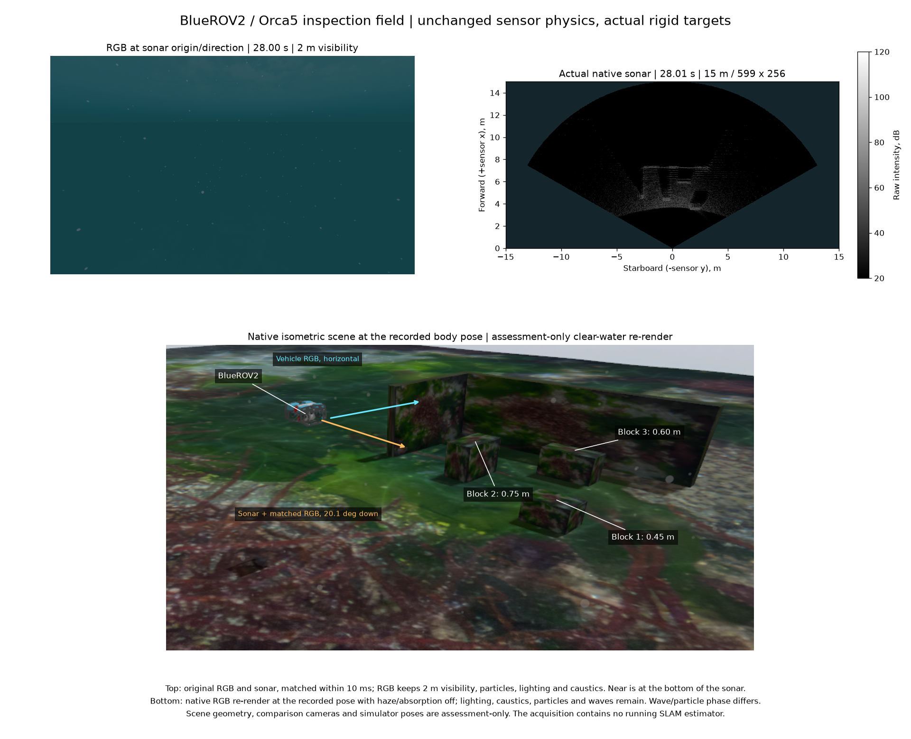
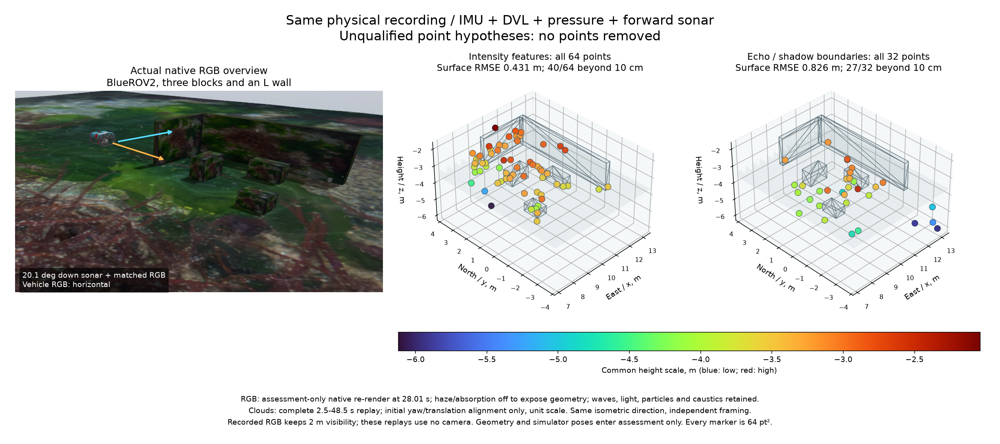

# 실제 검사 장면과 동일 입력 소나 점 복원 비교

[English](README.md)

BlueROV2 기본 월드는 60 × 60 m Orca5 해저를 유지하고 ㄱ자 벽 옆에 해저에 고정된 블록 세 개를 둡니다. 블록 높이는 0.45·0.75·0.60 m, 벽 높이는 1.6 m입니다. 하나의 상자 정의로 실제 충돌·시각 형상, 브라우저 치수, 경로 여유 공간 계산용 표면을 만듭니다. 물리 해저는 여유 공간 계산용 격자와 분리합니다. 구조물이 부족했던 앞선 기록도 회귀 사례로 보존합니다.

## 소스와 센서 기록

별도 통합 `ffecee9b`에는 현재 main `8c47601`, #6, #31–36의 현재 head가 모두 포함됩니다. [소스 검토 기록](source-review.json)에 정확한 커밋과 포함 관계가 있습니다. #31은 센서 생성·장착 자세, #32는 ROS 수명·촬영 시각, #33은 행렬의 부분 타일, #34는 원래 길이 변환·주파수 창·약한 반사의 부동소수점 계산, #35는 무반사 미리보기, #36은 실제 거리 축의 끝점을 담당합니다. SLAM 수신부는 무반사 `-inf`와 공개된 거리 벡터를 보존하고 잠재 점의 물리 범위를 검사합니다. 소스 PR을 #6이나 원격 main에 병합하지 않습니다.

네이티브 실행은 소나 95프레임(599거리 × 256빔, 15 m), 차량 RGB 238프레임, IMU 4,748개, 압력 475개, 네이티브·상태 DVL 각각 47개를 기록합니다. DVL은 모두 네 빔으로 해저를 추적하며 single Ping은 실제 차량에서 제거되어 있습니다. 원본 소나 전체의 해시·격자·시각이 [95프레임 검사](field-audit.json)를 통과하고, 같은 위치·방향의 비교 RGB는 10 ms 이내로 맞습니다. 경로의 최소 계획 여유 거리는 1.351 m이며 임무를 완료합니다. 기록용 프로세스 그룹 네 개가 정상 종료하고, 별도 네이티브 장면 렌더링도 0으로 종료합니다. 이 장면 비교에서 설치 SDK·소나 물리 모델·센서 파라미터는 바꾸지 않습니다.

위: 기록된 비교 RGB와 실제 소나입니다. RGB는 시정 2 m, 수중 조명, 부유 입자, 해저 집광무늬를 적용합니다. 소나 축은 거리이며 아래가 가까운 곳입니다. 차량 RGB는 수평을, 소나와 비교 카메라는 아래로 20.1°를 봅니다. 아래: 기록된 28.01초 차량 자세로 네이티브 장면을 다시 렌더링한 평가용 전경입니다. 구조를 드러내기 위해 안개·흡광을 끄고 파도·조명·입자·집광무늬를 유지합니다. 파도·입자의 위상은 원본과 다릅니다.

## 동일 입력 네이티브 재생

기본 설정 세 가지는 원래 시각, 미지 바이어스 초기화, IMU, 해저 추적 중인 DVL, 압력을 동일하게 사용합니다. 2.5–48.5초의 상태 139개를 각각 보존하며 RGB는 입력하지 않습니다. 시작 소나 구간 두 개는 원본에 보존하고 기존 1초 IMU 초기 이력을 위해 재생에서 제외합니다. 시뮬레이터 자세와 장면 형상은 추정기에 입력하지 않습니다. 궤적 평가는 초기 수평 방향과 평행이동만 맞추며, 축척은 1이고 중력 방향의 기울기 오차도 남깁니다.

| 방식 | 위치 RMSE | 자세 RMSE | 전체 출력 점 | 표면 RMSE | 10 cm 초과 |
| --- | ---: | ---: | ---: | ---: | ---: |
| IMU + DVL + 압력 | 0.0297 m | 0.671° | — | — | — |
| + 강도 영상의 점 추적 | 0.1175 m | 1.466° | 64 | 0.431 m | 40 / 64 |
| + 반사·그림자 경계의 점 추적 | 0.0549 m | 1.285° | 32 | 0.826 m | 27 / 32 |

두 점군은 이상점을 포함해 보존된 점을 모두 표시합니다. 점 크기는 64 pt²이며 전체 높이를 포괄하는 Turbo 색 범위를 공유합니다. 장면과 점군은 같은 등각 방향에서 보고 화면 범위는 각각 맞춥니다. 회색 표면은 평가 기준입니다. 원본 PLY·JSON 전체와 모든 점의 오차를 포함합니다. 10 cm 개수는 이 기록의 분포이며 해양 SLAM의 보편적인 합격 기준이 아닙니다. 두 방식 모두 이 조건에서 유용한 지도나 항법 보조로 인정하지 않습니다. 모델에 알려진 바이어스를 사용한 별도 항법 대조군의 위치 RMSE는 0.0181 m이며 점 추적 방식의 동일 조건 기준선과 구분합니다. 네이티브 작업자는 기존 클라이언트의 SIGTERM 경로로 종료합니다(자식 -15, 재생 Python 0). SIGKILL은 사용하지 않습니다.

## 정확한 자세를 넣은 진단

오프라인 대조군은 출력된 점마다 마지막으로 승인된 네이티브 이력의 관측을 그대로 고정합니다. 평가용 정확한 위치·자세로 기존 고도 초기값 아홉 개와 최대 열두 번의 계산을 실행하고 모든 결과를 보존합니다. 측정 비용이 가장 작은 결과를 고른 뒤에만 실제 표면과 비교합니다. 이 낙관적 진단의 정답은 네이티브 재생에 입력하지 않습니다.

| 같은 관측, 정확한 자세 | 평가한 점 | 표면 RMSE | 10 cm 초과 | 조건부 위치 3σ 중앙값 |
| --- | ---: | ---: | ---: | ---: |
| 강도 점 추적 | 64 / 64 | 0.395 m | 40 / 64 | 0.826 m |
| 반사·그림자 경계 점 추적 | 32 / 32 | 0.796 m | 29 / 32 | 0.875 m |

조건부 3σ는 자세를 고정하고 측정 정보만으로 계산합니다. 공유된 자세 불확실성과 물리적 대응점의 불확실성은 포함하지 않으므로 결합 불확실성이나 지도 합격을 뜻하지 않습니다. 가정한 측정 오차로 정규화한 적합 잔차의 중앙값은 0.750·1.104이지만 실제 표면 오차는 큽니다.

적합에 사용하지 않은 2초 이후 관측은 강도 방식의 64개 추적 중 13개에 남습니다. 관측 80개 중 예측 형상 안이 56개, 밖이 24개입니다. 형상 안의 56개에 대한 거리 RMSE는 0.124 m입니다. 경계 방식은 32개 중 2개 추적에 관측 세 개가 남고, 형상 안 두 개·밖 한 개입니다. 형상 안의 거리 RMSE는 0.0905 m입니다. 후속 관측이 없는 추적도 전체 개수에서 제외하지 않습니다. 이 적은 생존 관측만으로 예측이나 대응점의 신뢰성을 입증하지 않습니다.

위치·자세 오차를 없애도 점 복원 실패가 남습니다. 고정 XYZ 제약을 더 넣기 전에 고도 모호성과 시점에 따라 달라지는 음향 반사 영역을 다뤄야 한다는 근거입니다. 이는 [충분히 구속되지 않은 소나 랜드마크](https://www.cs.cmu.edu/~kaess/pub/Westman18icra.html)와 [퇴화에 대응하는 소나 제약](https://www.cs.cmu.edu/~kaess/pub/Westman20joe.html)의 일차 문헌에서 다루는 한계와도 관련됩니다. 이 기록은 두 논문의 전체 방법을 구현하거나 검증한 결과가 아닙니다. 다음에는 같은 원본에서 거리·방위각 반사 영역과 고도를 미정으로 남기는 표현을 비교합니다. 실제 DVL 해저 추적 상실·장치 부재, 유용한 형상, 일반 초기화, 설치·플랫폼 동작, VRX, WAM-V 측량 검증은 계속 필요합니다.

## 재현과 범위

공개 POSIM-SLAM 소스에서 진단 의존성을 설치하고 `python docs/diagnostics/sonar-inspection-scene-20261031/verify.py`를 실행합니다. 앱에서는 선택된 POSIM-SLAM 서브모듈을 초기화하고 같은 기록의 `docs/validation/.../verify.py`를 실행합니다. 검증기는 전체 궤적, 모든 출력 점의 삼각형 표면 거리, 보존된 정확한 자세 적합 비용과 미사용 관측 예측, 공개 파일 해시와 대표 원본 소나를 다시 계산합니다. 센서를 새로 실행하거나 외부에만 보존된 원본까지 검사하지는 않습니다. `plot_cloud.py`로 이 데이터의 전체 점군 그림을 다시 그립니다.

전체 센서 원본, 실패한 스테이징·설정 대조군, 소스·바이너리 추적은 외부에 한 번 보존합니다. 이 기록에는 비공개 앱 구현, 새 provider ABI, 설치 SDK가 없습니다. [소스 식별](source-identity.json), 전체 측정 출력, 기록·재생·평가의 범위를 구분합니다. Orca5에서 유래한 형상·이미지는 [원본 MIT 고지](Orca5-LICENSE.txt)를 유지하며 라이브러리 자체 코드는 Apache-2.0입니다.
