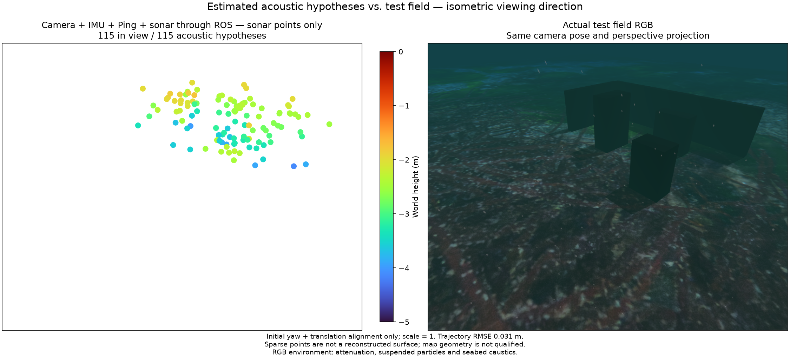

# Joint sonar through ROS / ROS 공동 소나 결합

The application ROS adapter uses POSIM-SLAM's `SensorEvents`, `AcousticTracks` and `SonarFusion` with the native Basalt worker. Camera, raw gyro/accelerometer, single Ping and imaging sonar keep their original measurement timestamps. Sonar's unresolved elevation is estimated through multiple poses; the initializer still needs visual observations. No simulator pose or surface identity enters the estimator.

애플리케이션 ROS 어댑터가 POSIM-SLAM의 `SensorEvents`·`AcousticTracks`·`SonarFusion`과 네이티브 Basalt 실행부를 사용합니다. 카메라·원본 자이로/가속도계·단일 Ping·영상 소나의 측정 시각을 유지합니다. 소나의 미확정 고도는 여러 자세에서 추정하며 초기화에는 시각 관측이 필요합니다. 시뮬레이터 자세·표면 ID는 추정기에 입력하지 않습니다.

## Measured execution / 실행 검증

Recorded BlueROV inputs are published through actual ROS subscriptions at 0.4× sensor-clock rate. With a 5 Hz camera cap, 16 recent states and OpenCV 4.13.0, the 75 s input test exports 1,809 visual points and 115 acoustic hypotheses before a deliberate sonar outage. It acknowledges 432 native states and supplies 136 acoustic snapshots; peak pending input is 6/16. Sonar loss clears the published acoustic cloud and rejects export. A camera/IMU/Ping-only regression also passes at 10 Hz. The 10 Hz joint configuration overflowed its queue in a longer run; this motivates the lower joint-mode default, not a larger buffer.

기록된 BlueROV 입력을 센서 시계 대비 0.4배 속도로 실제 ROS 구독에 발행합니다. 카메라 한도 5 Hz·최근 상태 16개·OpenCV 4.13.0 설정의 75초 입력 시험에서, 의도적 소나 중단 전에 시각 점 1,809개와 소나 가설 115개를 내보냅니다. 네이티브 상태 432개를 확인하고 소나 스냅숏 136개를 전달하며 대기 입력은 최대 6/16개입니다. 소나 중단 시 발행 점군을 비우고 내보내기를 거부합니다. 카메라·IMU·Ping 경로의 10 Hz 회귀 시험도 통과합니다. 10 Hz 공동 설정의 긴 시험은 입력 큐가 넘쳐 실패했으며, 공동 모드 기본값을 낮춘 근거로 보존합니다.

The figure shows 115 acoustic hypotheses; 68 are within 10 cm of a physical surface. Surface-distance median/p90/maximum are 8.56/31.75/53.96 cm. Trajectory RMSE is 3.11 cm. The same isometric perspective, four-times-size markers and fixed Turbo height scale are used. RGB includes underwater attenuation, suspended particles, caustics and sea surface. Only initial yaw and translation are aligned; scale is one. [Recorded evidence](sonar-live-ros.json).

소나 가설 115개 중 68개가 실제 표면 10 cm 이내에 있습니다. 표면 거리의 중앙값/90분위수/최대값은 8.56/31.75/53.96 cm이고 궤적 RMSE는 3.11 cm입니다. 같은 등각 방향의 원근 투영·네 배 크기의 점·고정 Turbo 높이 범위를 사용합니다. RGB에는 수중 감쇠·부유 입자·집광무늬·수면이 포함됩니다. 초기 방위각과 위치만 정렬하며 축척은 1입니다. [검증 JSON](sonar-live-ros.json).

The map remains unqualified: physical echo correspondence and useful surface reconstruction are unresolved. Different frontend versions, camera admission and initialization prevent attributing differences from earlier replay to an algorithm improvement. This recorded ROS test is not a new Gazebo mission, real-time hardware benchmark, GUI or installed-provider qualification. It adds no third-party dependency or research novelty claim.

실제 에코 대응과 유용한 표면 복원이 해결되지 않아 지도는 미검증 상태입니다. 이전 재생과 프런트엔드 버전·카메라 입력 주기·초기화가 달라 수치 차이를 알고리즘 개선으로 해석할 수 없습니다. 기록 기반 ROS 시험이며 새 Gazebo 주행·실시간 하드웨어 성능·GUI·설치 공급자 검증과 구분합니다. 새 제3자 의존성이나 연구 신규성을 주장하지 않습니다.
