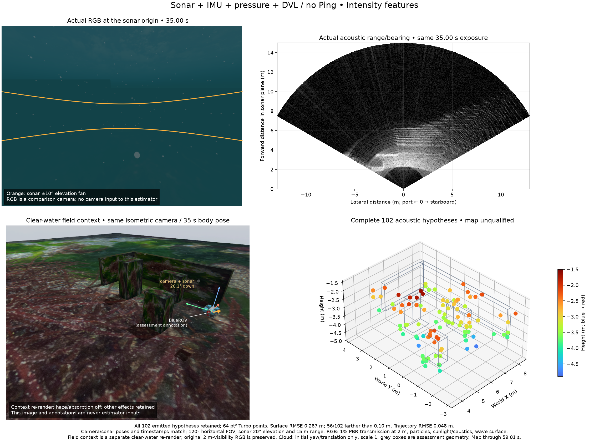
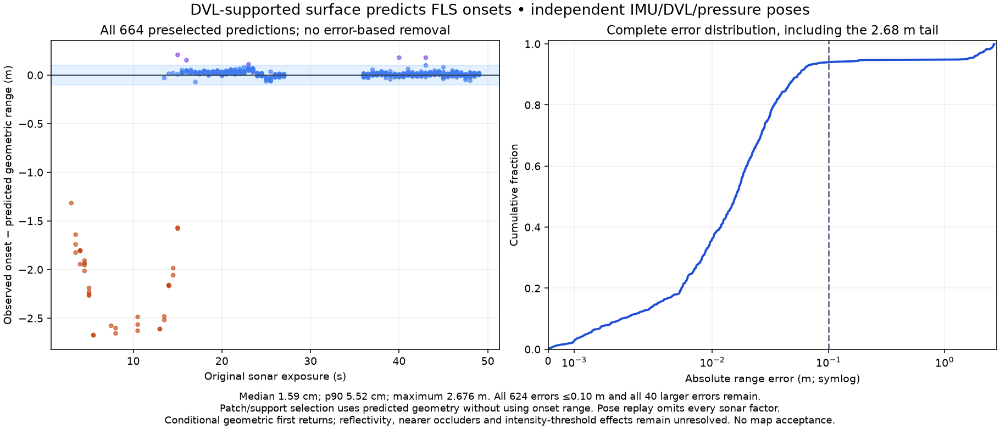

# Low-altitude FLS / DVL surface prediction

The shared forward-sonar preset has a 15 m ray/acoustic maximum, 0.2 m geometric
minimum, 256 horizontal beams, 256 vertical rays, 120° × 20° fan and 2 Hz rate.
Actual raw reception has 598 range bins, ending at 14.974916 m, with approximately
25.1 mm spacing. Camera and sonar share their origin and 20.1° downward mounting.
RGB has 1% scene transmission at 2 m, particles, sunlight/caustics and wave water.
Ping is physically absent. Raw IMU, pressure and bottom-locked DVL are recorded.

The real controller completes a fixed-heading, three-lane route at 2.5 m
commanded depth. Actual path length is 24.85 m, XYZ extent 5.59 × 3.84 × 2.39 m
and yaw span 3.13°. Assessment-only median height above terrain is 1.326 m;
a flat/level near-fan approximation is 2.648 m. These values explain the chosen
operating geometry and never enter the estimator. Both range and trajectory
differ from the historical 10 m record; this is not a cross-record algorithm
accuracy comparison.

All 116 sonar, 292 original RGB, 5,828 IMU, 58 common/native DVL, 582 pressure
and 59 field-camera frames are retained. All 232 DVL beam ranges/locks match
the original native report at the same timestamp; range variance stays unknown.
Acquisition and matching context render exit normally, with every owned group
empty. The actual IMU rate is 100 Hz under the existing 10 ms physics step.

## Same-input point-factor control

Both replays use public component `061c45c`, native binary `cb5cbc7c`, identical
original input hashes, state clocks, mounts, declared noise and sixteen-state
retention. Each has 178 states and 57 DVL/57 pressure optimization states.
Camera and Ping inputs are absent. The control omits every acoustic point
factor and supplies no sonar track updates; it does not emit an acoustic map.

The intensity-point baseline retains all 102 hypotheses. Surface RMSE/p90/max
is 28.66/44.08/112.41 cm, with 56/102 farther than 10 cm from the nearest
assessed surface. Trajectory RMSE is 4.79 cm, versus 2.11 cm without acoustic
point factors. Alignment uses initial yaw and translation only, with scale 1.
No trajectory fit or error-based point removal is applied. Both replay clients
close workers with SIGTERM (-15); normal-zero acquisition shutdown is separate.

Optimistic perfect-pose post-estimation fits retain every 102 submitted track
history. All optimistic three-sigma major axes exceed 10 cm. Eleven fitted
tracks leave the vertical fan, and surface-error p90 is still 45.33 cm. These
fixed-point hypotheses remain unsuitable; point identity and joint uncertainty
are unqualified. Perfect poses are assessment-only and never change estimation.



RGB and sonar have the exact same 35.00 s exposure. The field view is a separate
clear-water context render at the same body pose and isometric camera; original
foggy RGB and field-camera frames remain intact. Haze/absorption are disabled
only for context, while particles, sunlight/caustics and water remain. All cloud
points use 64 pt² markers and shared Turbo limits -4.9 to -1.5 m, without colour
saturation. Grey boxes and arrows are assessment annotations.

## Local surfaces and delayed overlap

The prior-three-frame continuous-cone plane diagnostic retains 216 held-out
DVL predictions. Absolute median/p90/max residual is 0.447/1.171/2.802 cm;
54/216 pass whole-cone spatial support. Other hypotheses remain in the record.
This diagnostic uses a declared, uncalibrated 20 mm independent / 10 mm shared
range-noise model. Low residuals do not establish physical surface identity or
joint pose/plane uncertainty.

Spatial association retains all 228 pose-covered DVL range hypotheses:
161 have no supported plane, eleven fail whole-cone hull support and 56 pass
the conditional support test. This association uses current DVL range seeds,
so its selected residuals are not independent held-out accuracy.

The range/azimuth-plane overlap tool tests 5,903 ground onsets from 114
pose-covered FLS frames against 67 local plane hypotheses. With at most 30 s
delay, 251 distinct earlier sonar onsets have sampled-bin geometric support
inside later DVL patches; 87 later onsets intersect earlier DVL support.
There is no contemporaneous overlap. These are possible geometric associations,
not verified echo/plane identities or certified full-cell uncertainty bounds.

## Prediction independent of acoustic point factors

`tools/evaluate_dvl_sonar_prediction.py` uses the **no-acoustic** pose replay
and its DVL patches. It predicts the first geometric plane intersection over
the calibrated 256 vertical rays. Only predicted intersections select support,
including centre and two azimuth-edge checks. The observed FLS onset range
never selects a patch or establishes support. Selection uses earliest support
availability, then latest DVL stamp and beam ID; it never chooses by residual.

All 664 selected predictions have an observed onset. Absolute median/p90/max
residual is 1.589/5.515/267.609 cm. All 624 errors within 10 cm and all forty
larger errors are retained: 35 observed onsets are more than 10 cm nearer than
the prediction, five are farther. The large tail is not fitted away.
Shared support means these are not 664 statistically independent samples.



A finite geometric patch cannot establish absence of a nearer object or model
material response, beam mixing and intensity-threshold delay. This evidence
supports investigating shared local-surface/visibility factors rather than
treating every image feature as a fixed landmark. It does not validate live
range fusion, calibrated confidence or a useful SLAM map. The next implementation
must preserve joint pose/plane variables and grouped DVL covariance, and handle
ambiguous/occluded FLS returns before native integration.

Three CLI tests independently check positive support, unchanged predictions when
onset ranges are altered, an out-of-range negative control, and rejection of
sonar-conditioned poses. A clean committed-source export plus these selected
diagnostic additions passes 451 tests, with sixteen optional native/decoder
checks skipped. No package dependency, native estimator, sensor noise or map
admission setting changes. This does not claim a new wheel/installed acceptance.

## Original data and reproduction

Large original inputs are retained once outside Git to avoid multiplying them
in CI/release checkouts. `data-pointer.json` lists all 494 files, hashes and
97,241,159 bytes in the canonical dataset. Its default local directory is
`/Volumes/ExternalHDD/POSIM/validation-data/posim-slam/sonar-low-altitude-15m-20261029`.
The original acquisition path links to that same input directory. Public Git
contains complete maps, traces, metrics, figures and checksum manifests;
**full raw replay requires this separate dataset**. Historical public raw
archives remain unchanged. The library and synthetic tests remain independent
of WWW-POSIM private modules and this dataset.

Run `python docs/diagnostics/sonar-low-altitude-15m-20261029/verify.py` for compact
evidence. Add `--raw --data-root DATASET_DIRECTORY` to verify every original
file. With the dataset available, reproduce the independent prediction:

```sh
python tools/evaluate_dvl_sonar_prediction.py \
  --record DATASET_DIRECTORY/inputs \
  --calibration DATASET_DIRECTORY/metadata/calibration.json \
  --states docs/diagnostics/sonar-low-altitude-15m-20261029/no-acoustic/states.csv \
  --replay-receipt docs/diagnostics/sonar-low-altitude-15m-20261029/no-acoustic/receipt.json \
  --spatial-report docs/diagnostics/sonar-low-altitude-15m-20261029/dvl-spatial-no-acoustic.json \
  --output prediction.json
```

한국어: 15 m 소나와 수심 2.5 m의 중첩 주행 원본입니다. 모든 원본과 점군을
보존했습니다. 기존 밝기 특징의 고정 점 모델은 여전히 불합격입니다. 전체 102점 중
56점이 평가 표면에서 10 cm보다 멀고, 같은 입력에서 음향 점 제약을 넣으면 궤적
RMSE가 2.11 cm에서 4.79 cm로 커집니다. 평가용 정확한 자세를 사용해도 모든 점의
낙관적 3시그마 불확실성이 10 cm를 넘습니다.

DVL의 국소 평면 거리 예측 p90은 1.17 cm이며, 과거 소나 251개 관측이 나중 DVL
지지 영역과 기하학적으로 겹칩니다. 별도로 소나를 융합하지 않은 자세를 사용하고,
소나 관측 거리를 대응 선택에 쓰지 않은 예측 664개를 평가했습니다. p90은 5.52 cm지만
최대 2.68 m의 불일치가 남습니다. 10 cm 이내 624개와 그 밖의 40개를 모두 보존합니다.
가까운 물체·약한 표면 반사·강도 문턱의 영향과 자세·평면 상관관계를 해결해야 하며,
이 결과는 실시간 융합이나 지도 합격 근거가 아닙니다.

대형 원본 97,241,159바이트는 외장 디스크 공용 검증자료 폴더에 한 벌만 보관합니다.
Git에는 전체 지도·추적·평가·그림·해시를 넣으며, 원본 재생에는 별도 데이터셋이 필요합니다.
새 CLI의 관측 유출 방지·양성·음성 대조가 통과했고, 깨끗한 소스의 451개 검사와
선택 검사 16개 생략을 기록합니다. 이전 원본·판정 기준·잡음은 유지합니다.
