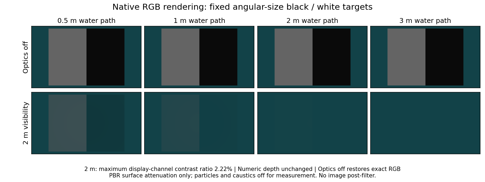
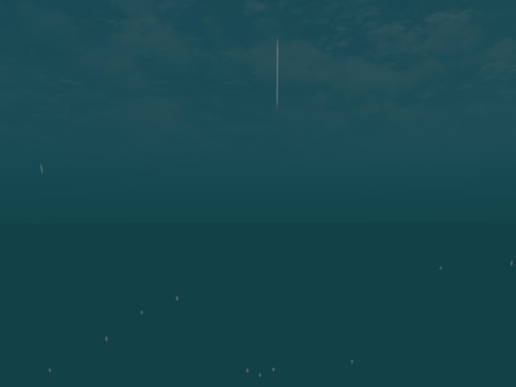

# Low-visibility camera-free sonar / 저가시성 카메라 없는 소나

The standalone native worker runs through the application ROS adapter without camera input from startup. A development BlueROV run uses a separately measured 2 m surface-optics profile: −ln(0.01)/2 = 2.302585 m⁻¹ minimum Beer–Lambert attenuation. The native renderer's black/white target contrast falls to at most 2.22% in display RGB at 2 m. Numeric depth is unchanged; switching optics off restores exact RGB. This is a rendering condition, not a turbidity calibration. Sky and custom water materials retain separate optics.

[Machine-readable result](sonar-low-visibility.json) records the shader and worker hashes, actual ROS subscriptions and scope. Over 60.01 s, the estimator emits 222 states and exports [146 local acoustic hypotheses](../data/sonar-low-visibility.ply). IMU, DVL and pressure participate; no camera messages enter the estimator. HTTP mode selection, export and all four display limits pass. All owned processes stop normally. The map is smaller than the display caps, so this run does not test their downsampling.

The RGB capture includes attenuation, sunlight, caustics, particles and water surface, and is evaluation-only. The image is not a paired isometric accuracy comparison. The existing [terrain support comparison](sonar-terrain-support.md) supplies matched field/map views. This run changes visibility, not the sensor combination or mapping algorithm.

Native runtime/API operation does not qualify map geometry, terrain-aided pose correction, installed-app interaction or navigation. The mission controller uses simulator external navigation, not this map. Export retains `map_qualified=false`, `navigation_ready=false` and `accumulated_local_sonar_hypotheses`.

The current worker also passes the C2 ROS interruption regression: 174 pose messages and 19 newly exported points after recovery. On the independent fresh A recording, poses resume but no new landmarks are admitted; export remains unavailable. This failure is retained, without loosening admission thresholds. DVL loss, reliable surface association and loop closure remain unqualified. No new dependency or third-party code is introduced.

## 한국어

독립 네이티브 워커는 시작부터 카메라 입력 없이 앱의 ROS 어댑터로 동작합니다. 개발용 BlueROV 시험에는 별도로 측정한 2 m 표면 광학 프로필을 사용합니다. 최소 Beer–Lambert 감쇠 계수는 2.302585 m⁻¹이며, 네이티브 렌더러의 흑백 표적 대비는 2 m에서 화면 RGB 기준 최대 2.22%로 낮아집니다. 수치 깊이는 같고 광학 효과를 끄면 RGB 바이트가 복원됩니다. 이는 탁도 보정이 아닌 렌더링 조건입니다. 하늘과 별도 수면 재질은 자체 광학 처리를 유지합니다.

60.01초 동안 상태 222회와 국소 음향 가설점 146개를 출력했습니다. IMU·DVL·수압을 함께 최적화하며 카메라 메시지를 구독하지 않습니다. HTTP 모드 선택, 내보내기와 네 표시 한도를 확인했고 소유 프로세스는 정상 종료했습니다. 점군이 모든 표시 한도보다 작아 이 시험만으로 다운샘플링을 검증할 수는 없습니다.

실제 전방 RGB는 차량 수심 1.513 m에서 촬영했습니다. 감쇠·햇빛·집광무늬·입자·수면을 포함하며 평가에만 사용합니다. 이 사진은 등각 지도 정확도 비교가 아닙니다. 같은 시점의 현장·점군은 [지형 지지 비교](sonar-terrain-support.md)를 참고하세요. 이번 시험은 센서 조합이나 지도 알고리즘을 바꾸지 않고 가시성만 바꿉니다.

네이티브 실행·API 검증으로 지도 정확도, 지형 보조 자세 보정, 설치형 앱 조작과 자율 항법을 합격 처리하지 않습니다. 임무 제어는 이 지도가 아닌 시뮬레이터 외부 항법을 사용합니다. 내보내기의 지도 미검증 표시는 유지합니다.

같은 워커의 C2 ROS 단절 회귀 시험에서는 자세 메시지 174개와 복구 후 새 점 19개를 확인했습니다. 독립적인 새 A 기록에서는 자세만 복구되고 새 특징점이 없어 내보내기가 계속 불가합니다. 이 실패를 보존하며 채택 기준은 완화하지 않았습니다. DVL 단절, 신뢰할 수 있는 표면 연결과 루프 폐쇄는 미검증입니다. 새 의존성이나 외부 코드는 추가하지 않았습니다.
