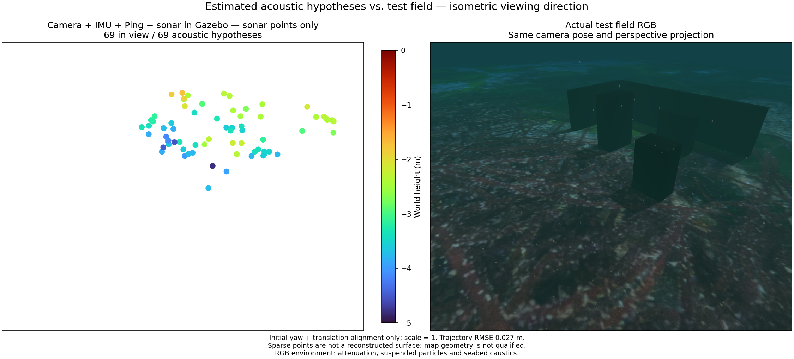
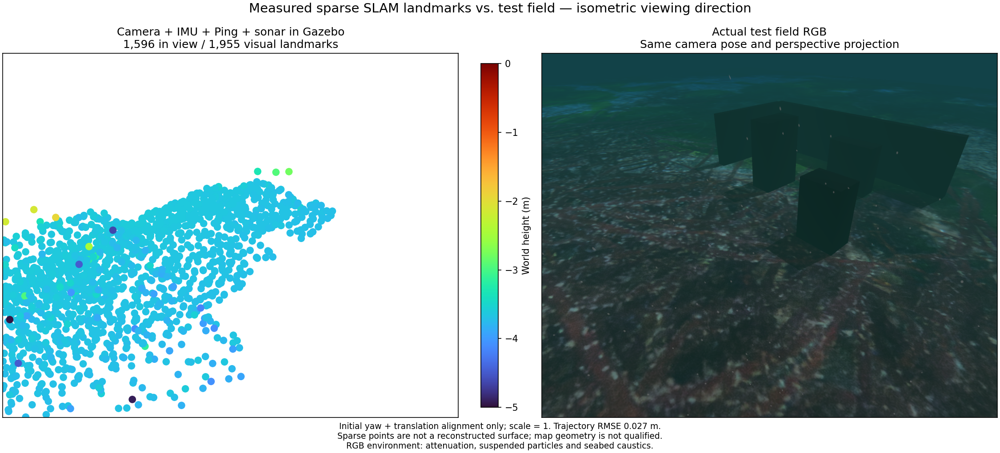

# Managed camera/IMU/Ping/sonar / 관리형 카메라·IMU·Ping·소나

The native Gazebo/ArduPilot example uses camera observations, raw IMU, single Ping and measured multibeam tracks with OpenCV 4.13.0 and the Basalt joint worker. The camera cap is 5 Hz and the recent-state window is 16. Visual normal equations use observed pose blocks; no sensor samples or state variables are removed by that matrix optimization.

네이티브 Gazebo·ArduPilot 예시는 카메라 관측·원본 IMU·단일 Ping·멀티빔 측정 트랙을 OpenCV 4.13.0과 Basalt 공동 실행부로 처리합니다. 카메라 한도는 5 Hz, 최근 상태 창은 16개입니다. 시각 정규방정식은 관측된 자세 블록으로 계산하며 이 계산 최적화는 센서 관측이나 상태 변수를 제거하지 않습니다.

The 60-second moving-input test retains one map segment after deliberate worker recovery, receives 300 poses and exports 1,955 visual landmarks plus 69 acoustic hypotheses separately. Position RMSE is 2.69 cm and maximum error 4.28 cm after initial yaw/translation alignment only; scale is one. The input queue peaks at 13/16. This single run does not establish workload-independent real-time performance or installed GUI acceptance. A separate recorded ROS test verifies sonar loss, empty clouds, rejected stale export and fresh visual/acoustic exports after return.

60초 이동 입력 시험은 의도적 실행부 재시작 후 한 지도 구간을 유지하고 자세 300회를 수신하며 시각 점 1,955개와 소나 가설 69개를 각각 내보냅니다. 초기 방위각·위치만 정렬하고 축척을 1로 고정했을 때 위치 RMSE는 2.69 cm, 최대 오차는 4.28 cm입니다. 대기 입력은 최대 13/16개입니다. 이 한 번의 실행으로 모든 부하 조건의 실시간 성능이나 설치형 GUI를 검증한 것은 아닙니다. 별도 ROS 기록 시험은 소나 중단 시 빈 점군·내보내기 거부와 복귀 후 새 시각·소나 지도 내보내기를 확인합니다.

Only 36 of 69 acoustic hypotheses lie within 10 cm of physical surfaces. Median/p90/maximum surface distances are 9.10/33.68/114.62 cm. Physical echo association and useful surface reconstruction remain unresolved; the map is not qualified. The figures share the actual field's isometric perspective, four-times marker diameter and fixed Turbo height range. RGB includes attenuation, suspended particles, seabed caustics and sea surface.

소나 가설 69개 중 36개만 실제 표면 10 cm 이내에 있습니다. 표면 거리 중앙값/90분위수/최대값은 9.10/33.68/114.62 cm입니다. 실제 에코 대응과 유용한 표면 복원이 해결되지 않아 지도는 합격으로 인정하지 않습니다. 두 그림은 실제 필드와 같은 등각 방향 원근 투영, 네 배 점 지름, 고정 Turbo 높이 범위를 사용합니다. RGB에는 수중 감쇠·부유 입자·해저 집광무늬·수면이 포함됩니다.

The second figure shows the same worker's visual landmarks, not sonar-derived points. Simulator truth is used only by the separate evaluator. [Evidence](sonar-managed-ros.json). [Recorded ROS baseline](sonar-live-ros.md).

두 번째 그림은 같은 실행부가 생성한 시각 특징점입니다. 소나에서 추출한 점과 구분합니다. 시뮬레이터 참값은 별도 평가에서만 사용합니다. [검증 자료](sonar-managed-ros.json). [기록 기반 ROS 기준 사례](sonar-live-ros.md).
