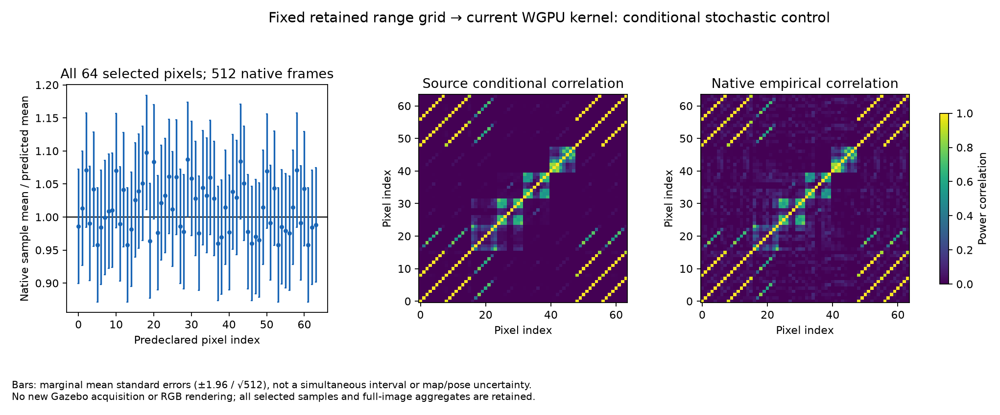

# 네이티브 조건부 전력과 반사율 점수

[English](README.md)



현재 POSIM WGPU 커널(`ffecee9b`, #6/#31–36 미병합 통합 소스)에 보존한
렌더러 거리 격자 256×256개와 서로 다른 프레임 난수 512개를 입력합니다.
기존 RGB8 근사 대신 거리 격자에서 계산한 원본 규약의 법선을 사용합니다.
15 m·599빈 고정 입력의 모든 광선을 유지합니다. Gazebo 월드 실행이나 SDK
복사, 새 현장 기록은 필요하지 않습니다.

실행 전에 64픽셀 질의, 네이티브 난수 시드·프레임과 상관 복소 가우시안
기준 반복 1,024회를 고정합니다. 두 통계량 각각의 99.5분위 기준을 정하며
이 검사에는 배율을 적합하지 않습니다. 최대 표준화 평균 오차는 **2.215**로
기준 **3.920** 이내이고, 정규화 공분산 오차는 **0.1989**로 **0.2774**
이내입니다. 주어진 입력에 대한 조건부 모멘트 대조이며 실물 장치·래스터화·
추정 형상·전체 영상 분포를 보정한 결과는 아닙니다.

`native-output.npz`는 모든 512회 실행의 선택한 복소 값, 전체 영상의 전력·
전력 제곱 합계와 사전 지정한 복소 출력 전체 3개를 보존합니다. `inputs.npz`는
전체 거리·법선·혼합 행렬·주파수 창을 보존합니다. 64픽셀은 통계 질의이며
점군 표시 한도가 아닙니다.

## 공통 반사율과 상관 관측

`sonar_power_evidence.profile_power_evidence`는 관측/예측 전력 비율의
평균으로 양의 공통 배율을 추정합니다. 지수 주변분포의 평균 점수로 목적함수를
만들고 민감도와 점수 공분산을 구분합니다. 전체 전력 상관관계는 조건부
샌드위치 공분산에 들어갑니다. 거의 특이한 픽셀 공분산을 역행렬로 만들거나
대각 잡음으로 바꾸지 않습니다. SVD는 식별 가능한 방향과 영공간을 별도로
반환합니다. 미지 배율 방향을 분산 0인 형상 추정으로 처리하지 않습니다.

기본 원리는 [Varin·Reid·Firth(2011), 2.2–2.4절](https://www3.stat.sinica.edu.tw/statistica/oldpdf/A21n11.pdf)의
복합 점수와 샌드위치 계산을 따릅니다. 구현은 입력한 평균·공분산·선택형
로그 평균 Jacobian에 조건을 둡니다. 전체 의존 영상의 우도나 항법·지도의
통합 불확실성은 아닙니다. 형상·재질 그룹과 독립 프레임 평균 가정을
명시해야 합니다.

단위 대조 7개는 배율 제거 후 미분, 상관 픽셀 복제, 배율 영공간, 전력 크기
범위, 지지하지 않는 반사, 잘못된 공분산과 독립 비선형 비율 추정을 확인합니다.
3픽셀을 상관관계와 함께 8번 복제해도 공분산은 그대로입니다. 독립으로
간주하면 공분산을 8배 작게 계산합니다. 별도의 비율 추정 5,000회 대조는
조건부 공분산과 일치합니다. 네이티브 SLAM 팩터는 추가하지 않습니다.

## 기존 병진 영상의 기준 모델

이미 검토한 원본 48/96/144번 영상에서 과거 DVL 평면 평균과 항법 평균으로
균일한 해저 가설만 구성합니다. 장면·정답·RGB·지도점은 입력하지 않습니다.
선택한 원본 전력·예측·공분산·잔차 전체를 보존합니다. 적합한 배율은
**3.148/1.364/1.923**, 상대 잔차 RMS는 **3.901/1.681/3.302**입니다.
무차원 기준 통계량이며 미터 오차나 보정된 확률은 아닙니다. 공통 밝기 변화로
모든 관측 형상을 설명할 수는 없습니다. 평면 외삽, 물체, 재질 차이와
평면·자세 평균의 불확실성은 남아 있습니다.

다음은 보존한 시점에서 이 점수와 명시적인 보조변수로 유한 해저·가림 물체
가설을 적합하고 비교하는 단계입니다. 다른 가림 분기와 원본 상관관계를
유지합니다. 이 영상은 시간 분할을 포함해 개발 자료입니다. 지도나 네이티브
팩터 수용에는 독립 장면·통합 불확실성·실제 DVL 잠금 손실·미장착 이득을
확인해야 합니다.

```sh
python docs/diagnostics/sonar-native-power-moments-20261031/verify.py
```

이식 가능한 검사는 저장한 네이티브 출력을 사용하며 GPU가 필요하지 않습니다.
`control.py`의 `--binary`·`--input`·`--output`으로 Apple Silicon에서 소스가
확인된 네이티브 연산자를 다시 실행할 수 있습니다. `--verify`는 수학 대조를
재현합니다. 취득 시 바이너리 SHA와 실제 로드된 심벌 경로를 확인합니다.
렌더러에서 보존한 입력은 소스 대조용이며 추정기 관측으로 사용하지 않습니다.
기존 지도와 실패 기록은 모두 유지합니다.
