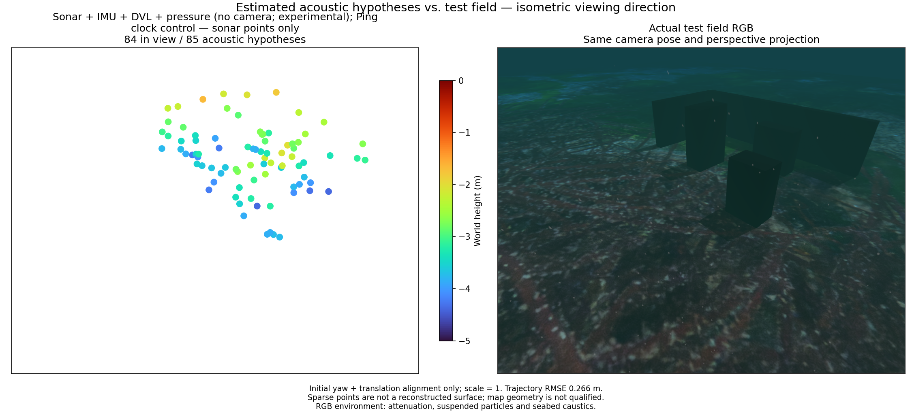

# Acoustic-model rerun / 음향 모델 재실행

[Metrics](sonar-normal-rerun.json) · [Local Ping experiment](terrain-ping.md)

A fresh simulated BlueROV recording uses a corrected spherical-ray normal
model in the acoustic generator. Cartesian local-plane normals are expressed
in each ray's frame before incidence-dependent scattering. This is an external
sensor-model change, not a new POSIM-SLAM estimator or a novelty claim.
The estimator receives only raw sensor observations, never renderer normals,
geometric ray endpoints or simulator poses.

새 BlueROV 시뮬레이션 기록은 음향 생성기의 구면 광선 법선 모델을 수정해
사용합니다. 직교 좌표의 국소 평면 법선을 각 광선 기준으로 표현한 뒤 입사각에
따른 산란을 계산합니다. 외부 센서 모델의 변경이며 POSIM-SLAM의 새 추정기나
연구 독창성을 의미하지 않습니다. 추정기에는 원본 센서 관측만 들어가며 렌더러
법선·기하학적 광선 끝점·시뮬레이터 자세는 전달하지 않습니다.

The 69 s camera-free replay has 245 states. Sonar + IMU + DVL + pressure
uses the same worker, frontend, observations and state timestamps as the
acoustic-factor-omission control. Ping timestamps remain as clock-only events;
local planes are disabled. The comparison is not a matched before/after
experiment of the acoustic generator, because the older capture is a separate
run. No camera frames enter either estimator; startup is replayed from IMU.
Live camera-free app startup and 2 m optical visibility remain unverified.

69초 카메라 없는 재생에서 상태 245개를 생성합니다. 소나·IMU·DVL·수압 모드와
소나 제약 제외 대조군은 작업 바이너리·추적기·관측·상태 시각이 같습니다. Ping은
시각만 유지하며 국소 평면은 꺼져 있습니다. 이전 기록은 별도 실행이므로 이 비교를
음향 생성기 수정 전후의 통제 실험으로 볼 수 없습니다. 두 추정기 모두 카메라
영상을 사용하지 않고 IMU로 시작합니다. 카메라 없는 앱의 실시간 시작과 광학
가시거리 2 m 조건은 아직 검증하지 않았습니다.

| Input / 입력 | Position RMSE (m) | Attitude RMSE (°) | Acoustic points / 음향 점 |
|---|---:|---:|---:|
| Sonar + IMU + DVL + pressure | 0.266 | 2.13 | 85 |
| Same clocks; acoustic factors omitted | 1.134 | 41.31 | — |

Only 39 of 85 points are within 10 cm of a physical surface; median surface
distance is 0.117 m and p90 is 0.394 m. **The map is not accepted.** Acoustic
constraints help motion estimation in this recording, but the sparse hypotheses
do not reconstruct the walls and boxes. Discarding all sonar factors is not a
solution. Persistent region association, elevation observability and terrain
constraints still require investigation. Surface proximity does not prove
scatterer identity or area coverage.

85개 중 실제 표면에서 10 cm 이내인 점은 39개입니다. 표면 거리 중앙값은
0.117 m, p90은 0.394 m이며 **지도는 불합격입니다.** 이 기록에서는 소나 제약이
움직임 추정에 도움이 되지만 희소 가설 점으로 벽과 상자를 복원하지 못합니다.
모든 소나 제약을 제거하는 것이 해결책은 아닙니다. 지속적인 영역 연결·고도각
관측 가능성·지형 제약을 더 조사해야 합니다. 표면 근접도는 반사점의 동일성이나
면적 복원을 입증하지 않습니다.

The panels share the isometric viewing direction and perspective. Turbo maps
height from −5 to 0 m; marker area is 64 pt² (4× the original comparison).
The RGB reference is captured after the mission with attenuation, particles,
caustics and sea surface. It is evaluation-only and is not a 2 m visibility test.

두 패널은 등각 시점 방향과 원근 투영을 공유합니다. Turbo로 높이 −5~0 m를
표시하고 점 면적은 64 pt²(최초 비교의 4배)입니다. RGB는 임무 후 촬영한 평가용
참조로 감쇠·부유입자·집광무늬·수면을 포함합니다. 가시거리 2 m 시험은 아닙니다.
