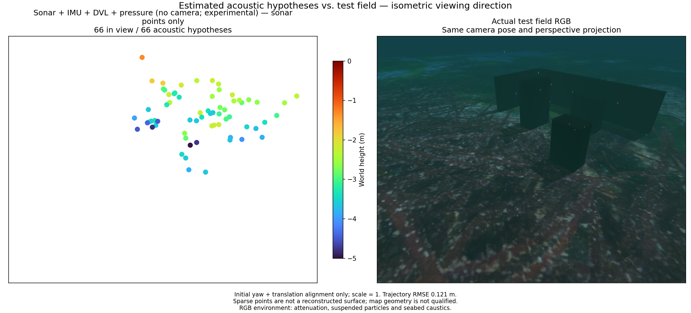
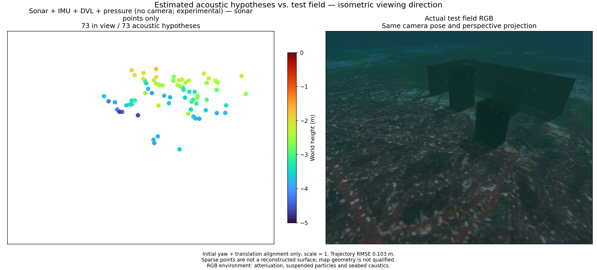

# Acoustic measurement ownership / 소나 관측의 중복 반영 방지

[Metrics and source hashes](sonar-owned-once.json) · [Native lifecycle contract](../../native/basalt/README.md)

A native point retires when any of its observation poses leaves the window.
All of that point's observations then enter the marginal prior, including rows
on retained poses. Reinitializing the same source from those rows counts their
information twice. Original source/timestamp identities must outlive the native
point. Rebinding now waits for three fresh observations. Rejected observations
are not consumed; failed replies commit neither ownership nor scheduling state.
The ledger is bounded by retained poses and the per-frame candidate budget.
Full covariance within a factor is preserved. Rebinding rejects nonzero
cross-covariance between consumed and fresh rows still present in the supplied
history. Correlation with omitted history is unsupported; callers must ensure
independence across those boundaries. The measured frontend uses diagonal noise.

The two frozen simulated recordings use camera-free sonar + raw IMU + DVL +
pressure, Basalt `0f3b2b52c807f70ff4e2973ce253c73329eea7bc` with the pressure
extension and OpenCV 4.13.0. Native binary, raw-input hashes, measured frontend
traces and all 212/214 state times match their pressure-enabled baselines.
No raw image tracking, optimizer, covariance, gate or sensor calibration changes.
Ground-truth poses and mesh are evaluation-only. Alignment uses initial yaw and
translation with scale fixed at one. Exact modified source hashes are in JSON.

An independent audit counts all rows for a new native ID, only appended rows
for an existing ID, and nothing for a rejected update. Baseline submissions
were reconstructed with the unmodified owner before editing; corrected replay
submissions were recorded at the actual client call. It checks factor ownership,
not whether different source IDs correspond to distinct physical scatterers.

| Path | Duplicate original observations | Position RMSE | Attitude RMSE | Points within 10 cm / total | Surface-distance p90 |
|---|---:|---:|---:|---:|---:|
| A before | 62 | 0.457 m | 1.48° | 34 / 64 | 0.556 m |
| A after | 0 | 0.121 m | 1.47° | 33 / 66 | 0.576 m |
| B before | 53 | 0.227 m | 2.08° | 38 / 69 | 0.336 m |
| B after | 0 | 0.103 m | 3.31° | 36 / 73 | 0.497 m |

The correction improves position on both recordings. Surface error does not
improve, and B's attitude error increases. Both maps fail reconstruction
acceptance. This is a correctness fix, not evidence of terrain SLAM, calibrated
uncertainty, long-term accuracy or 2 m optical-visibility acceptance. A new
pressure/no-pressure comparison would be required to isolate pressure benefit
under this lifecycle; older pressure contrasts must not be read as that result.

Both panels use the same isometric viewing direction and perspective projection.
RGB is evaluation-only with attenuation, suspended particles, seabed caustics
and sea surface. All hypotheses are drawn with 64 pt² markers and fixed Turbo
−5 to 0 m height limits. No smoothing or artificial surface filling is applied.

## 한국어

네이티브 점의 관측 자세 하나가 창에서 제거되면 그 점의 전체 관측이 주변화
사전정보에 들어갑니다. 남아 있는 자세의 같은 관측으로 점을 다시 생성하면
정보가 중복 반영됩니다. 원본 ID·시각을 기억하고 아직 사용하지 않은 관측이
3개 모였을 때 재등록합니다. 거부된 관측은 소모하지 않고 잘못된 응답은 상태를
갱신하지 않습니다. 보관 자세와 프레임당 후보 한도로 메모리를 제한합니다.
한 팩터 안의 전체 공분산은 보존합니다. 제공 이력에서 기존 관측과 새 관측의
공분산이 0이 아니면 재등록을 거부하며, 생략된 이력과의 상관관계는 지원하지
않습니다. 호출자가 이력 경계의 독립성을 보장해야 하고 측정 추적기는 대각
잡음을 사용합니다.

같은 원본 기록·추적 결과·네이티브 실행 파일·상태 시각을 유지한 두 재생에서
중복 관측은 62회와 53회에서 모두 0회가 됐습니다. 위치 RMSE는 각각
0.457→0.121 m, 0.227→0.103 m입니다. **표면 오차는 개선되지 않았고 B의 자세
RMSE는 2.08→3.31°로 커졌습니다. 두 지도 모두 형상 복원 합격이 아닙니다.**
표의 10 cm는 표면 근접도 진단 기준이며 실제 물리적 대응 관계의 증명이 아닙니다.

기존 제출 이력은 수정 전 관리 코드로 재구성했고 새 제출 이력은 네이티브
호출 시점에 직접 저장했습니다. 별도 감사 코드는 새 점의 전체 행, 기존 점의
추가 행, 거부된 갱신을 구분합니다. 정답 자세와 지형은 평가에만 사용합니다.
카메라 없는 경로지만 2 m 가시거리나 지형 SLAM 검증은 아직 아닙니다.
그림은 같은 등각 방향의 원근 투영이며 RGB에는 감쇠·입자·집광무늬·수면이
포함됩니다. 전체 점, 64 pt² 크기, Turbo −5~0 m를 사용합니다.
