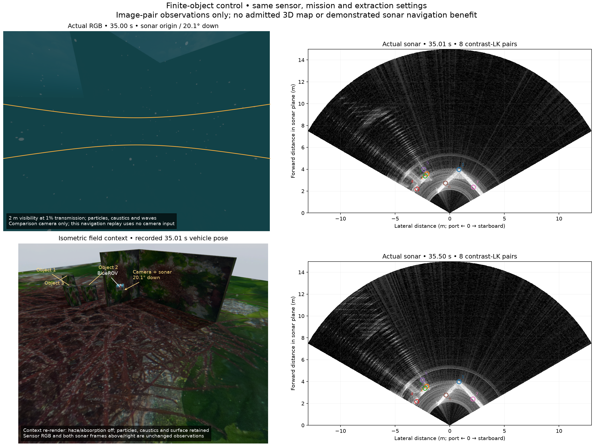

# 소나 대응 관계와 유한 물체 비교

[English](README.md)

기존 벽·평탄 해저 장면과 상자 세 개를 추가한 실제 수집을 비교합니다.
작성한 임무, 센서 보정과 추출 설정은 같습니다. 파도 위상, 시작 시각과
실제 운동은 다르므로 동일 입력의 방법 비교는 아닙니다. 센서 조합은
소나·원시 IMU·압력·DVL이며, 항법에는 Ping과 카메라를 입력하지 않습니다.
제품 기본값과 네이티브 코드는 변경하지 않았습니다.

## 전체 관측

두 번째 주행은 12.54m, 선회 범위 49.83°를 완료했습니다. 소나 111장,
RGB 278장, IMU 5,556개, DVL 56개, 압력 555개를 보존했습니다.
DVL은 모두 유효합니다. 콜백 오류가 없고, 감독 프로세스는 강제 종료 없이
0으로 종료했으며 소유한 프로세스 그룹 네 개가 모두 비었습니다.
소나 제약을 제외한 보정 항법은 상태 175개 전체에서 궤적 RMSE 1.36cm입니다.
이는 항법 근거이며 유용한 소나 지도를 입증하지는 않습니다.

첫 상자 배치는 기존 2.5m 계획 반경과 겹쳐 임무 시작 전에 거부됐습니다.
실패 자료를 보존했습니다. 수정한 장면은 실제 플래너에서 최소 여유 1.20m와
별도의 0.5m 차체 여유 검사를 통과했습니다. 소나는 거리 15m,
수평 빔 256개, 수직 광선 256개, 시야각 120° × 20°를 유지합니다.

## 사용하지 않은 세 번째 영상과의 일관성

특징 추출에는 자세나 정답을 사용하지 않습니다. LK는 기존 네이티브
OpenCV 4.13 전처리와 순방향·역방향 검사를 유지합니다. A-KAZE는
OpenCV 4.13.0 기본값과 최근접 거리 비율 0.8의 양방향 전역 대응을 사용합니다.
소스 기여 하한·대비 마스크는 기술자 대응 후 양 끝점을 검사합니다.

두 영상의 거리·방향 적합에는 과거에 출력한 보정 항법 평균, 고도각 초기값
아홉 개, 기존 0.0250836m / 0.00821331rad 척도를 사용합니다. 세 번째 영상은
적합과 후보 선택에서 제외합니다. 세 번째 영상에서 놓친 추적도 분모에
포함합니다. 아래 수치는 양립 후보/학습 단계 선택 후보입니다.
비용 기준 9는 진단 관례이며 보정된 확률이 아닙니다.

| 추출 방법 | 벽·평탄 해저 | 유한 상자 추가 |
| --- | ---: | ---: |
| LK, 원시 강도 | 549/1,746 | 719/2,057 |
| LK, 소스 기여 하한 | 135/383 | 190/478 |
| LK, 소스 대비 | 49/113 | 67/134 |
| A-KAZE, 원시 강도 | 31/132 | 38/125 |
| A-KAZE, 소스 기여 하한 | 13/56 | 19/51 |
| A-KAZE, 소스 대비 | 2/26 | 8/22 |

대비 LK의 마지막 열에서 실제로 다시 찾은 검증 추적은 87개이며,
그중 67개가 양립합니다. 보고 분모는 학습 단계의 134개 전체입니다.
이 검사는 표본으로 탐색한 학습 해 가운데 낙관적인 해를 사용하며 자세
공분산을 제외합니다. 동일한 물리적 점을 관측한다는 증거는 아닙니다.
추적 상실과 이상값은 명시적으로 처리해야 하며, 추적 유지율 100%를 요구하는
것은 아닙니다. 새 자세 제약이나 3D 지도는 아직 설치하지 않았습니다.

## 같은 시점의 센서와 현장 비교



RGB와 소나는 원점과 하향 20.1° 자세가 같습니다. RGB는 35.00초,
첫 소나는 35.01초입니다. 주황색은 소나의 고도각 ±10° 범위입니다.
번호 원은 고정 시점에서 얻은 대비 LK 대응 여덟 쌍 전체이며 지도점이 아닙니다.
소나 영상은 거리 좌표를 사용하며 아래가 가깝고 오른쪽이 우현입니다.

RGB에는 2m에서 투과율 1%, 입자, 해저 집광무늬와 파도를 적용합니다.
현장 참조는 기록된 차체 자세에서 안개·흡수만 끄고 다시 렌더링한 영상입니다.
다른 효과를 유지하며 파도·입자 위상은 다릅니다. 물체·차량 표시는 평가용입니다.
실제로 수집한 안개 낀 현장 RGB도 원본 기록에 보존합니다.
추적점 표시는 공통 거리 좌표 변환을 사용합니다.

## 재현과 다음 조건

독립 POSIM-SLAM 저장소에서 Python 3.10 이상과 NumPy로 실행합니다.

```sh
PYTHONPATH=src python3 docs/diagnostics/sonar-pair-correspondence-20261030/test_pair_geometry.py
PYTHONPATH=src python3 docs/diagnostics/sonar-pair-correspondence-20261030/verify.py
```

검증기는 준비된 모든 대응과 초기 해 아홉 개를 다시 적합하고 두 장면의
전체 요약을 검사하며, 자세가 없는 시점도 구분합니다.
`--output NEW_DIRECTORY`로 재계산한 모든 해를 저장할 수 있습니다.
독립 수치 검사 다섯 개에는 제자리 선회의 높이 모호성, 불가능한 관측,
경계 제약에서의 정지 조건이 포함됩니다. 준비 자료는 적합과 미사용 시점
예측을 재현합니다. 원시 영상 추출과 네이티브 재생에는 원본 기록이 필요합니다.
원본 입력과 원래의 전체 적합 출력은 외부 저장소에 한 벌만 보존합니다.
독립 진단에는 비공개 앱 코드를 포함하지 않습니다.

다음은 관측들이 하나의 상대 운동에 일관되게 맞는지 검사하고, 관측 가능한
상대 운동 정보부터 사용한 뒤 XYZ 점으로 승격하는 방법을 비교하는 것입니다.
이는 기존 [관측이 불충분한 랜드마크](https://www.cs.cmu.edu/~kaess/pub/Westman18icra.html)와
[퇴화를 고려한 소나 SLAM](https://www.cs.cmu.edu/~kaess/pub/Westman20joe.html) 연구에
근거합니다. 현재 비교는 해당 방법의 구현, 항법 개선, 물리적 대응이나
연구 독창성을 입증하지 않습니다. 대표 Orca5 지형, 저시정, DVL 잠금
상실·복구와 DVL 없는 운용 검증이 남아 있습니다.

[앞선 소스 기여·결합 불확실성 기록](../sonar-source-support-20261030/README.ko.md)은
별도의 XYZ 점 채택 실패를 보존합니다.
