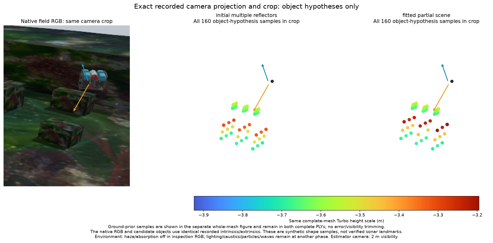
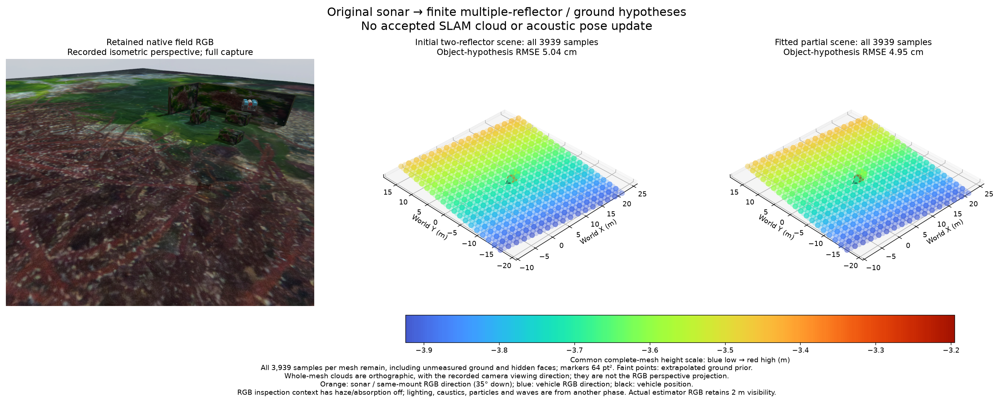

# Finite partial-scene inverse fit

[한국어](README.ko.md)

Fit shared scene heights to original sonar power, using the existing source
operator. The scene contains both sensor-derived reflector candidates and a
finite coarse ground mesh. No reference scene, pose truth or RGB enters the
fit. This is a conditional offline inverse experiment, not an accepted SLAM map.



The crop uses identical recorded camera intrinsics/extrinsics. It shows all 160
object-hypothesis samples per family. Orange indicates the sonar and same-mount
inspection RGB direction (35° down); blue indicates the vehicle RGB direction.
RGB inspection haze/absorption is off, while lighting, caustics, particles and
waves remain from another phase. The estimator camera retains 2 m visibility.



The whole-mesh plots retain all 3,939 samples each, including 3,779 extrapolated
ground-prior samples and hidden object faces. Their orthographic view follows
the recorded camera direction; it is a separate projection from the native RGB.
Both figures use 64 pt² markers and the same blue-to-red Turbo height scale.
Every sample remains in each complete PLY; none is removed by error/visibility.

## Inputs and actual inverse operation

The source is POSIM integration `ffecee9b`, including the freshly checked,
unmerged heads of #6 and #31–36. [Source review](source-review.json) separates
creation/mount, ROS lifetime/clock, partial matrix tiles, floating weak returns,
empty previews and physical range-grid responsibilities. No additional producer
patch is established. These inverse changes belong to POSIM-SLAM.

Reuse the [height-diversity record](../sonar-height-diversity-fit-20261031/README.md):
five training frames 27/49/81/88/151 and unused temporal frames 51/90/153. All
original 599×256 power grids, 15 m range, 256×256 rays, source identities and
frozen queries remain unchanged. Raw files are referenced by exact hash, not
copied. These are development views of the same scene, not independent validation.

Both existing single-link candidate clusters (11 and 62 conditional detections)
seed finite prisms; the previous experiment selected only the larger cluster.
The 2 m background grid starts from causal DVL plane means. Its extrapolation is
an explicit shape prior, not measured ground. DVL range variance is unavailable;
resolution or zero variance never substitutes for it. There are 339 shared
vertices and 600 opaque triangles. Reflectivity is fixed at .001 per triangle;
one positive common brightness gain is profiled per view.

`sonar_scene_fit.SceneHeightFit` changes shared world-z vertices. A frozen-normal
radial derivative proposes steps; every proposal recomputes exact first hits,
float32 range-derived normals and Fourier mean power before acceptance. The
derivative excludes source-normal/visibility changes and supplies no information
matrix. A declared neighbour-change penalty (10 per squared metre) is a shape
prior, not calibrated measurement noise. All residuals remain; there are no
per-pixel gains. Absence beyond the finite mesh remains unknown, never free space.

## Measured result and limits

The bounded search takes 169.1 s, with nine current-state evaluations, 17
proposals and eight accepted steps. It stops when all five step sizes fail the
actual objective. Training composite data score improves **2026.942→1778.554**;
unused temporal score improves **1458.748→1215.957**. The final shape-prior penalty
is 0.606. Pixel correlations remain in all eight final full covariance records;
the marginal score does not declare independent pixels.

Object-hypothesis surface RMSE changes **5.04→4.95 cm**; both retain 14/160 samples
beyond the historical diagnostic 10 cm. Whole-scene RMSE is **13.09→13.09 cm**,
dominated by unsupported ground. Only 186/576 ground faces and 12/24 object faces
receive any predicted rays across all eight views. Ray hits are not calibrated
physical support or independent landmarks. Large residuals persist at frames
81/88/90, and unused frame 51 worsens. No inferred mesh, surface sample or pose
update is admitted to native SLAM.

The result establishes an actual source-checked inverse operation and preserves
the missing-support problem. Fixed navigation, coarse terrain, seed association,
material/visibility alternatives and shared pose/map uncertainty remain open.
Next validate persistent reflector births and local support against unused views,
then joint uncertainty and physical DVL-loss benefit. A larger synthetic mesh or
better image score cannot qualify a useful map.

## Reproduce

From a POSIM-SLAM checkout with its NumPy/SciPy diagnostic dependencies:

```sh
python -m unittest discover -s tests -p test_sonar_scene_fit.py
python docs/diagnostics/sonar-partial-scene-fit-20261031/verify.py
```

The verifier recomputes every final original power, mean, full covariance,
complete geometry/assessment and PLY. A 1 mm visible-vertex negative control
exceeds its numerical arithmetic budget. Optimization is not repeated. For a
new fit, copy `protocol.json` and `run_fit.py` into a fresh directory and supply
`--records` pointing at the shared diagnostic tree, first with `--prepare`.
`construction-seal.json` freezes every inference input/output before assessment.
The preparation dictionary-key failure is preserved in `setup-failure.json`;
it starts no fit and changes no raw data. The retained SDK lacks optional cv2:
59 local neighbouring tests pass and one unrelated session-test import fails;
hosted CI installs the declared research dependencies. No SDK is changed.

The first Linux replay exposes an incorrect bit-equality check on derived
`10**(dB/10)` powers: one of 48 values differs by 1 ULP. Original raw/output
hashes remain exact. Only this recomputed float64 arithmetic uses eight machine
epsilons relative with zero absolute floor; 64-epsilon and missing/created weak
return controls fail. The sealed fit, sensor noise and map criteria are unchanged.

Code and record are Apache-2.0. No new third-party dependency, forward acoustic
model, SDK, renderer run, downloaded artifact or service restart is introduced.
