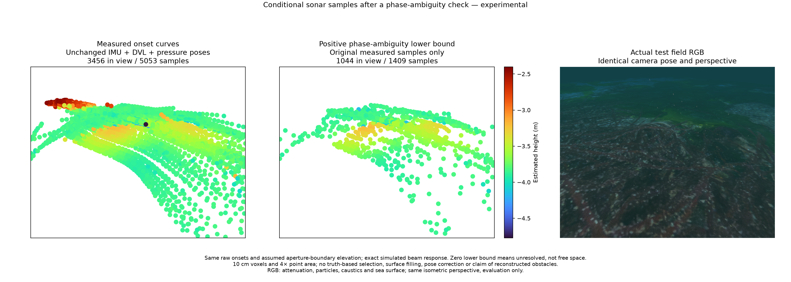
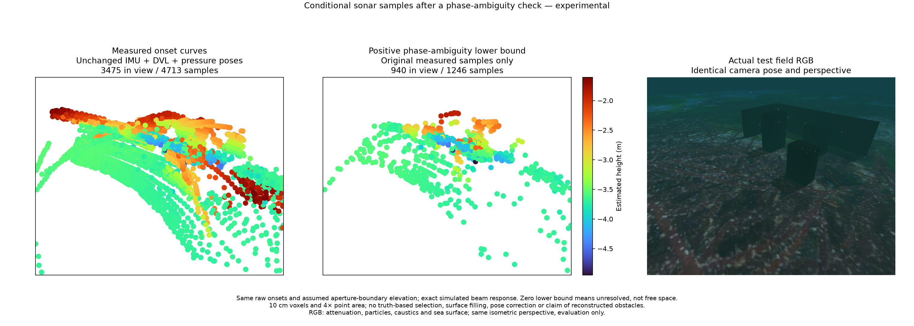

# Conditional acoustic magnitude bounds / 조건부 음향 크기 구간

`posim_slam.sonar_phase_bounds.BeamPhaseBounds` is an independent, offline NumPy utility under Apache-2.0. It uses calibrated complex beam mixing to bound a source amplitude when only output magnitudes are available. It is outside the app estimator and does not correct poses.

`posim_slam.sonar_phase_bounds.BeamPhaseBounds`는 Apache-2.0 독립 오프라인 NumPy 도구입니다. 보정된 복소 빔 혼합 행렬과 출력 크기로, 위상을 모르는 원래 빔의 진폭 범위를 계산합니다. 앱 추정기 밖에서 사용하며 자세를 보정하지 않습니다.

## Model / 모델

For `y = Hx`, set `A = inverse(H)`. For source beam `i`, each term `A[i,j] y[j]` has magnitude interval `[l_j, u_j]`. Standard polygon inequalities give:

```text
upper = sum(u)
lower = max(0, max(l + u) - sum(u))
```

A positive lower bound rules out zero source amplitude under that model and its supplied error intervals. Zero means unresolved contribution, not free space. These are deterministic bounds, not confidence intervals; bounds for different beams share observations. No phase recovery is performed.

`y = Hx`에서 역행렬의 각 항에 크기 구간을 적용한 표준 다각형 부등식입니다. 하한이 양수이면 지정한 모델·오차 구간 안에서 원래 빔의 진폭이 0일 수 없습니다. 하한 0은 판단 불가이며 빈 공간을 뜻하지 않습니다. 확률적 신뢰구간이 아니며 빔 사이의 관측도 공유합니다. 위상은 복원하지 않습니다.

```python
from posim_slam.sonar_phase_bounds import BeamPhaseBounds

model = BeamPhaseBounds(calibrated_complex_mixing)
interval = model.query(raw_output_magnitudes, source_beam_ids,
                       relative_error=relative_amplitude_error,
                       absolute_error=absolute_amplitude_error)
```

Each input row contains all measured beam magnitudes at one range sample and selects one source beam. The matrix must be square, finite and invertible (up to 512 beams; condition number at most 1e8); each query accepts up to 4,096 rows. Clipped display images, nonlinear preprocessing or unknown response calibration do not satisfy this contract. Use raw amplitude, not dB values or power.

입력 행마다 같은 거리 표본의 모든 빔 크기와 검사할 빔 번호 하나를 지정합니다. 행렬은 유한한 가역 정방행렬이어야 합니다(최대 512빔, 조건수 1e8 이하). 한 번에 최대 4,096행을 처리합니다. 잘린 표시 영상, 비선형 전처리, 미보정 장치 응답에는 이 모델을 적용할 수 없습니다. dB·전력 대신 원본 진폭 크기를 사용합니다.

## Matched field comparisons / 같은 시점의 현장 비교





Both comparisons use unchanged camera-free IMU + DVL + pressure poses, including camera-free initialization. The independent collector uses a frozen visual worker and simulator-fed ArduPilot navigation; neither collector poses nor RGB enter the replay estimator or sample selection. RGB is an evaluation reference with attenuation, particles, caustics and sea surface. The panels share an isometric perspective, a common full-height Turbo scale, 10 cm voxels and 4× point area. Some exported points lie outside the view.

두 비교는 초기화를 포함해 카메라 없는 IMU + DVL + 수압 추정 자세를 그대로 사용합니다. 별도 수집기는 고정된 시각 추정기와 시뮬레이터 위치를 받는 ArduPilot을 사용하지만, 그 자세와 RGB는 재생 추정·점 선별에 들어가지 않습니다. RGB는 감쇠·입자·집광무늬·수면을 포함한 평가 참조입니다. 등각 방향 원근, 전체 높이 범위의 공통 Turbo 색상, 10 cm 복셀, 4배 점 면적을 사용합니다. 일부 내보낸 점은 화면 밖에 있습니다.

| Scene / 장면 | Raw → selected entries / 시작점 | Voxel points / 복셀 점 | Surface-distance p90 / 표면 거리 p90 |
|---|---:|---:|---:|
| Relief / 굴곡 해저 | 7,137 → 1,768 | 5,053 → 1,409 | 0.788 → 0.071 m |
| Walls and boxes / 벽·상자 | 7,115 → 1,693 | 4,713 → 1,246 | 0.903 → 0.402 m |

The explicit POSIM PR6 sinc response and numerical amplitude error intervals (relative 1e-5, absolute 1e-37) select existing onset samples where `lower > 0`. No truth-based threshold, point relocation or surface filling is used. Evaluation loads truth only after sealing selections, with initial yaw/translation alignment and fixed scale. Distance is to the closest seabed or explicit physical target collision surface. Lower error describes a smaller selected subset, not improved coverage or localization.

POSIM PR6 sinc 응답과 수치 진폭 오차 구간(상대 1e-5, 절대 1e-37)을 명시하고 기존 시작점 중 `lower > 0`인 점을 선택합니다. 정답 기반 임계값, 점 이동, 표면 채우기는 사용하지 않습니다. 선별을 저장한 뒤 정답을 읽어 초기 방향·이동만 맞추고 축척을 고정해 평가합니다. 거리는 해저 또는 명시된 물리 장애물 충돌 표면 중 가장 가까운 곳까지 측정합니다. 오차 감소는 더 작은 부분집합의 결과이며 관측 범위나 위치 추정 개선을 뜻하지 않습니다.

[Relief PLY / 굴곡 PLY](../data/sonar-phase-relief.ply) · [Corner PLY / 장애물 PLY](../data/sonar-phase-corner.ply) · [Measurements / 수치 기록](sonar-phase-bounds.json)

## Validation and limits / 검증과 한계

Six unit tests cover attainable extrema, arbitrary complex phases with bounded errors, uncertainty widening and invalid inputs. Across six static native acoustic scenes, all 7,488 sampled source magnitudes from the identity-beam control lie inside the predicted mixed-beam intervals. Query-only median time is about 0.07 ms; this excludes inversion, frontend processing, mapping and rendering.

단위 시험 6개는 달성 가능한 극값, 복소 위상과 오차, 불확실성 확대, 잘못된 입력을 검사합니다. 정적 네이티브 음향 장면 6개의 7,488개 표본 모두에서 빔 혼합 없는 대조군의 원래 진폭이 예측 구간 안에 있습니다. 질의 계산 중앙값은 약 0.07 ms이며 역행렬·전처리·지도·렌더링 시간은 제외합니다.

The relief geometry diagnostic finds 816 onsets incompatible with the nominal bearing over the full elevation aperture; all admit some alternative bearing and all are excluded by this filter. That is consistent with angular ambiguity, not proof of a unique physical echo origin. A separate nonnegative intensity-only inverse generally worsens single-frame onset accuracy and is not adopted; its results remain in the measurements file.

굴곡 해저 진단에서는 전체 수직 시야에서도 명목 방위각과 맞지 않는 시작점 816개가 나옵니다. 다른 방위각에는 호환 가능한 지형이 있고 이 필터는 816개를 모두 제외합니다. 이는 각도 모호성과 일치하지만 실제 반사원을 유일하게 확인한 결과는 아닙니다. 별도 비음수 강도 역산은 단일 프레임 시작점 정확도를 대체로 악화해 채택하지 않았으며 수치 파일에 보존합니다.

Positive amplitude alone does not establish a landmark: range sidelobes, elevation, material response and surface identity remain unresolved. These figures still assign onset elevation to the aperture boundary. The object scene retains large errors. Sonoptix hardware response and noise have not been calibrated; simulated bounds are not hardware guarantees. Initial unfiltered ground fusion and separate surface registration do not outperform their IMU/DVL/pressure controls. [Native replay with source screening](sonar-phase-ground.md) has mixed results across two scenes. This is an offline sample-selection experiment, not qualified terrain-aided SLAM.

양의 진폭만으로 랜드마크가 성립하지 않습니다. 거리 부엽, 고도각, 재질 응답, 표면 식별이 남습니다. 그림은 시작점 고도각을 여전히 시야 경계로 가정하며 장애물 장면의 큰 오차도 남습니다. Sonoptix 실물 응답·잡음은 보정하지 않았으므로 시뮬레이션 구간은 실물 보증이 아닙니다. 초기 미선별 해저 융합과 별도 표면 정합은 IMU/DVL/수압 대조군보다 좋아지지 않습니다. [음향 선별을 적용한 네이티브 재생](sonar-phase-ground.md)은 두 장면에서 결과가 엇갈립니다. 오프라인 점 선별 실험이며 검증된 지형 보조 SLAM이 아닙니다.

Terrain-referenced navigation uses a prior bathymetric map; map-free terrain SLAM must build and associate repeated observations. Uniform flat ground cannot constrain all horizontal motion. Forward-looking imaging sonar also lacks direct elevation: [multi-view acoustic geometry](https://www.cs.cmu.edu/~kaess/pub/Huang15iros.pdf) and [bathymetric tile matching](https://doi.org/10.3390/s22030954) are relevant research directions with different sensor contracts. [Earlier local surface support and registration](sonar-terrain-support.md).

지형 참조 항법은 사전 수심 지도를 사용하며, 사전 지도 없는 지형 SLAM은 반복 관측으로 지도를 만들고 대응시켜야 합니다. 균일한 평면은 모든 수평 운동을 구속하지 못합니다. 전방 영상 소나는 고도각을 직접 주지 않습니다. 위의 다중 시점 음향 기하·수심 타일 정합 연구는 서로 다른 센서 계약을 전제로 합니다. [국소 표면 지지·정합](sonar-terrain-support.md).
