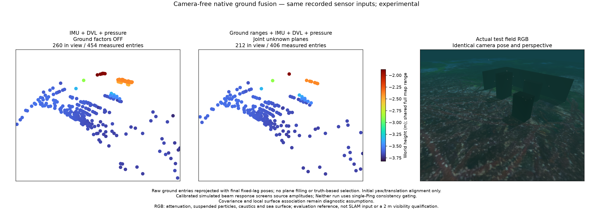
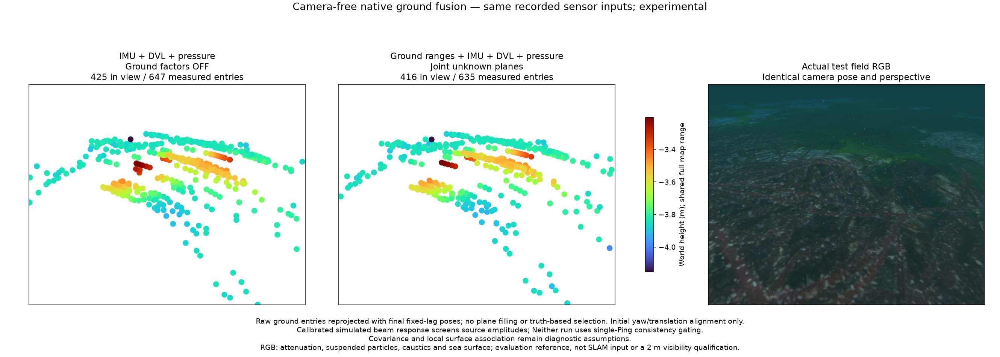

# Source-supported ground fusion / 음향 지지를 검사한 해저 융합

The optional `source_bounds` argument in `ground_entries`, `ground_entry_curve` and `fit_ground_entry` screens measured onsets using an explicit `BeamPhaseBounds` response and `amplitude_error=(relative, absolute)`. It retains the existing angular sampling and range values. An unresolved onset is censored; it is never replaced by a later bright return. Plane fitting, noise settings and native factor equations remain unchanged. The default is off; this experimental path is not connected to the app selector.

`ground_entries`, `ground_entry_curve`, `fit_ground_entry`의 선택형 `source_bounds`는 명시적인 `BeamPhaseBounds` 응답과 `amplitude_error=(상대, 절대)`로 측정 시작점을 검사합니다. 기존 각도 표본과 거리값을 유지합니다. 판단 불가인 시작점은 제외하며 뒤의 밝은 반사로 대체하지 않습니다. 평면 맞춤·잡음 설정·네이티브 제약식은 그대로입니다. 기본값은 꺼짐이며 앱 선택기에는 연결하지 않았습니다.

```python
fit = fit_ground_entry(frame, vertical_fov_rad=vertical_fov,
                       up_sonar=estimated_up,
                       source_bounds=calibrated_beam_bounds,
                       amplitude_error=(relative_error, absolute_error))
```

The illustrated native replays explicitly use the POSIM PR6 sinc response and numeric amplitude intervals 1e-5 relative / 1e-37 absolute. No real Sonoptix response calibration is claimed. Both scenes use the same frozen settings. All 16 new replays exclude RGB from initialization, and every no-ground control produces byte-identical online states to the earlier corresponding control. Raw IMU, bottom-lock DVL and hydrostatic pressure drive those controls. The collector itself uses VIO and simulator-fed ArduPilot navigation; those poses and RGB are excluded from estimator replay. This is recorded estimator evidence, not independent vehicle-navigation or installed-package acceptance.

그림의 네이티브 재생은 POSIM PR6 sinc 응답과 수치 진폭 구간(상대 1e-5 / 절대 1e-37)을 명시합니다. Sonoptix 실물 보정은 아닙니다. 두 장면에 같은 고정 설정을 씁니다. 새 재생 16회 모두 초기화부터 RGB를 제외하며, 해저 융합 없는 모든 대조군의 온라인 상태는 해당 이전 대조군과 바이트 단위로 같습니다. 대조군에는 원본 IMU·해저 고정 DVL·정수압을 사용합니다. 수집기 자체는 VIO와 시뮬레이터 위치를 받는 ArduPilot을 쓰지만, 그 자세와 RGB는 재생 추정기에 들어가지 않습니다. 기록된 추정기 검증이며 독립 차량 항법·설치 패키지 합격은 아닙니다.

## Position and map comparisons / 위치·지도 비교

Final fixed-lag position RMSE, metres; same initial yaw/translation alignment, fixed scale, no whole-trajectory fitting. The spatial model uses the previously frozen 0.08 m / 2 m surface covariance; no parameters are selected from these results.

최종 고정 구간 추정 위치 RMSE이며 단위는 m입니다. 초기 방향·이동만 맞추고 축척을 고정하며 전체 궤적 정합은 하지 않습니다. 공간 모델은 앞서 고정한 표면 공분산 0.08 m / 2 m를 사용하며 이번 결과로 수치를 고르지 않았습니다.

| Configuration / 구성 | Relief / 굴곡 해저 | Walls and boxes / 벽·상자 |
|---|---:|---:|
| IMU + DVL + pressure control / 대조군 | 0.04717 | 0.10337 |
| Unscreened ground + Ping check / 미선별 해저 + Ping 검사 | 0.04734 | 0.28642 |
| Screened ground + Ping check / 선별 해저 + Ping 검사 | 0.04710 | 0.09202 |
| Unscreened ground, no Ping check / 미선별 해저, Ping 검사 없음 | 0.22674 | 0.69894 |
| Screened ground, no Ping check / 선별 해저, Ping 검사 없음 | 0.19715 | 0.04085 |
| Screened + frozen spatial model, no Ping check / 선별 + 고정 공간 모델, Ping 검사 없음 | 0.26840 | 0.14561 |

The wall/box improvement also appears online: RMSE 0.10426 → 0.04112 m without Ping gating. It is one successful recording, not a general accuracy guarantee. On relief the same setting worsens online RMSE 0.04679 → 0.19547 m. The frozen spatial model worsens both cases relative to screened ground alone and is not adopted. With Ping gating, relief registers only four single-frame planes and has no multi-frame ground states; its tiny RMSE change is not evidence of useful terrain correction.

벽·상자 장면은 Ping 검사 없이 온라인 RMSE도 0.10426 → 0.04112 m로 줄어듭니다. 한 기록의 성공이며 일반 정확도 보증이 아닙니다. 같은 설정의 굴곡 해저는 온라인 RMSE가 0.04679 → 0.19547 m로 악화됩니다. 고정 공간 모델은 선별 해저만 쓴 경우보다 두 장면 모두 나빠 채택하지 않습니다. Ping 검사가 있는 굴곡 장면은 단일 프레임 평면 4개만 등록하고 여러 프레임을 연결한 해저 상태는 없어, 미세한 RMSE 변화는 유용한 지형 보정 근거가 아닙니다.





Both figures use source screening without Ping gating or the spatial model. RGB and PCL share the same isometric perspective. RGB includes attenuation, particles, caustics and sea surface, and is evaluation-only; these figures do not qualify the separate 2 m optical profile. PCL uses Turbo over a shared full height range, 10 cm voxels and 4× point area. Sparse ground curves do not reconstruct walls or boxes. Surface-distance metrics in the [numeric report](sonar-phase-ground.json) are to the seabed only, not all collision surfaces, coverage or obstacle accuracy.

두 그림은 Ping 검사·공간 모델 없이 음향 선별을 사용합니다. RGB와 점군은 같은 등각 방향 원근을 씁니다. RGB에는 감쇠·입자·집광무늬·수면이 있으며 평가 전용입니다. 이 그림은 별도의 2 m 광학 프로필을 검증하지 않습니다. 점군은 전체 높이의 공통 Turbo 색상, 10 cm 복셀, 4배 점 면적을 사용합니다. 드문 해저 곡선은 벽·상자 복원이 아닙니다. [수치 보고서](sonar-phase-ground.json)의 표면 거리는 해저까지의 거리이며 모든 충돌 표면·관측 범위·장애물 정확도가 아닙니다.

[Corner PLY / 장애물 장면 PLY](../data/sonar-phase-ground-corner.ply) · [Relief PLY / 굴곡 해저 PLY](../data/sonar-phase-ground-relief.ply)

## Why tracking alone is insufficient / 영상 추적만으로 부족한 이유

All eligible 16-observation intensity chains were also checked: 199 in the object scene and 18 on relief, using the first eight observations to fit and the next eight to predict. Their best conditional point fits touch the elevation boundary in 112 and 12 chains respectively. Held-out valid-geometry counts are 1,423/1,592 and 112/144; range RMSE over valid observations is 0.0443 m and 0.1774 m. Invalid predictions are retained in the denominator. These fixed-pose fits do not prove physical point identity or joint uncertainty. Moving onset boundaries should be modelled as surfaces, not automatically promoted to persistent landmarks.

16관측 이상인 모든 유효 강도 추적을 따로 검사했습니다. 장애물 장면 199개, 굴곡 장면 18개이며 앞 8개로 맞추고 다음 8개를 예측했습니다. 최적 조건부 점 해가 고도각 경계에 걸린 추적은 각각 112개·12개입니다. 이후 관측 중 유효 기하 예측은 1,423/1,592와 112/144이고, 유효 관측의 거리 RMSE는 0.0443 m·0.1774 m입니다. 실패 예측도 분모에 보존합니다. 고정 자세에서의 맞춤은 물리적 점 식별이나 공동 불확실성을 증명하지 않습니다. 움직이는 시작 경계는 표면으로 모델링해야 하며 자동으로 고정 랜드마크가 되지 않습니다.

Four focused tests cover identity-response parity, censoring without replacement, mandatory calibration/error input and gain consistency. Existing eight ground tests pass. Matched evaluation rejects different response models between control and fused runs. The remaining work is a surface model and association that generalize to curvature, plus independent noise/material, DVL-loss, loop-closure and live-package tests. Standard polygon inequalities and existing plane factors are not claimed as novel algorithms. [Amplitude bounds and assumptions](sonar-phase-bounds.md).

검사 4개는 항등 응답의 기존 결과 유지, 대체 없는 제외, 보정·오차 입력 요구, 이득 변화 일관성을 다룹니다. 기존 해저 시험 8개도 통과합니다. 대조군과 융합군의 응답 모델이 다른 비교는 거부합니다. 굴곡에 일반화되는 표면 모델·대응과 독립 잡음·재질, DVL 소실, 루프 폐쇄, 실시간 패키지 검증이 남습니다. 표준 다각형 부등식과 기존 평면 제약식을 새로운 알고리즘으로 주장하지 않습니다. [진폭 구간과 가정](sonar-phase-bounds.md).
