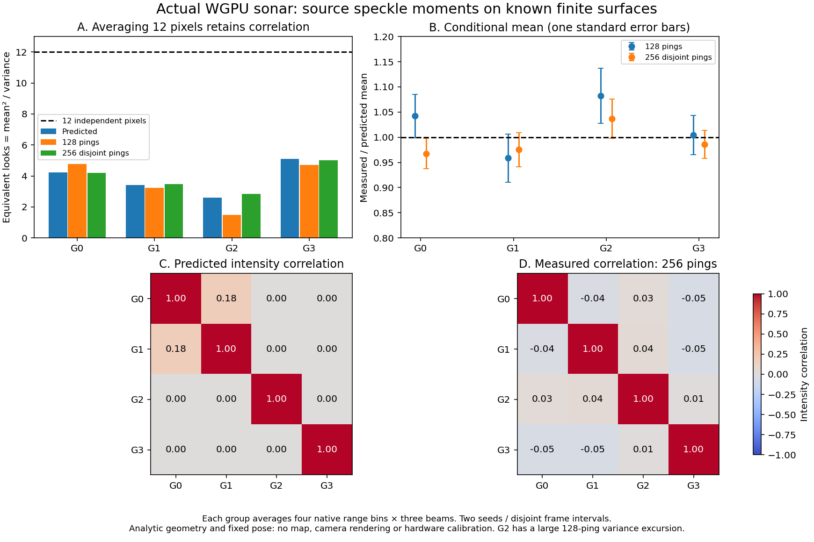
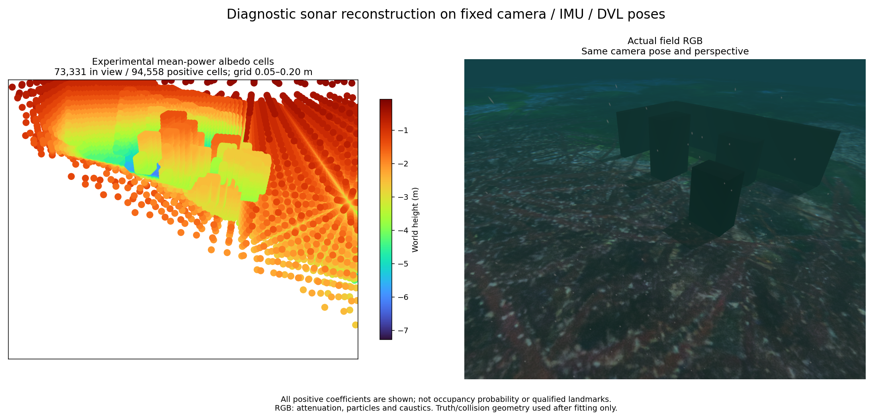

# Scattering units and correlated power / 산란 단위와 전력 상관

## Shared field coordinates

The [volume projector](../../tools/sonar_power_volume.py) separates per-batch
optimization coordinates from relative scattering strength. Exported `albedo`
equals `coefficient * training_projector.scale`. `forward_scattering(albedo)`
uses that same strength at other poses; `adjoint_scattering` is its adjoint.
Changing the number or membership of observations does not change material
strength. Values remain relative, not calibrated material reflectivity.

The [frozen-field correction](../data/sonar-unit-correction.json) records the
previous error: test prediction reused training-normalized coefficients in a
separately normalized test operator. Corrected held-out relative L2 values are:

| Record / response | Corrected L2 |
|---|---:|
| Shallow adaptive / native Hamming | 0.76972 |
| Deeper adaptive / fractional Hamming | 0.74054 |
| Heading-held inspection / fractional Hamming | 0.93633 |

Frozen rescoring changes no field array. [Three fresh reproductions](../data/sonar-unit-reproduction.json)
retain identical coordinates, cell sizes and positive support. Deeper/inspection
fields are bitwise identical; shallow coefficients differ by at most
3.33×10⁻¹⁴. No point is removed or admitted by this correction. The geometry
failures in the linked guides remain. Historical scores and all eleven controls
are retained in the correction data.

## Source intensity moments



The NumPy [moment model](../../src/posim_slam/sonar_speckle.py) uses the selected
source's independent proper complex-Gaussian ray scattering. With complex pixel
response `H` and ray power `q`, `K = H diag(q) H*`. Pixel mean intensity is
`diag(K)`; intensity covariance is `abs(K)**2`. Weighted pixel averages retain
this covariance. The range response uses the exact finite Fourier sum of the
shifted periodic Hamming window, including complex phase between pixels.

Each shown group averages four range bins and three beams. Predicted equivalent
looks `mean² / variance` are 4.24, 3.41, 2.60 and 5.09. Twelve averaged pixels
therefore do not imply twelve independent observations. Equivalent looks alone
does not specify a Gamma likelihood: a grouped intensity is a weighted quadratic
form, and separate groups can remain correlated.

The actual matching WGPU library uses 256×256 rays and 399 native range bins.
[128 pings](../data/sonar-speckle-128-report.json) use seed 73 / frames 20000–20127;
[256 pings](../data/sonar-speckle-256-report.json) use seed 9173 / frames 60000–60255.
These are two unique seed/frame sets, with supplied analytic surfaces/normals
and fixed pose. Means differ by at most 1.50/1.07 theoretical standard errors.
G2 variance has a 4.65-standard-error excursion in the 128-ping set; its
256-ping residual is -0.09. Predicted G0/G1 correlation is 0.175, while empirical
values are 0.210 and -0.042. These finite-sample results do not establish a
calibrated joint observation likelihood. Full samples are in the matching
`sonar-speckle-128-controls.npz` and `sonar-speckle-256-controls.npz` files.

The response is limited to 256 selected pixels, 65,536 rays and 4,194,304 complex
entries. Moments accumulate in double precision. These array bounds are not a
peak-memory specification. Geometry, material and pose are conditional inputs;
quantization effects, hardware noise and pose uncertainty are not calibrated.
The diagnostic does not alter runtime fusion or qualify a map.

```sh
python tools/probe_sonar_speckle.py --library /path/to/libmultibeam_sonar.dylib \
  --output /tmp/sonar-speckle --frames 256 --seed 9173 --first-frame 60000
```

## Relative-power loss control



A bounded, measured-only control uses an Itakura–Saito quasi-loss on the same
complete adaptive grid. Grouped observations are correlated, so this is a
mean-consistent relative loss, not an independent-Gamma confidence model.
Its L1 scaling and optimizer differ from the least-squares control; this is not
an isolated causal comparison of losses. The optimizer reaches its 100-iteration
limit with a large projected gradient and is not accepted as converged.

The exported 94,558 positive cells are all scored. Only 13,450 are within 10 cm
of a physical surface; median/p90/maximum distances are 0.759/2.209/3.607 m.
Held-out relative loss falls to 4.61 from the least-squares field's 455,403, while
held-out L2 worsens to 0.99077 from 0.93633. [Geometry results](../data/sonar-relative-loss-failure.json)
retain this failure. No cells are cropped for the image or metric. The figure
uses the actual field RGB and identical isometric camera pose/perspective,
64 pt² markers and full-data Turbo height limits. RGB attenuation, particles
and caustics are evaluation-only. This control is not a runtime mode.

[Févotte et al.](https://hil.t.u-tokyo.ac.jp/~kameoka/SAP/papers/Fevotte2009__Nonnegative_matrix_factorization_with_the_Itakura-Saito_divergence_With_application_to_music_analysis.pdf)
describe the established multiplicative-noise/IS connection. These mathematical
ingredients and the coordinate correction are not a research novelty claim.
Surface support, visibility and joint pose uncertainty still need an operational
solution. The core uses existing NumPy; diagnostics use existing SciPy. No
external implementation or new dependency is imported.

## 한국어

관측 묶음마다 쓰는 최적화 정규화 계수와 상대 산란 강도를 분리합니다. 내보낸
`albedo`는 계수에 학습 정규화를 곱한 값이며, 다른 자세에서는 같은 값을
`forward_scattering`에 넣습니다. 대응 역투영은 `adjoint_scattering`입니다.
자료를 나누거나 개수를 바꿔도 물체의 산란 강도는 바뀌지 않습니다. 실제 재질의
보정된 반사율을 뜻하지는 않습니다.

기존 평가는 학습 계수를 별도 정규화한 검증 투영기에 그대로 넣었습니다.
정정한 미사용 영상 L2는 얕은 기록 0.76972, 깊은 기록 0.74054, 방향 유지 관측
0.93633입니다. 봉인한 계수장 재평가는 입력 배열을 바꾸지 않습니다. 새로 재생한
세 기록도 좌표·셀 크기·양수 지지는 같습니다. 깊은 기록과 방향 유지 기록은 계수까지
완전히 같고, 얕은 기록의 계수 차이는 최대 3.33×10⁻¹⁴입니다. 형상 실패는 남습니다.

복소 가우시안 광선 산란의 픽셀 응답 `H`와 전력 `q`로 `K = H diag(q) H*`를
구합니다. 평균 강도는 `diag(K)`, 강도 공분산은 `abs(K)**2`입니다. 거리 창의
유한 Fourier 합과 픽셀 사이 위상을 유지하고 가중 평균의 상관도 계산합니다.
12픽셀 평균의 예측 등가 관측 수는 4.24/3.41/2.60/5.09이며, 독립 관측 12개로
취급할 수 없습니다. 등가 관측 수만으로 정확한 Gamma 우도도 정할 수 없습니다.

실제 WGPU의 128/256핑은 다른 시드·프레임 구간을 사용합니다. 평균 잔차는 최대
1.50/1.07 표준오차지만, 128핑의 약한 G2 분산에는 4.65 표준오차의 이탈이 있습니다.
256핑에서는 -0.09입니다. G0/G1 상관은 예측 0.175, 관측 0.210/-0.042입니다.
이를 보정된 공동 우도로 인정하지 않습니다. 알려진 형상·법선과 고정 자세의
조건부 대조이며 실제 장비 잡음·양자화 영향·자세 불확실성은 보정하지 않았습니다.

선택 픽셀 256개, 광선 65,536개와 복소 응답 4,194,304개로 제한하고 배정밀도로
모멘트를 누적합니다. 프로세스 최대 메모리 사양은 아닙니다. 상대 밝기 오차를 쓰는
별도 진단은 100회 제한에서 수렴하지 못했고, 94,558셀 중 13,450셀만 표면 10 cm
안에 남습니다. 중앙값·p90·최대 거리는 0.759/2.209/3.607 m입니다. 미사용 상대
손실은 4.61로 작아져도 L2는 0.93633에서 0.99077로 나빠집니다. 전체 점을 유지하며
이 방식도 수용하지 않습니다. 위 비교는 같은 실제 RGB 카메라 위치·원근, 64 pt² 점,
전체 높이 Turbo를 사용합니다. RGB의 감쇠·입자·집광무늬는 평가용입니다.

표준 통계·최적화 방법을 독립 구현한 진단과 좌표 계약 수정이며 학술적 새로움을
주장하지 않습니다. 기존 NumPy·SciPy와 고지를 유지하고 외부 코드는 가져오지 않습니다.
