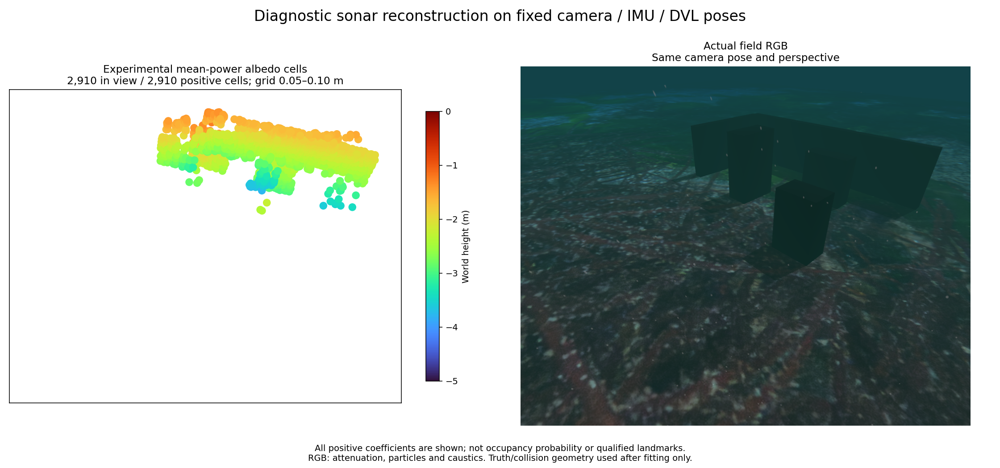

# Fixed-pose sonar power reconstruction / 고정 자세 소나 강도 복원



The separate [diagnostic tool](../../tools/sonar_power_volume.py) reconstructs a
nonnegative scattering field from measured imaging-sonar intensity and fixed
estimated poses. Install `python -m pip install -e '.[diagnostics]'` in this
repository, then run:

```sh
python tools/sonar_power_volume.py \
  --inputs docs/data/sonar-power-volume-inputs.npz \
  --output /tmp/sonar-volume --cell .2 --refine 2
```

The output directory must be new. Outputs include the complete field, held-out
predictions, a version/hash report and `albedo-cells.ply`. The PLY preserves every
positive cell, including outliers, with cell size and relative coefficient.
Its header identifies experimental scattering cells and sets map qualification
and navigation readiness to false. [Recorded PLY](../data/sonar-power-volume.ply)
and [input provenance](../data/sonar-power-volume-provenance.json) are supplied.

## Inputs and method

The numeric fixture contains 24 measured sonar frames and synchronized
camera/IMU/DVL pose estimates from one recovered frame segment. Pressure selects
immersed observations; it is not a fused navigation factor in this record.
There are no truth poses, collision meshes or camera pixels in this input.
Twelve alternating frames train the field and twelve test it. Train-only 99.5th
percentile scaling is fixed before reconstruction. Azimuth and range groups
average three beams and four native range bins respectively, retaining the last
partial group. This source profile uses 0.2–10 m range, 120° horizontal and 20°
vertical aperture, and a sonar mount 0.35 rad downward.

The model integrates candidate cells over the sonar's elevation aperture. It
uses the generic POSIM plugin's expected beam-power mixture, a
`r^-3 exp(-4 alpha r)` per-ray proxy, and its periodic Hamming window's integer-bin
power response. Actual ordered beam angles are interpolated. Sub-bin delays use
linear interpolation. This is a source-informed proxy; it omits surface normals,
occlusion, coherent cross terms and pose uncertainty. It does not reproduce a
commercial Sonoptix receive array or its rated angular resolution.

Column-normalized nonnegative L1 least squares uses FISTA with checked quadratic
majorization. The penalty is 0.02 times the maximum training adjoint. The full
selected-view volume starts at 20 cm cells. Positive training support and its
neighbors subdivide twice; all other coarse cells remain. The fit uses 80/100/100
iterations. Test intensities never choose cells or coefficients. Limits are
800,000 candidate cells, 48 poses and 650 MB of stored projection arrays; actual
process memory includes additional arrays. This is an offline tool.

## Measured diagnostic, 27 October 2026

The supplied run uses Python 3.14.7, NumPy 2.5.3 and SciPy 1.18.1. These are
reproduction versions, not minimum package requirements. All rows use the same
fixed observations/poses. Distance is measured to collision surfaces only after
fitting, using initial yaw/translation alignment and scale one. No points are
removed using truth. Counts are positive scattering cells, not certified landmarks.

| Range response / grid | Positive cells | Held-out relative power L2 | Cells within 10 cm | Median / p90 / max surface distance, m |
|---|---:|---:|---:|---|
| Coarse linear / 20 cm | 388 | 0.84216 | 218 | 0.08407 / 0.37880 / 0.58025 |
| Coarse linear / adaptive | 2,850 | 0.65543 | 1,793 | 0.06445 / 0.25380 / 0.74090 |
| Native Hamming / 20 cm | 419 | 0.85067 | 232 | 0.09118 / 0.37880 / 0.58025 |
| Native Hamming / adaptive | 2,910 | 0.64985 | 1,826 | 0.06860 / 0.25380 / 0.74590 |

Temporal interpolation and a training-mean image score 0.94639 and 0.99022.
The adaptive native run retains 531,443 total cells and uses 126.0 MB of stored
projection arrays. Its positive cells are 5–10 cm. Wall/box structure appears,
but 1,084 cells exceed 10 cm and maximum error increases with refinement.
The map remains unqualified. A lower power residual is not geometric certainty.
Adjacent-frame testing is correlated and this record informed exploratory
model choices; an independent recording is still required.

The comparison uses the same actual isometric camera pose and perspective,
Turbo height colors from -5 to 0 m, and 64 pt² markers. RGB contains underwater
attenuation, particles and seabed caustics. All positive cells enter scoring,
including any outside the image. See [full metrics](../data/sonar-power-volume-surface.json).

## 한국어

별도 진단 도구는 측정 소나 강도와 고정한 추정 자세로 음수가 아닌 산란 계수장을
복원합니다. 위 명령은 새 출력 폴더에 전체 계수장·검증 영상 예측·버전/해시 기록과
PLY를 저장합니다. PLY는 이상점을 포함한 양의 셀 전체와 셀 크기·상대 계수를
보존하며, 헤더의 지도 적합성과 항법 준비 상태는 거짓입니다.

숫자 입력은 같은 복구 좌표계의 카메라·IMU·DVL 추정 자세와 측정 소나 24장입니다.
수압은 잠긴 관측을 고르는 데만 쓰며 이 기록의 항법에는 융합하지 않습니다.
정답 자세·충돌 메시·카메라 픽셀은 입력에 없습니다. 번갈아 12장으로 학습하고
12장으로 검증합니다. 학습 자료의 99.5백분위로 정규화하며 방위각 3빔과 원본 거리
4칸씩 평균합니다. 마지막 불완전 묶음도 보존합니다.

수직 개구 안의 후보 셀을 적분하고, POSIM 일반 소나 플러그인의 평균 빔 전력 혼합,
거리별 `r^-3 exp(-4 alpha r)` 근사와 주기 Hamming 창의 정수 거리칸 전력 응답을
사용합니다. 실제 순서의 빔 각도를 보간하며 거리칸 사이 지연은 선형으로 근사합니다.
표면 법선·가림·위상 간섭·자세 불확실성은 생략합니다. 상용 Sonoptix 수신 배열이나
공칭 각도 분해능을 재현하는 모델은 아닙니다.

열 정규화한 비음수 L1 최소제곱을 FISTA로 풀며 이차 상계 조건을 검사합니다.
벌점은 학습 역투영 최댓값의 0.02배입니다. 전체 관측 체적의 20 cm 격자에서 시작해
학습 신호를 설명하는 셀과 이웃을 두 번 나누고, 나머지 거친 셀도 모델에 남깁니다.
반복 횟수는 80/100/100회입니다. 검증 영상 강도는 셀 선택·계수 계산에 쓰지 않습니다.
후보 80만 셀·48자세·저장 투영 배열 650 MB로 제한한 오프라인 도구이며 실제 프로세스는
다른 배열 메모리도 사용합니다.

표의 실행 환경은 Python 3.14.7·NumPy 2.5.3·SciPy 1.18.1이며 패키지의 최소 버전과는
구분합니다. 정답 충돌 표면은 복원 후에만 평가에 사용하고 초기 방위각·위치만
정렬하며 축척은 1입니다. 정답을 이용한 점 제거는 없습니다. 시간 보간과 평균 영상의
검증 전력 상대 L2는 0.94639/0.99022입니다. 수치를 랜드마크 정확도나 확률로 해석하지 않습니다.

최종 실행은 전체 531,443셀·저장 투영 배열 126.0 MB이며 양의 셀 크기는 5~10 cm입니다.
벽과 상자 구조는 보이지만 2,910셀 중 1,084셀이 표면에서 10 cm 밖이고 최대 오차는
약 75 cm입니다. 세분화로 전력 예측은 좋아져도 최대 형상 오차는 증가합니다.
지도는 미통과입니다. 인접 영상 검증은 상관되어 있고 이 기록을 보며 모델을 검토했으므로
독립 기록 검증이 필요합니다. 그림은 실제 같은 등각 방향 카메라 원근과 Turbo -5~0 m,
64 pt² 점을 쓰며 RGB에는 수중 감쇠·입자·해저 집광무늬가 포함됩니다.

## References / 참고 자료

- [Westman, Gkioulekas and Kaess, 2020: A Volumetric Albedo Framework for 3D Imaging Sonar Reconstruction](https://www.cs.cmu.edu/~kaess/pub/Westman20icra.pdf). Established fixed-pose volumetric reconstruction reference; its ADMM solver differs from this tool's FISTA proxy.
- [ROS Maritime learning materials](https://ros-maritime.oceansoft.org/education_and_tutorials/#courses-and-open-course-material) and [robot_localization sensor preparation](https://github.com/cra-ros-pkg/robot_localization/blob/ros2/doc/preparing_sensor_data.rst): operational sensor/frame contracts. These links do not supply code or a new dependency.

체적 산란 복원은 기존 연구 방향입니다. 위 논문의 ADMM과 이 도구의 FISTA 근사는
구분하며 새 학술적 기여를 주장하지 않습니다. 교육 자료는 센서·좌표계 운용 참고로
사용하며 외부 코드를 복사하지 않습니다. 자체 도구는 Apache-2.0이고 선택형 SciPy와
기존 NumPy·문서 이미지의 고지는 [제3자 문서](../../THIRD_PARTY.md)를 따릅니다.
