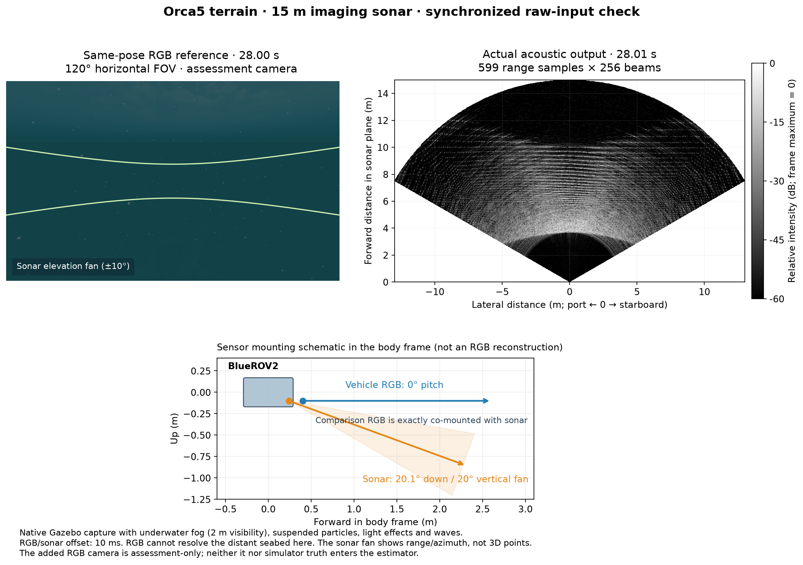

# 소나 PR #31–36: 소스 통합과 새 기준 입력

[English](README.md)

음향 소스는 `codex/sonar-slam-source-20261030`의
`7afd71e7b7a1a13eca8c4b8deb9c6e8461285cd5`입니다. POSIM main `8c47601`,
#6과 후속 PR 여섯 개를 별도 브랜치에서 통합했습니다. 후속 PR을 #6이나 원격
main에 병합하지 않았습니다. 앱은 이 소스를 별도 패치 없이 빌드합니다.

| PR | 선택 커밋 | 담당 범위 |
| --- | --- | --- |
| [#6](https://github.com/IOES-Lab/POSIM/pull/6) | `d51d7b85` | 음향 표시 대상, 스캔 기하, 광선 법선, 미터 단위 부채꼴과 픽셀별 검은 바닥값 |
| [#31](https://github.com/IOES-Lab/POSIM/pull/31) | `7dc96021` | 중복 생성 방지와 장착 자세 |
| [#32](https://github.com/IOES-Lab/POSIM/pull/32) | `f1055f48` | 컨텍스트 수명과 실제 촬영 시뮬레이션 시각 |
| [#33](https://github.com/IOES-Lab/POSIM/pull/33) | `5f327fd5` | 행렬의 마지막 부분 타일 |
| [#34](https://github.com/IOES-Lab/POSIM/pull/34) | `3421795d` | 원래 길이 FFT, 주파수 창과 잠금 Cargo 빌드 |
| [#35](https://github.com/IOES-Lab/POSIM/pull/35) | `02f6dccd` | 빈 프레임 미리보기 생략과 원본/영상 복구 시험 |
| [#36](https://github.com/IOES-Lab/POSIM/pull/36) | `fbfd000d` | 최대 거리 표본, CPU 거리 배정과 외곽 표시 셀 |

원저자와 커밋 이력을 유지했습니다. #35/#36 시험 수정은 각각의 포크 브랜치에
커밋했습니다. 두 커밋의 Code Formatting Lint는 성공했으며, 이는 시뮬레이션
검증을 대신하지 않습니다.

## 빈 영상과 최대 거리

현재 #6은 이미 0 또는 비유한 전력의 개별 픽셀을 검게 표시합니다. #35는 프레임
전체가 비었을 때 그리기를 생략하고 원본/영상 복구를 검사합니다. 예전 `a1786726`의
흰 영상 재현 결과는 당시 기록으로 보존합니다. 현재 #6에서도 같은 오류가
재현된다는 뜻은 아닙니다.

시험은 Metal/헤드리스 렌더링과 영상 형식을 명시합니다. 장면 변경 경계는 발행된
시뮬레이션 시각으로 확인하며, 원본 구독은 발행자와 맞는 volatile 센서 QoS를
사용합니다. 처음의 transient-local QoS 불일치로 원본 수신이 없었던 실패도
보존했습니다. 제한 시간과 필요한 표본 수는 줄이지 않았습니다.

CPU와 WGPU/Metal 모두 **125/125 시각 일치 쌍**을 통과했습니다. 빈 영상 세 구간과
정상 반사 복구를 포함하며 서버는 정상 종료했습니다. 시험은 32빔·400거리 표본과
801 × 401 미터 단위 미리보기를 사용합니다. 실행 소스 `11a2b6c4`와 최종
`7afd71e7`의 운영 코드는 같고, 이후 차이는 시험뿐입니다. 과거 전체 해상도
전송 실패가 해결됐다는 결과는 아닙니다.

음속 1500 m/s, 대역폭 29.9 kHz, 최대 거리 15 m에서 `dr = c/(2B)`는
0.025083612 m이며, `ceil(2RB/c)+1`은 **599개 표본**입니다. 이전 598개 입력은
14.974916 m에서 끝나며 당시 소스와 함께 유지합니다. 소비자는 실제 거리 배열과
크기를 읽습니다. 기존 관측 뒤에 가상 표본을 붙이지 않습니다.

거리 배정과 광선 법선 CTest가 통과했습니다. 소스의 CPU 회귀 시험은 15 m를
포함한 108조건 × 17빔입니다. `dladdr`로 확인한 최종 운영 WGPU 라이브러리는
N=599에서 단일 반사체 **18/18조건**을 통과했습니다. N=598은 **6/18조건**에서
최대 거리 부근의 반사가 0번 거리로 감겼습니다. 물리 입력·난수 시드·프레임은
같고, 각 길이의 Hamming 창을 사용합니다. 복소 출력 36개 전체를
[endpoint-ffi-all.npz](endpoint-ffi-all.npz)에 보존했습니다.
`dr/2 + 1e-5 m`는 격자 계산 검사의 허용값이며 SLAM 잡음이나 해양 인식 합격선이
아닙니다. NumPy가 있으면 저장 결과를 독립 검사할 수 있습니다.

```sh
python verify.py
```

## 실제 Orca5 지형 관측



네이티브 Gazebo 관측은 안개·흡수, 부유 입자, 햇빛·해저 집광무늬와 파도를
사용합니다. 시정은 2 m이며 해당 거리에서 장면 투과율이 1%가 되는 정의입니다.
비교 RGB는 소나와 정확히 같은 링크·자세에 있으며 수평 시야각은 120°입니다.
차량의 실제 RGB 장착 위치는 유지했습니다. 이 RGB에서는 멀리 있는 해저를
식별하기 어렵습니다. 소나 축은 미터이고 위가 먼 거리입니다. 영상은 거리·방위
강도이며 3차원 점군이 아닙니다.

그림은 임무 시작 20초 후부터 RGB·등각 RGB가 각각 50ms 이내인 첫 소나를
선택했습니다. 소나는 28.01초, RGB는 28.00초입니다. 전체 관측에서 40쌍은 같은
시각이며 55쌍은 10ms 차이입니다. 시각을 고치지 않았습니다. 비교 카메라와 실제
자세는 평가용이며 소나/VIO 추정기는 실행하지 않았습니다. 임무 제어는 Gazebo의
모의 외부 항법을 사용하므로 경로 완료가 SLAM 항법 성공을 뜻하지 않습니다.

- 소나 95프레임 × 599거리 표본 × 256빔, 차량 RGB 239프레임.
- IMU 4,763개, 압력 476개, DVL 47개.
- DVL 47개 모두 4빔 바닥 잠금이 유효합니다. Ping은 실제 모델에 없습니다.
  바닥 잠금 상실·복구 시험은 아닙니다.
- 소나 위치의 비교 RGB 96프레임, 등각 RGB 48프레임, 평가용 자세 1,191개.
- 모든 소나 원본 전력 해시·크기·거리 배열·시각 순서·50ms 이내 실제 자세
  구간이 검사에 통과했습니다. 2 Hz 요청에서 최대 관측 시각 간격은 0.51초입니다.
- 명령 수심 1.7/2.2 m의 경로를 완료했고 계획상 최소 해저 여유는 1.372 m입니다.
  소유한 네 프로세스 그룹 모두 비었으며 강제 종료 없이 정상 종료했습니다.
  LIVE와 Actions 러너는 건드리지 않았습니다.

지형은 실제 60 × 60 m, 세 배 크기의 Orca5 데모입니다. 이전 상자 전용 시험
장면으로 바꾸지 않았습니다. 처음의 깊은 경로는 기존 지형 계획기가 거부했습니다.
XY·방위와 0.5 m 수심 변화를 유지한 채 운용 수심을 조정했습니다. 지형이나 안전
여유·센서 잡음·지도 승인 조건을 완화하지 않았습니다.

사전 실패에는 표준 패키지 보조 파일 누락, 카메라/소나의 동일 장착 가정,
비공개 촬영 도구의 XML 네임스페이스 손실, 예전 임무 정지 시간 형식, 위험 수심,
지형에 상자 전용 평가기를 적용한 경우가 있습니다. 등록 지형은 기존 지형
계획기가 검사하고 추가 상자는 별도로 검사하며 미등록 메시를 거부하도록 평가
범위를 바로잡았습니다. 양성·음성 대조 네 개가 통과했습니다. 처음의 오프라인
해시 검사는 ROS 전력과 NPZ 파일 해시를 혼동했으며, 원본을 바꾸지 않고 기록기의
전력 바이트 정의에 맞춰 수정했습니다. 실패 기록도 유지합니다.

## 범위와 다음 단계

지정 소스를 다시 빌드했으며 SDK 교체나 새 제공자 API는 없습니다. 소스가 맞는
렌더러 캐시와 외부 Gazebo 렌더러·로더 보정은 실행 조건에 명시합니다. 설치 SDK,
출시 앱, 다른 네이티브 플랫폼이나 유용한 SLAM 지도를 검증한 결과가 아닙니다.
이번 입력·진단 갱신은 POSIM-SLAM 알고리즘과 버전을 바꾸지 않습니다.

599개 새 입력으로 물리 반사체의 지속성과 거리 응답 우도를 검사합니다. 예전
598개 입력은 회귀 대조로 유지합니다. 스페클을 고정하거나 이미 적용된 창 처리를
중복 수정하지 않습니다. 점군을 줄이거나 불확실성·신선도·지도 승인 조건을
완화해 통과시키지 않습니다. 전체 지도, DVL 상실/부재, 설치 실행, VRX와 WAM-V
측량 검증은 계속 남아 있습니다.

작은 메타데이터·연산 출력 전체·그림은 WWW-POSIM과 POSIM-SLAM에 함께 둡니다.
원본 관측과 모든 사전 실패·네이티브 로그는 다음 경로에 한 번만 보존합니다.
`/Volumes/ExternalHDD/POSIM/validation-data/posim-slam/sonar-pr35-36-20261030`.
GitHub Artifact는 다운로드하지 않았습니다.
