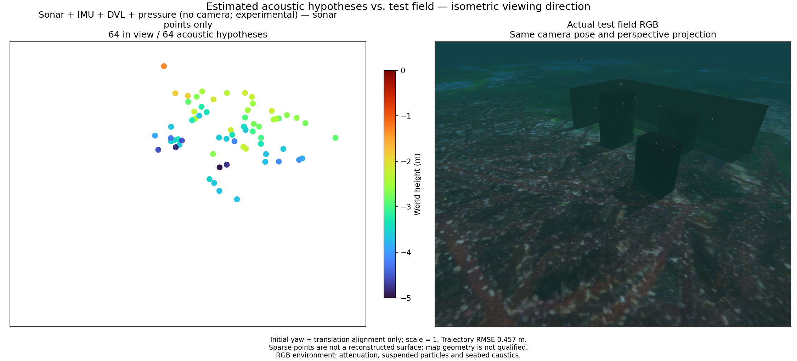

# Hydrostatic depth in camera-free fusion / 카메라 없는 융합의 정수압 깊이

These preserved runs use the earlier snapshot lifecycle, which reuses some
marginalized sonar observations. See the [ownership correction and matched
replays](sonar-owned-once.md) for current evidence. The pressure implementation
checks below remain distinct from these affected recorded comparisons.

아래 보존 기록에는 주변화한 소나 관측을 다시 사용하는 문제가 있습니다.
현재 결과는 [소유권 수정과 같은 기록의 재생](sonar-owned-once.md)을 참고하세요.
수압 구현 자체의 수치 검증과 이 영향을 받는 기록 비교를 구분해야 합니다.

[Metrics and source hashes](sonar-pressure-recorded.json) · [Native method](../../native/basalt/README.md)

The native Basalt research optimizer jointly estimates one unknown pressure
height datum with pose, velocity and IMU biases. It preserves the complete
datum/state marginal cross-information. A noisy first sample is a numerical
seed, never an absolute height anchor. Input uses the physical pressure/IMU
mount, original timestamps and independent reported pressure variance.
Basalt is pinned at `0f3b2b52c807f70ff4e2973ce253c73329eea7bc` and the
acoustic frontend uses OpenCV 4.13.0. Exact modified source and binary hashes
are in the accompanying evidence; no new dependency is introduced.

Two frozen simulated sensor recordings provide sonar, raw IMU, bottom-lock
DVL and pressure. No camera packets, terrain mesh, truth pose or ideal
orientation enter these replays. Pressure is selected at at least one-second
intervals from its 10 Hz recording, retaining each selected original time.
Conversion uses reference pressure 101325 Pa, density 1025 kg/m³ and gravity
9.80665 m/s², matching the capture's hydrostatic source. Reported noise is
30 Pa standard deviation. Density/gravity and pressure offset are constant;
dynamic wave pressure is not modelled. Near-surface clipping is screened by
requiring pressure above reference plus three reported standard deviations.
That screening is a heuristic, not a guaranteed submergence classifier.

Each control includes exactly the same state times, but omits pressure factors.
The controls use 212 states on path A (64.5 s) and 214 on path B (67 s).
Changing event count changes the duration covered by the 16-state window;
comparisons against earlier, differently timed replays cannot isolate the
pressure factor. Alignment uses initial yaw and translation only, scale 1.

| Path and input | Depth RMSE | Position RMSE | Points | Within 10 cm | Surface p90 |
|---|---:|---:|---:|---:|---:|
| A, same-clock control | 1.96 cm | 0.174 m | 67 | 32 | 0.684 m |
| A, pressure enabled | 0.75 cm | 0.457 m | 64 | 34 | 0.556 m |
| B, same-clock control | 1.00 cm | 0.237 m | 74 | 40 | 0.292 m |
| B, pressure enabled | 0.37 cm | 0.227 m | 69 | 38 | 0.336 m |

**Depth improves in both runs; total navigation and map accuracy do not
consistently improve. Neither map adequately recovers wall/block geometry.**
Pressure is not a solution to horizontal drift or unreliable sonar association.
These runs do not qualify an app default, terrain SLAM or 2 m optical visibility.
Source correspondence and acoustic elevation remain unresolved. Do not smooth
these points into an apparently complete terrain or weaken admission gates.

Removing acoustic optimizer observations while retaining IMU, DVL, pressure
and all event times gives position RMSE 0.246 m on A and 0.409 m on B; attitude
RMSE is 4.28° and 19.22°. These navigation-only ablations have no point cloud.
Acoustic constraints help B but harm A relative to this ablation. They require
better association/observability handling, rather than unconditional removal.

## Paired figures / 비교 그림

Each pair shares the same RGB camera pose and isometric viewing direction.
RGB is an evaluation-only reference with attenuation, suspended particles,
caustics and sea surface. Turbo uses fixed −5 to 0 m limits and point marker
area 64 pt². These are sparse acoustic hypotheses, not a recovered surface.

Synthetic tests separately verify pose Jacobians, an independent dense Schur
prior comparison, first-sample gauge, failed-install rollback, replay rejection,
malformed input and repeated marginalization. A 20-second IMU/pressure test
has a 17 m unknown datum, 2 cm first-sample noise, four seconds of pressure
loss and maximum depth error 1.99 cm; adding DVL gives 0.98 cm. Camera-clock
tests exercise 65 states with three pressure states between blank images.
Existing DVL, sonar-clock and Ping-prior checks pass. Synthetic accuracy does
not substitute for scene reconstruction or actual sensor calibration.

네이티브 Basalt 연구용 추정기는 수압의 미지 높이 기준값 하나를 자세·속도·IMU
바이어스와 함께 추정하고, 주변화에서도 기준값과 상태의 상관정보를 보존합니다.
첫 측정은 계산 초기값이며 절대 높이를 고정하지 않습니다. 센서 장착 위치,
원래 시각과 보고된 수압 분산을 사용합니다. Basalt 고정 버전은 위에 명시한
커밋이며 음향 추적기는 OpenCV 4.13.0입니다. 추가 외부 의존성은 없습니다.

두 시뮬레이션 기록에서 카메라·정답 자세·이상적 자세·지형을 입력하지 않고
소나·원본 IMU·바닥 잠금 DVL·수압을 재생합니다. 10 Hz 수압 중 최소 1초 간격의
원본 표본을 사용하며 시각을 옮기지 않습니다. 기준 압력 101325 Pa, 밀도
1025 kg/m³, 중력 9.80665 m/s²와 보고 잡음 30 Pa를 사용합니다. 밀도·중력·압력
오프셋은 일정하고 파도 동압은 모델링하지 않습니다. 기준 압력보다 잡음 표준편차의
3배 이상 높은 값만 잠긴 상태의 후보로 사용하며, 이는 완전한 잠수 판별기가 아닙니다.

각 대조군은 같은 상태 시각을 유지하고 수압 제약만 생략합니다. A는 64.5초,
B는 67초이며 초기 yaw·이동만 정렬하고 축척은 1로 고정합니다. **두 경로의 깊이는
개선되지만 전체 위치와 지도 품질은 일관되게 개선되지 않습니다.** 모든 점군은
벽·블록을 충분히 복원하지 못합니다. 수평 이동·소나 대응점·높이 모호성은 남아
있으며 앱 기본값, 지형 SLAM, RGB 유효 시야 2m의 합격 근거가 아닙니다.

소나 제약만 제외하고 같은 시각의 IMU·DVL·수압을 유지한 항법 대조군은 A에서
위치 RMSE 0.246m·자세 RMSE 4.28°, B에서 0.409m·19.22°입니다. 이 대조군에는
점군이 없습니다. 소나 제약이 B에는 도움이 되지만 A에는 악영향을 줍니다.
일괄 제거보다 대응점과 관측 가능한 방향의 처리를 개선해야 합니다.

비교 그림의 RGB는 평가 전용이며 감쇠·입자·집광무늬·수면을 포함합니다. 같은
등각 방향과 카메라 원근 투영, 고정 Turbo 높이 범위 −5~0m, 점 면적 64pt²를
사용합니다. 합성 시험의 깊이 오차와 주변화 검증은 실제 장면 복원이나 상용 센서
보정을 대신하지 않습니다. 수압 융합 자체는 기존 센서 융합 방법이며 신규 연구
기여로 주장하지 않습니다.
