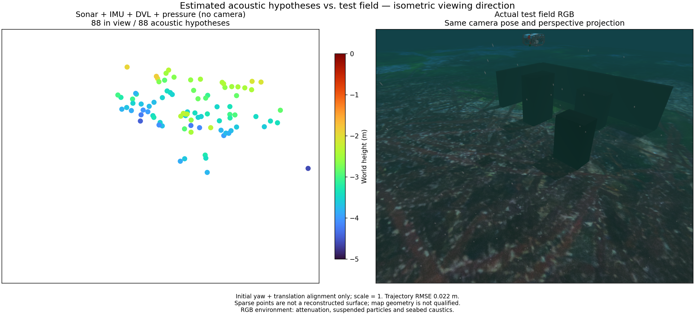

# Camera-free pressure recovery / 카메라 없는 수압 복구

This measured ROS replay uses sonar, raw IMU, DVL and pressure; camera sensors
are removed from its model and camera topics are not subscribed. The RGB is an
evaluation-only reference of the same static field captured after the mission.
It includes attenuation, particles, seabed caustics and surface waves. Matching
isometric viewing direction/perspective, fixed Turbo limits and four-times point
diameter are used. The figure shows the initial 88-point export.

Independent trajectory evaluation uses only initial yaw/translation alignment
per local segment, with scale one. Initial 27.65 s RMSE is 0.02162 m (maximum
0.05669 m). After the four-second pressure outage, the 20.15 s recovered segment
has 0.06614 m RMSE (maximum 0.14877 m). This does not establish global continuity.

Only 48 of 88 initial acoustic points lie within 10 cm of collision surfaces.
Median surface distance is 0.08699 m, p90 0.33625 m, maximum 0.93397 m. Recovery
exports 26 points, whose geometry is not evaluated by this initial-export figure.
Sensor delivery, stale-map invalidation, fusion and export pass; useful terrain
reconstruction remains unqualified. This interval differs from the mixed visual
experiment and must not be used as a matched ranking of the two algorithms.

## 한국어

실측 ROS 재생은 소나·원본 IMU·DVL·수압을 사용합니다. 모델에서 카메라 센서를
제거하고 카메라 토픽을 구독하지 않습니다. RGB는 임무 후 촬영한 같은 정적
현장의 평가 전용 참조입니다. 수중 감쇠·입자·해저 집광무늬·수면 파도를 포함합니다.
같은 등각 방향·원근 투영, 고정 Turbo 범위와 지름 4배 점을 사용하며,
그림은 초기 내보내기 88점을 보여줍니다.

각 로컬 구간의 초기 방위각·위치만 정렬하고 축척은 1로 고정했습니다.
초기 27.65초 위치 RMSE는 0.02162 m, 최대는 0.05669 m입니다.
수압 4초 중단 후 복구된 20.15초 구간의 RMSE는 0.06614 m, 최대는
0.14877 m입니다. 재설정 전후 전역 지도 연속성을 입증하지 않습니다.

초기 소나 88점 중 48점만 충돌 표면 10 cm 이내입니다. 표면 거리는 중앙값
0.08699 m, p90 0.33625 m, 최대 0.93397 m입니다. 복구 내보내기는 26점이며
그 기하는 이 초기 지도 그림의 평가 대상이 아닙니다. 센서 수신·오래된 지도
폐기·융합·내보내기는 통과했지만 유용한 지형 복원은 아직 미검증입니다.
시각 센서 결합 시험과 평가 구간이 달라 알고리즘 우열 비교로 사용하지 않습니다.
