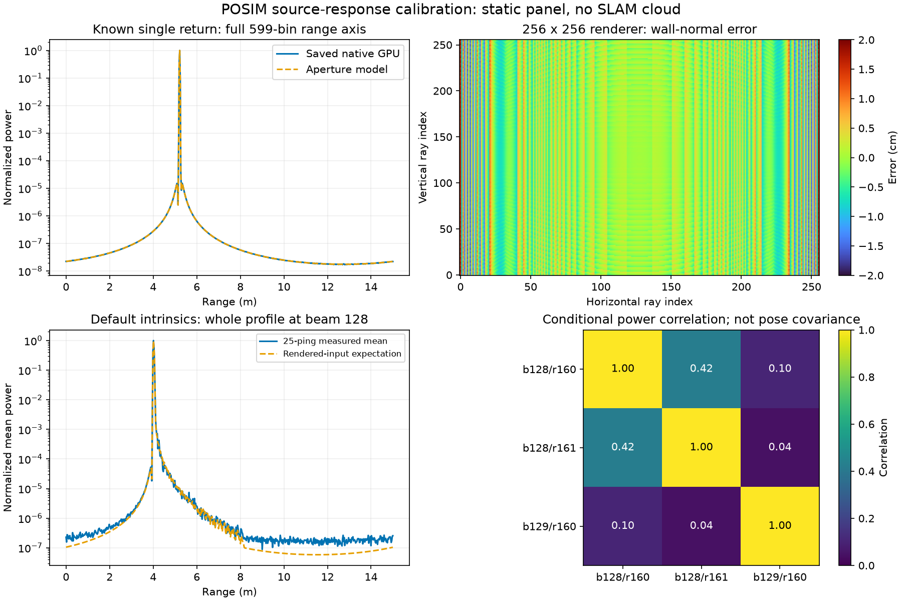

# Sampled sonar response and correlated power

[한국어](README.ko.md)

The frequency-aperture model explains the saved single-return native outputs,
and the diffuse-return expectation is checked against actual static-panel
inputs. Weak-tail calibration remains open. This is a source-model diagnostic,
not sonar mapping acceptance.
POSIM source is `7afd71e7b7a1a13eca8c4b8deb9c6e8461285cd5`, containing
current engine main, #6 and #31–36 on a separate branch. Those PRs remain open.
The installed SDK, native estimator, selected runtime factors and map-admission
limits are unchanged.

`PosimRangeResponse` implements the producer's normalized periodic Hamming
aperture, sampled frequencies and original-length FFT. It accepts supplied
scatterer ranges, complex-amplitude variances and beam mixing. For independent
circular complex Gaussian scatterers, the transfer H gives
`C = H diag(v) H*`, `E[P_i] = C_ii`, and
`Cov(P_i, P_j) = |C_ij|²`. The mean is evaluated in blocks of 32 scatterers;
joint moments are limited to 64 selected output pixels. These are conditional
source-model moments. Geometry, physical correspondence and pose uncertainty
are not inferred by this diagnostic API. GPU rounding/saturation and hardware
calibration require separate checks.

The source publishes `20 log10(|z|)`, so power is `10**(dB/10)`; zero return
remains zero power. Range response, angular mixing, propagation and incidence
are included. The source's ray-local normal z is the incidence cosine. The
first private plane calculation omitted this factor; that failed control and
its data remain externally, without changing the producer to fit the model.

## Measured controls

- The 32 positive saved native single-return outputs cover odd/even 598/599
  samples, two seeds and eight distances. Maximum normalized complex residual
  against the aperture is about `1.08e-4`. A full physical-range search, without
  a truth-centred bracket, recovers those controlled distances with maximum
  error `6.10e-7 m`. This checks a known numerical operator; it is not real-sonar
  or scene-level accuracy. Four out-of-range outputs remain zero. The complete
  original arrays stay in the [source/grid record](../sonar-pr31-36-20261030/README.md).
- A new unchanged #35 WGPU test passes all 125 raw/preview pairs and normal
  server exit. The observer retains 180 raw, 180 normal and 180 rendered-range
  frames with equal measured stamp sets. Its 32-beam, 32-ray, 10 m, 900 kHz
  fixture processes elevation indices 0/10/20/30. It is distinct from the demo.
- A separate control copies the actual demo intrinsics: 256 beams, 256 vertical
  rays, 120° × 20°, 700 kHz, 29.9 kHz bandwidth, 1500 m/s, 15 m, 599 samples,
  ray skip 1 and 2 Hz. It obtains 25 equal-stamp raw/normal/range triplets from
  52 raw, 52 normal and 25 range arrivals. The complete streams are not all
  synchronized or demonstrated lossless. Both owned processes exit 0 without
  forced termination. Static fixture mounting, topic and flat panel replace
  the vehicle/world; this is not a BlueROV operating or environment test.
- All selected renderer geometries are exactly constant over their evaluation
  windows. Captured raw ranges and existing RGB8 normals condition the power
  expectation. Only a common positive amplitude scale is fitted. These renderer
  values are assessment inputs and never enter SLAM.

| Control | Wall-normal renderer RMS | Ideal-geometry power residual | Rendered-input power residual | Adjacent-range power correlation |
| --- | ---: | ---: | ---: | ---: |
| 32-beam, wall 4.000 m | 14.543 mm | 0.309 | 0.204 | 0.700 |
| 32-beam, wall 4.001 m | 14.498 mm | 0.337 | 0.229 | 0.698 |
| Demo intrinsics, wall 4.000 m | 4.964 mm | 0.208 | 0.190 | 0.425 |

Each power residual is full-image relative L2 against the same 25-ping mean.
The ideal-versus-rendered comparisons use identical observations. The two
sensor configurations change several parameters, so the table does not isolate
a vertical-ray-count effect. Maximum absolute wall-normal renderer error is
40.561/40.248 mm in the small fixture and 18.676 mm with the demo intrinsics.
No offset correction or zero-error target is installed.

For the ideal independent-ping Gaussian model, a single pixel's 25-sample
mean has relative RMS `1/sqrt(25)=0.2`. This is a reference scale, not a fitted
confidence certificate or acceptance threshold for the reported residuals.
The listed correlations are calculated from the supplied source geometry,
not estimated field correlations. Correlated bins do not provide independent
landmark evidence.

The weak tail remains unqualified. Across all 51,200 cells at 10–15 m, measured
mean power is 0.29845 versus 0.06456 predicted (ratio 4.623), while every rendered
hit is below 8.162 m. These powers use the fixture's units and fitted common
scale. The global L2 result is dominated by the strong echo and does not
validate that tail. The source's fixed-point accumulation is a candidate
mechanism; a causal matched-input comparison is still needed. No numerical-noise
offset or new measurement confidence is installed.

The calibration uses a static flat panel without fog, particles, caustics or
waves. All 599 range bins and the complete 256 × 256 renderer grid are shown
or retained in the data. The rendered geometry is a calibration reference,
not a generated SLAM cloud. The previous [underwater RGB/sonar comparison](../sonar-pr31-36-20261030/sonar-input-comparison.png)
retains the actual Orca5 context with 2 m optical visibility.

## Field consequence and boundaries

Every beam in the 95-frame canonical Orca5 record is compared with its best
single-return power profile: all 24,320 profiles are retained, with median
normalized residual 0.813. The earlier controlled panel has 2,624 nonempty
profiles with median 0.272. Entire beams can contain multiple returns; this
does not establish that every local point feature is invalid. It motivates
checking local observation support and persistence before converting intensity
pixels into XYZ landmarks. Whole-field raw input remains once externally;
`all-profile-fits.npz` retains every fitted profile/result, not the original
field images.

The next gate is sensor-only local-patch association across independent views,
with range response, correlated powers, pose uncertainty and ambiguous
elevation retained. Existing work distinguishes usable motion constraints
from well-constrained 3D landmarks ([Westman et al., 2018](https://www.cs.cmu.edu/~kaess/pub/Westman18icra.pdf),
[Westman and Kaess, 2020](https://www.cs.cmu.edu/~kaess/pub/Westman20joe.html)).
No new field factor, point-map improvement or academic novelty is claimed.
Prior failed point fits, including minimum optimistic 3-sigma about 0.493 m,
remain unchanged. IMU/pressure defaults, DVL/Ping exclusion and full-map export
remain requirements. Useful sonar maps, physical DVL-loss/absence benefit,
installed/platform acceptance, VRX and WAM-V surveying remain open.

## Reproduction and retention

Run `python verify.py` with matching POSIM-SLAM and NumPy. It recomputes the
native transfer, complete small-fixture input checks and power expectations.
For the high-resolution case it recomputes moments from saved full-resolution
25-frame sufficient statistics plus one complete representative input frame.
It does not rerun acquisition or the raw field extraction. `plot_response.py`
recreates the figure with Matplotlib. Source hashes and native library identity
are retained. Six new numerical controls cover the independent closed-form
aperture, source period, mixtures, clipping, Gaussian power covariance and
invalid inputs. The clean SDK suite passes 527/549 with 22 optional skips.

Full captures, private acquisition code, startup failures and the omitted-
incidence control stay once on ExternalHDD. The published small-fixture arrays
use lossless alias deduplication; the large capture publishes full-resolution
sufficient statistics to avoid duplicating the whole raw stream in both Git
repositories. Decoded ranging XYZ omits unrelated PointCloud2 fields.
The first high-resolution preflight loses the literal `gz:` prefix during SDF
serialization; the second assumes a fixed five-second initialization. Both
fail with normal cleanup. The fixture writer preserves the prefix, and the
recorder waits for an actual first frame with a separate 30-second startup
bound. The operating gate remains 25 matched triplets within 30 seconds.
The first isolated unit export omits committed tools/native dependencies;
restoring that dependency closure fixes the harness without changing tests.
No GitHub Artifact download, LIVE/runner restart, SDK replacement or new
provider ABI is used.

The first Linux CI run passes the numerical tests but finds a local Python
cache entry in the saved hash inventory. The inventory is regenerated from
Git-managed report files and verified in a fresh archive; generated bytecode
is not a diagnostic input. No measurement check or numerical limit is removed.

## Matched arithmetic control

A frozen full-resolution geometry/normal input is supplied to the unchanged
production WGPU binary and two numerical references. The three controls use
seed 73 and frames 20, 21 and 22 with identical Philox coefficients, propagation,
aperture, beam mixing and original-N FFT. Only per-scatterer spectral rounding
differs between the floating and fixed-point references. No accumulator
overflow occurs in these inputs. The captured RGB8 normal approximation is
supplied identically; this does not reconstruct the original field RNG/input.

The native 10–15 m mean powers are 0.3070, 0.2916 and 0.2962; the fixed-point
reference gives 0.3073, 0.2915 and 0.2961. The floating reference gives 0.0727,
0.0572 and 0.0599. Fixed-point versus floating whole-complex residuals to the
native output are 0.043–0.046% versus 0.764–0.823%. The weak-tail complex
residual remains 4.94–5.09% even with the fixed-point reference. This controlled
intervention establishes a rounding contribution; it does not fully calibrate
the original capture, explain the prior landmark uncertainty or improve SLAM.
The raw/smooth display path clips below 20 dB; other contrast/whitening and
quantitative paths have different support. Do not generalize one path's cutoff.

`fixed-point-frame20.npz` retains the complete native, fixed-point and floating
complex outputs for one control, with all bins. All three full outputs remain
once externally. `verify.py` recomputes that complete frame's power/residual
statistics. To rerun all three production comparisons with the source-bound
plugin, use `python probe_fixed_point.py --binary /path/to/libmultibeam_sonar.dylib
--output /new/external/directory --save-full` (one command). The probe writes
its protocol before execution and uses only the supplied public geometry and
source equations; it starts no renderer or estimator. A kernel remedy needs
its own clipping, low-amplitude and throughput controls. No shader patch,
noise compensation, new map factor or admission change is made here.

The first arithmetic export narrows reference arrays and uses inconsistent
single/double precision for norm accumulation. The tight verifier rejects the
residual mismatch. The final export retains reference precision and computes
all reported norms/powers in double precision, with the same tolerance.
