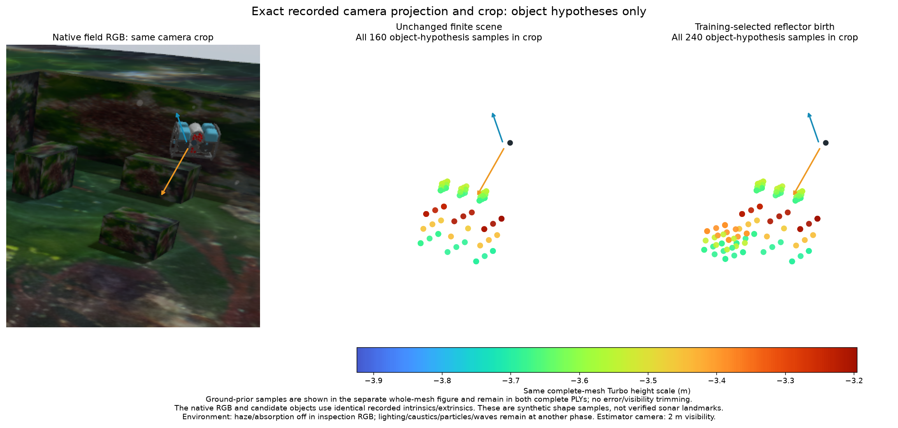
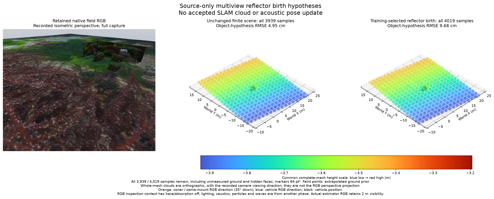

# Reflector proposals and whole-image agreement

[한국어](README.ko.md)

This record tests sensor-only reflector birth and identifies a remaining field
input/model agreement gate. The birth is **not accepted**. More matching views
and a lower image score still produce a false finite shape. No native update,
map admission, sensor-noise change or source-PR merge occurs.



The exact recorded camera projection/crop contains all 160 baseline and 240
selected object samples. Orange is sonar/same-mount inspection RGB, 35° down;
blue is vehicle RGB. Inspection RGB disables haze/absorption; lighting, caustics,
particles and waves remain from another phase. Estimator RGB visibility is 2 m.



The whole-scene plots preserve all **3,939/4,019** samples and hidden faces, with
64 pt² markers and common blue-to-red Turbo heights. Faint ground is an
extrapolated prior. These orthographic views follow the recorded RGB viewing
direction; the object crop uses its exact perspective. Every sample remains in
both PLYs. They are model hypotheses, not measured sonar landmarks.

## Original-power inverse

Reuse the [preceding sealed finite scene](../sonar-partial-scene-fit-20261031/README.md),
original eight sonar frames and navigation means. Source integration `ffecee9b`
contains current #6/#31–36; fresh remote heads and main remain unchanged and
unmerged. IMU/pressure/DVL inputs and the 15 m, 599×256 image / 256×256 ray profile
remain unchanged. No raw recording is duplicated.

`sonar_birth` evaluates a full-image proposal mean using the same source normals,
finite Hamming autocorrelation and original-length Fourier transform. Signed
cancellation values and a diagnostic arithmetic envelope remain explicit.
The existing exact positive source operator checks selected predictions; no
original weak/zero return is clipped. Common total-power gain and identical
5×5 local power averages yield 392 excess components in five training views.
Forty components enter the bounded search. Contrast/size settings are proposal
parameters, not calibrated false-alarm probabilities.

Every selected member pixel spans its nominal ±10° elevation fan. At 0.2 m search
cells, 337/8,534 cells overlap in at least three distinct views. Duplicated pixels
or regions within one view never add view count. Three novel finite-box modes
receive 5/4/4 view support. Their ground support is the existing uncertain DVL
plane prior. No shadow height, true mesh, pose truth or RGB initializes them.

Compare 11 complete scene alternatives with identical original queries: unchanged,
transparent removal of the old single-view seed, and three heights at each new
mode. Training alone selects one birth. In 87.2 s, its composite query score
changes **1883.532→1843.119**; the next alternative is 1843.632. After sealing,
unused temporal score changes **1867.861→1780.747**, with mixed individual views.
Full correlated query moments remain. These development views do not establish
independent-scene validity or joint pose/map confidence.

Assessment after the seal finds the new 80 samples have **15.24 cm** surface RMSE,
44 beyond diagnostic 10 cm. Most lie near seabed/existing geometry rather than a
new object. Combined object-group RMSE changes **4.95→9.68 cm**; whole-scene RMSE
**13.09→13.13 cm**. The unchanged prior ground dominates the whole-scene count.
No sample is removed to improve these results.

## Separate kernel agreement from field agreement

A post-selection positive-sum calculation checks every native pixel without FFT
cancellation or a mean floor. Whole-image training/unused scores also favour the
false birth: **2,262,453→1,860,263 / 1,419,887→1,121,950**. Sparse query selection
alone therefore does not explain the failure. The sealed winner is unchanged.

Reusing complete reference-scene grids at navigation/true poses gives full-image
residual RMS **2.61/5.24/44.54** and **2.35/2.66/45.13** at frames 27/81/88. Reference
geometry and 40 ms truth interpolation remain assessment-only, with unresolved
rasterization/capture-time accuracy. The actual captured seafloor DAE and the
assessment ground match all 16,384 vertices and 32,258 triangles exactly. Nominal
eight-view directions have no upward rays. These checks do not certify the
actual renderer range grid, sensor pose or capture time.

The earlier 512 native GPU evaluations now pass at **all 153,344 pixels**, extending
their original 64-query check. A separate 64-call C-ABI control on the supplied
frame-88 reference grid also passes every pixel. Both use predeclared two-sided
Bonferroni Gamma tails at family α=.01, conditional on proper Gaussian scattering
and independent frame counters. The exact loaded binary SHA is retained. The
supplied grid is not the actual renderer grid; no new renderer/world/SDK runs.
No additional producer patch is established by these controls.

**Next:** compare the exact actual ray-grid input, sensor/vehicle pose and capture
time for the same field frame. Resolve scene-to-ray/raster/pose/time disagreement
before adding more mapper factors. Then include shared pose/map/material
uncertainty. Repeated-view overlap alone cannot admit a physical reflector.

## Reproduce and preserve

With the library's NumPy/SciPy diagnostic dependencies:

```sh
python -m unittest discover -s tests -p test_sonar_birth.py
python -m unittest discover -s docs/diagnostics/sonar-reflector-birth-20261031 -p test_full_image_audit.py
python docs/diagnostics/sonar-reflector-birth-20261031/verify.py --full-image
```

The verifier rebuilds discovery in fresh bounded scratch space, every alternative's
original-power score, final correlated moments, unused predictions and every
failed surface/PLY. Full mode recomputes whole-image/reference/native controls
from retained inputs; CI needs no GPU or downloaded artifacts. Original hashes
remain exact; float64 power, float32 source-normal and geometric arithmetic
budgets remain separate from physical sensor noise/admission.

The previous plot helper accepts record/family/label arguments. Its original two
PNGs and receipt remain byte-identical; only helper/manifest identities change.
Code/record are Apache-2.0, with existing Orca5 MIT asset notices retained. No
third-party dependency, installed SDK mutation or LIVE/runner restart is added.
