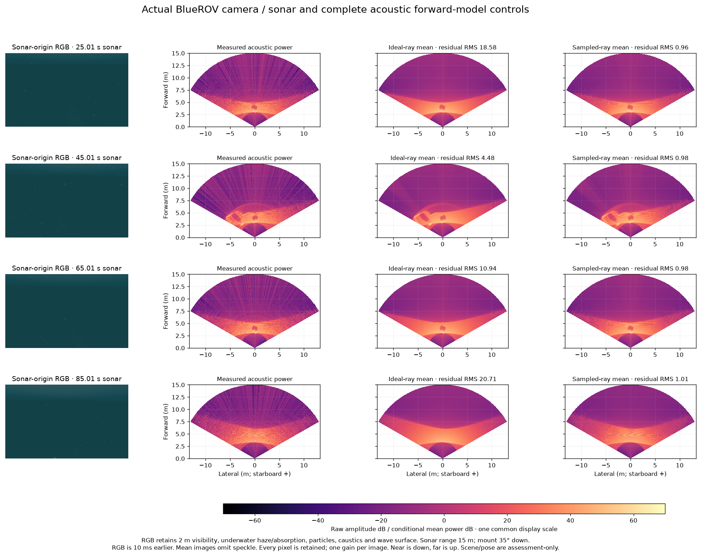

# 실제 렌더러의 음선 샘플링과 음향 예측

움직이는 BlueROV/Orca5 주행에서 미리 정한 네 프레임의 네이티브 입력,
복소 출력과 대응 원본 영상을 모두 보존합니다. 소나는 700 kHz,
256빔 × 수직 음선 256개, 시야 120° × 20°, 거리 15 m, 갱신율 2 Hz입니다.
IMU·압력·DVL을 사용하며 단일 Ping은 없습니다.



RGB에는 가시거리 2 m의 수중 안개·흡수, 부유 입자, 해저 집광무늬와
파도 수면이 적용됩니다. 소나 위치의 카메라는 소나와 같은 하향 35°
장착 자세입니다. RGB 시점은 소나보다 10 ms 앞섭니다. 소나 영상의
아래는 가까운 거리, 위는 먼 거리이며 가로축도 미터 단위입니다.
음향 패널은 같은 표시 척도를 사용합니다. 평균 예측은 무작위 스펙클을
제외하고 영상마다 하나의 공통 배율을 추정합니다. 지도 복원 없이
관측 모델을 대조하는 그림입니다.

## 전체 입력 대조

원본 영상 613,376픽셀은 기록한 복소 출력을 C++ 발행식으로 변환한 값과
비트 단위로 일치합니다. 네 법선 텐서도 원본 C++ 함수와 비트 단위로
일치합니다. 각 프레임의 렌더 시작·콜백 자세와 시각도 일치합니다.

물리 장면은 [보존된 기준 장면](../sonar-inspection-scene-20261031/README.ko.md)과
바이트 단위로 같습니다. 실제 렌더러 자세에서 소스의 최근접 픽셀
음선 방향을 적용하면 형상·자세·시각·거리 편향을 맞추지 않고 거리 차이를
설명합니다. Gazebo 10.0.2는 이 설정에서 256 × 256의 첫 렌더 텍스처를
선택합니다.

| 소나 시각 (s) | 이상적 음선 거리 RMS (cm) | 샘플링 반영 거리 RMS (mm) | 이상적 전력 잔차 RMS | 샘플링 반영 전력 잔차 RMS |
| --- | ---: | ---: | ---: | ---: |
| 25.01 | 3.957 | 0.0735 | 18.57 | 0.963 |
| 45.01 | 6.358 | 0.0674 | 4.49 | 0.976 |
| 65.01 | 3.903 | 0.0807 | 10.94 | 0.983 |
| 85.01 | 3.740 | 0.0973 | 20.71 | 1.005 |

샘플링을 반영한 반환 유무는 모든 셀에서 실제 렌더러와 같습니다.
반환이 있는 셀의 거리 차이는 네 프레임 전체에서 최대 1.857 mm입니다.
전력 잔차는 프레임마다 153,344픽셀 전부를 사용한 무차원 조건부 진단값입니다.
지도 오차·실측 정확도·독립 픽셀의 유의확률을 뜻하지 않습니다.
C++ 법선 함수는 이 기록과 정확히 일치하지만 NumPy 근사는 일부 경계에서
민감하며 성분 차이가 최대 0.847입니다. 이 차이와 이전 실패 지도도 보존합니다.

## 재현

```sh
python -m pip install -e .
python docs/diagnostics/sonar-renderer-sampling-20261101/verify.py
```

검증기는 NumPy와 독립 라이브러리를 사용합니다. 모든 보존 음선·원본
픽셀을 검사하고 이상적 음선과 실제 샘플링의 전체 전력 예측을 다시
계산합니다. 장면·렌더러 자세는 평가용입니다. 시뮬레이터·설치된 SDK·
비공개 WWW-POSIM 소스·Actions Artifact 없이 재현합니다.

`SurfacePowerModel(..., sampled_ray_directions=grid)`는 교점 계산에
`[고도각, 빔, 3]` 단위 음선 보정 격자를 받습니다. 음향 빔과 법선 계산은
명목 각도를 유지합니다. 보정은 영상 강도와 독립적으로 생산자 소스에서
제공합니다. 선택형 기능이며 이 기록으로 네이티브 자세 제약을 추가하거나
지도를 승인하지 않습니다.

[캡처 기록](capture-receipt.json)은 정상 종료와 외장 보존을 기록합니다.
내장 임시 사용량은 최대 181,137,912바이트로 승인된 2 GiB 이내입니다.
2,346개 파일을 해시 검증한 뒤 임시 폴더를 제거했습니다. 라이브 항해는
같은 세션으로 전진했고 설치된 SDK와 원본 소나 PR은 변경하지 않았습니다.
[입력 식별](inputs.json), [네이티브 법선 대조](native-normal-control.json),
[원본 발행식 대조](native-publication-control.json), [전체 평가](assessment.json)의
범위를 구분합니다.

## 소스와 고지

POSIM 진단 소스는 [`8d131df4`](https://github.com/IOES-Lab/POSIM/tree/8d131df47fd745815bd15f36365a4bd49aa13e47)입니다.
샘플링 코드는 [Gazebo Rendering 10.0.2](https://github.com/gazebosim/gz-rendering/blob/gz-rendering10_10.0.2/ogre2/src/Ogre2GpuRays.cc)를
참조합니다. Copyright 2018 Open Source Robotics Foundation, Apache-2.0 고지를
유지합니다. [샘플링 식별](sampling-identity.json)에 원본 blob과 실제 바이너리를
고정합니다. 자체 라이브러리·보정 코드는 Apache-2.0이며 이 기록의 [LICENSE](LICENSE)와
[소스 고지](source-notices.md)를 따릅니다. RGB·장면은 [Orca5 MIT 고지](Orca5-MIT.txt)를
유지합니다. 보정과 소스 일치는 알려진 구현 기법이며 연구 독창성을 주장하지 않습니다.
