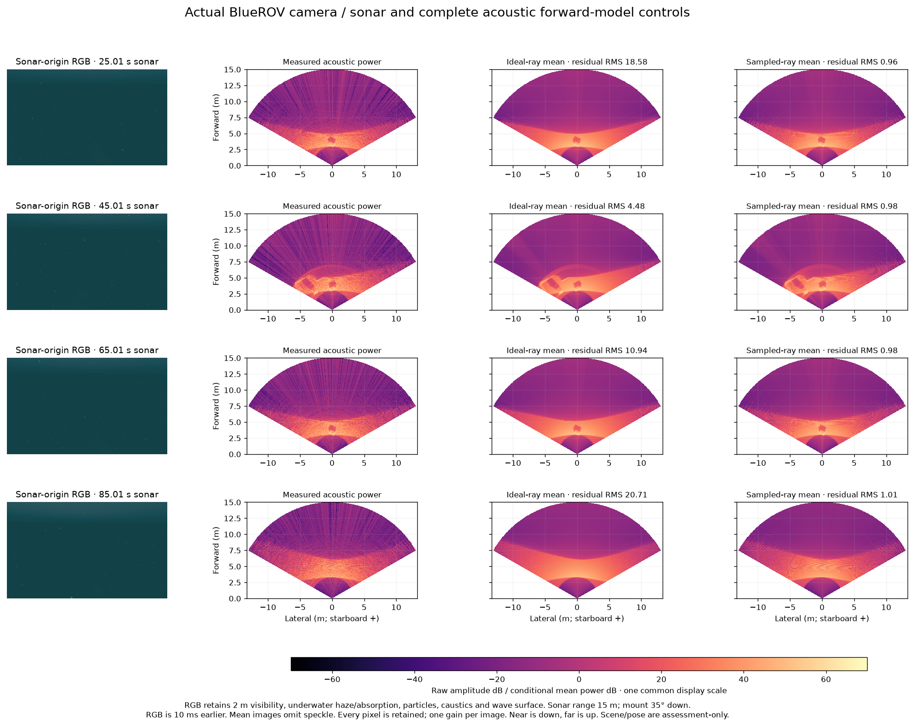

# Actual renderer sampling and acoustic predictions

Four preselected frames from a moving BlueROV/Orca5 field run retain all native
inputs, complex outputs and matching raw messages. The sensor uses 700 kHz,
256 beams × 256 vertical rays, a 120° × 20° fan, 15 m range and 2 Hz updates.
IMU, pressure and DVL are present; single Ping is absent.



RGB retains 2 m underwater visibility, haze/absorption, particles, caustics and
the wave surface. The sonar-origin camera shares the sonar's 35° downward mount;
the RGB frame precedes its sonar frame by 10 ms. Near sonar ranges are down,
far ranges up; horizontal coordinates are metres. Every acoustic panel uses the
same display scale. Mean predictions omit random speckle and profile one gain
per image. This is a forward-model control without a reconstructed SLAM map.

## Complete comparisons

All 613,376 published raw pixels match the captured complex output's C++
publication expression bit-for-bit. All four captured normal tensors match
the original C++ helper bit-for-bit. Begin/callback rendering poses and stamps
agree within each trace.

The physical scene is byte-identical to the [retained reference](../sonar-inspection-scene-20261031/README.md).
At the captured rendering poses, the source-derived nearest-texel cube rays
account for the range discrepancy without fitting geometry, pose, time or bias.
Gazebo 10.0.2 chooses a 256 × 256 first-pass texture for this profile.

| Sonar time (s) | Ideal-ray range RMS (cm) | Sampled-ray range RMS (mm) | Ideal power residual RMS | Sampled power residual RMS |
| --- | ---: | ---: | ---: | ---: |
| 25.01 | 3.957 | 0.0735 | 18.57 | 0.963 |
| 45.01 | 6.358 | 0.0674 | 4.49 | 0.976 |
| 65.01 | 3.903 | 0.0807 | 10.94 | 0.983 |
| 85.01 | 3.740 | 0.0973 | 20.71 | 1.005 |

Every sampled-ray return/miss mask matches the actual renderer. Maximum shared
valid-range discrepancy is 1.857 mm across these frames. Power residuals are
dimensionless conditional-model diagnostics over all 153,344 pixels per frame;
they are not map error, hardware accuracy or independent-pixel significance.
The C++ normal helper is exact on this record. Its NumPy approximation retains
some corner sensitivity, including a maximum component difference of 0.847;
that difference and all previous failed maps remain explicit.

## Reproduce

```sh
python -m pip install -e .
python docs/diagnostics/sonar-renderer-sampling-20261101/verify.py
```

The verifier uses NumPy and this independent library. It checks every retained
ray and raw pixel and recalculates full ideal/sampled power controls. Scene and
renderer poses are assessment-only. No simulator, installed SDK, private
WWW-POSIM source or Actions Artifact is needed.

`SurfacePowerModel(..., sampled_ray_directions=grid)` accepts a supplied
`[elevation, beam, 3]` unit-ray calibration for intersections. Nominal angles
remain the acoustic beam/normal convention. The calibration is supplied from
the producer source, independently of image intensities. It is opt-in; this
record does not add a native pose factor or qualify a map.

The [capture receipt](capture-receipt.json) records clean exit and verified
external preservation. Owned internal scratch peaks at 181,137,912 bytes under
the authorized 2 GiB cap and is removed after all 2,346 files are hash-verified.
LIVE keeps its session and advances. Installed SDKs and original sonar PRs are
unchanged. [Input identities](inputs.json), [native normal control](native-normal-control.json),
[exact raw publication](native-publication-control.json) and [full assessment](assessment.json)
retain their separate scopes.

## Source and notices

Diagnostic POSIM source: [`8d131df4`](https://github.com/IOES-Lab/POSIM/tree/8d131df47fd745815bd15f36365a4bd49aa13e47).
The sampling adapter follows [Gazebo Rendering 10.0.2](https://github.com/gazebosim/gz-rendering/blob/gz-rendering10_10.0.2/ogre2/src/Ogre2GpuRays.cc),
Copyright 2018 Open Source Robotics Foundation, Apache-2.0. [Sampling identity](sampling-identity.json)
pins the upstream blob and actual installed binary. Original library/adapter
code is Apache-2.0; this record’s [LICENSE](LICENSE) and [source notices](source-notices.md) apply. RGB/scene assets
retain the [Orca5 MIT notice](Orca5-MIT.txt). These are established
calibration and source-consistency techniques; no research novelty is claimed.
