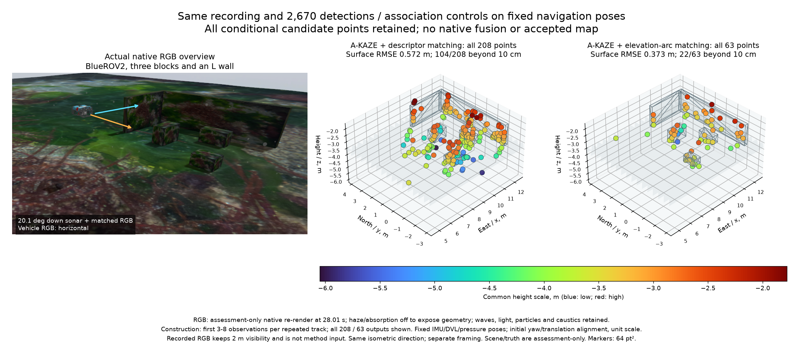

# Projective sonar association and motion observability

[한국어](README.ko.md)

This offline control reuses the [physical inspection recording](../sonar-inspection-scene-20261031/README.md), corrected POSIM integration `ffecee9b` and all current #6/#31–36 heads. It compares association methods without changing the sensor, native optimizer, provider ABI or installed SDK. IMU/DVL/pressure navigation uses no sonar or RGB, and remains fixed for both methods. Its pose uncertainty is not propagated here; these are nominal association and conditional point diagnostics.

## Same detections, different association

Default A-KAZE on the existing raw-image transform (20–90 dB, 5×5 Gaussian blur) produces 2,670 features over 93 replayable frames. Raw input and all earlier startup frames remain unchanged. Both methods use these exact stored pixels/descriptors and OpenCV 4.10.0 research detections. Prepared data also preserves the original float64 metre/radian observations consumed by fitting; pixel re-interpolation is only checked at floating-point precision, not substituted into replay:

- **Descriptor:** mutual Hamming matching with the existing 0.8 nearest-neighbour ratio.
- **Projective:** reuse `project_return_arc()` to project the birth observation's complete ±10° elevation arc using the causal navigation poses. Accept only mutually unique candidates within 2 pixels. Features farther than 5 pixels from every existing locus may start a track; ambiguous candidates remain unresolved. Keep unseen tracks for at most two seconds and bound the database to 300. These pixel choices are empirical diagnostic settings, not calibrated probability gates.

The geometric ingredient follows [Westman et al., ICRA 2018, section IV and Algorithm 1](https://www.cs.cmu.edu/~kaess/pub/Westman18icra.html), which uses A-KAZE with geometric association rather than descriptor appearance. We add mutual uniqueness and a bounded track lifetime for this control; this is not the complete paper's backend or a novelty claim. The [2020 degeneracy-aware work](https://www.cs.cmu.edu/~kaess/pub/Westman20joe.html) also separates reliable correspondence from weakly constrained reconstruction. No upstream implementation is copied.

Each track with at least three observations emits one conditional point hypothesis using only its first three to eight observations, the existing nine elevation seeds and twelve bounded iterations. Diagnostic sigmas remain 0.0250836 m and 0.00821331 rad. Scene geometry and simulator truth enter only the separate all-point assessment, after selecting by measurement cost. No native factor or accepted map is added.

| Complete outcomes | Descriptor | Projective |
| --- | ---: | ---: |
| Unique tracks / tracks with ≥3 observations | 1,578 / 208 | 636 / 63 |
| Matched detections | 1,092 | 344 |
| Ambiguous detections rejected by geometry | — | 1,690 |
| Points emitted and assessed | 208 / 208 | 63 / 63 |
| Surface RMSE / median | 0.572 / 0.0984 m | 0.373 / 0.0598 m |
| Points beyond 10 cm | 104 / 208 | 22 / 63 |
| Median fixed-pose measurement-only position 3σ | 5.675 m | 1.780 m |
| Points with that optimistic 3σ ≤10 cm | 0 | 0 |

All 208/63 points, outliers and all nine seed outcomes are retained. Markers are 64 pt² with one complete Turbo height range. The native field overview reuses the recorded 28.01 s body pose, showing vehicle/sensor directions. Only this assessment re-render disables haze/absorption; waves, underwater lighting, particles and seabed caustics remain, with different particle/wave phase. Original sensor RGB retains 2 m visibility and is not method input. Views share the isometric direction with independent framing. Original synchronized sensor views remain in the preceding record; no raw acquisition or reference RGB is duplicated.

## Unused views and limitations

At least two seconds after the construction window, descriptor tracks retain 70 observations from only 9/208 chains: 62 predicted inside the fan and eight outside. Range/azimuth RMSE over the 62 valid predictions is 0.0270 m / 0.0141 rad. Projective tracks retain 22 observations from 9/63 chains: 21 valid, one outside, with 0.0318 m / 0.0344 rad RMSE over those 21. Missing chains and out-of-fan predictions stay in the denominator. Association uses the birth arc, not the fitted point, so passing the nominal association check does not establish persistent 3D identity. Lower median surface error does not establish reliable navigation or mapping benefit.

Changing arc sampling from 65 to 257 changes one frame's assignment. The saved complete control retains this discrepancy; sampled segments do not certify continuous-curve distance. Pose uncertainty, correspondence identity, continuous locus bounds and useful 3D observability remain unresolved. The point maps stay unqualified. Native SDK `NativeOpenCV` intentionally has no A-KAZE entry point; a first private preflight attempting it fails and is retained. The successful comparison uses the existing separate research Python backend, with no SDK/ABI workaround.

## Motion-design control

An independent ideal-point calculation keeps the same physical mount and diagnostic sigmas, with 16 exact poses. It is an optimistic measurement-information calculation, not a vehicle run. At 2.5 m range, stationary observations have rank two. A ±15° body-yaw sweep gives 0.283 m maximum-direction position 3σ; ±45°/±55° body yaw gives 0.103/0.0882 m. The 20.1° pitched mount and rotating lever make body yaw different from pure yaw about the sonar axis. ±15° body roll gives 0.103 m, and ±20° roll gives 0.0775 m. At 5/10 m, ±15° roll gives 0.205/0.411 m. Unsupported observations remain explicit. Shared pose uncertainty, actual feature persistence and sensor model error would add further limitations.

This supports a closer inspection with the existing waypoint heading targets, followed by deliberate roll if needed, before another backend patch. Installed binary inspection identifies ArduSub 4.5.7 (`30257f01`) and its extended manual-control symbol. Its [pinned joystick source](https://github.com/ArduPilot/ardupilot/blob/30257f01/ArduSub/joystick.cpp) and [Guided controller](https://github.com/ArduPilot/ardupilot/blob/30257f01/ArduSub/mode_guided.cpp) differ from current-master input scaling. Actual roll response, route clearance, loss/recovery and map benefit still need the isolated native trial; no roll command is executed in this record.

Run `python verify.py` from a public POSIM-SLAM source checkout with NumPy. It independently reproduces Hamming matching and both complete association histories, checks the coarse/fine discrepancy, every conditional point/cost/held-out prediction and the ideal-motion information. `test_projective_assoc.py` covers ambiguity, duplicate detections, order invariance, support gaps, image boundaries and lifetime/clock behavior. `replay_prepared.py` needs only prepared measurements and public library code; `plot_comparison.py` redraws the figure. Complete raw hashes and shared asset hashes remain explicit. Earlier source, native-map and installed/platform acceptance scopes remain unchanged. Shared Orca5-derived assets retain their [MIT notice](../sonar-inspection-scene-20261031/Orca5-LICENSE.txt).
