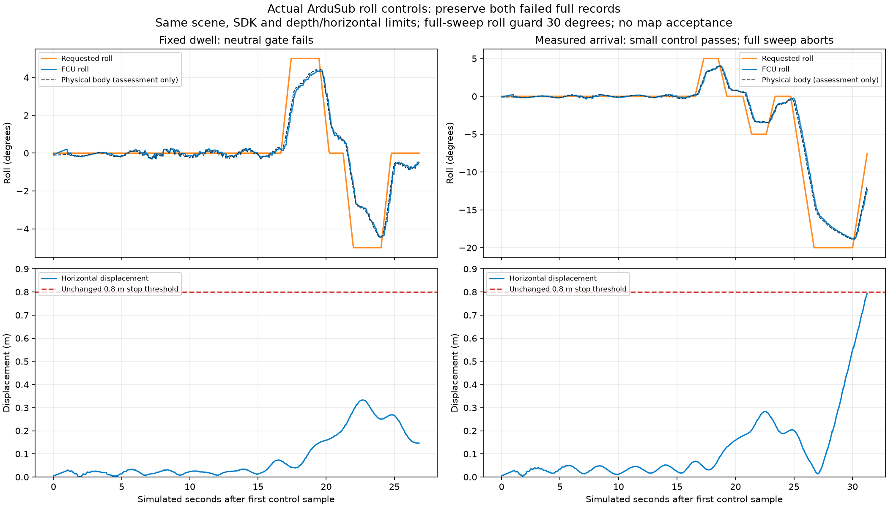

# Actual roll controls and sonar point observability

[한국어](README.ko.md)

Two native ArduSub recordings test whether informative roll motion can be
operated before changing the sonar estimator. Both complete raw records remain,
including their failures. No native pose correction or SLAM map is installed.



The first control commands ±5° in ALT_HOLD. Its first neutral return has a
1.070° mean over the fixed final second and fails the predeclared 1° limit.
The second waits for distinct fresh FCU feedback to remain within the same
1° neutral / 2° tilted limits for one simulated second. All four small-command
stages pass. It then reaches −18.46° mean for a −20° request, but the return
sweep stops at the unchanged 0.8 m horizontal-displacement guard. The full
±20° sweep is incomplete. Actual physical body roll reaches −18.92°; FCU/body
roll comparison has 0.253° RMSE. Both sessions confirm disarming and exit all
owned processes normally, without force. The full-sweep roll guard is 30°;
the small-command guard is 15°. Depth/horizontal/pitch limits are unchanged.

ALT_HOLD accepts quaternion attitudes and holds depth; it does not hold
horizontal position. The installed POSHOLD source uses RC lean input, while
the application sends neutral MANUAL_CONTROL messages continuously. Another
RC publisher must not compete with it. A future full inspection maneuver needs
one authoritative input publisher and position/depth hold, not a wider drift
limit or a second hand-tuned position controller.

The second recording retains 76 sonar frames, 189 RGB frames, 3,780 raw IMU
samples, 38 DVL samples and 377 pressure samples. All DVL samples are bottom
locked; Ping is physically absent. Sonar range is 15 m, with 256 horizontal
beams and 256 vertical rays over 120° × 20°. RGB uses 2 m visibility at 1%
transmission, with particles, caustics and waves. Pressure is hydrostatic about
the mean surface and does not model wave-induced dynamic pressure.

The fixed pair is the last sonar before the large-roll stage and its next
frame (32.01/32.50 s), selected from control timestamps before inspecting match
counts. Unchanged source-amplitude support and raw OpenCV 4.13 LK yield 35
positive-support pairs and five contrast-support pairs. Every original chain
remains in `prepared-input.json`. The longest positive chain has 14 observations
over 6.49 s; all contrast chains are lost by 36.01 s. Source support includes
angular mixing, not the range response or physical reflector identity.

Public bounded triangulation uses nine seeds, 30 iterations, the existing
16-observation limit and unchanged range/azimuth noise. Perfect poses are used
only for offline assessment. In the full bounded-history control:

| Source support | Original pairs / fitted | Minimum local position 3σ | Surface error median / 90th / maximum | Held-out compatible |
| --- | --- | --- | --- | --- |
| Positive | 35 / 18 | 0.493 m | 0.043 / 0.262 / 0.707 m | 15 / 18 |
| Contrast | 5 / 4 | 0.865 m | 0.130 / 0.209 / 0.228 m | 4 / 4 |

The other original pairs lack an independent third view. All modes, invalid
seeds and unsupported observations remain. Conditional local uncertainty does
not prove a unique elevation or calibrated confidence; 10 cm counts in the
machine summaries are descriptive, not a universal acceptance rule. The small
surface median does not qualify a map. Different positions, trajectories and
wave phases prevent a one-variable improvement claim against the earlier
vertical-motion recording. Rotation about the sonar boresight is an established
observability direction ([Wang et al., IROS 2023](https://arxiv.org/html/2307.16160v2));
this control is not research novelty.

Use an independently installed POSIM-SLAM and NumPy to reproduce the 60 prepared
summary comparisons:

```sh
python verify_prepared.py
```

All 14 poses required by these chains have truth brackets no wider than 50 ms.
The initial evaluator incorrectly also required an unrelated startup frame
10 ms before truth reception; its failure is retained in the private record.
Pose construction now uses the full dependency closure of every original chain,
with no observation removal or interpolation-limit change.

`source-identity.json` records the SDK, inspected sonar integration and exact
binary/calibration hashes. These results use the existing measured local
overrides, not a newly released SDK. Raw sensor records, private acquisition
code and full logs are stored once on the validation disk. They are not copied
into this public library. Prepared mathematical data and this record are
mirrored in WWW-POSIM. Physical echo identity and range response, useful maps,
DVL loss/absence, installed application, VRX and later WAM-V survey gates remain
open. No new sensor-combination acceptance or RGB/cloud overview is claimed.
