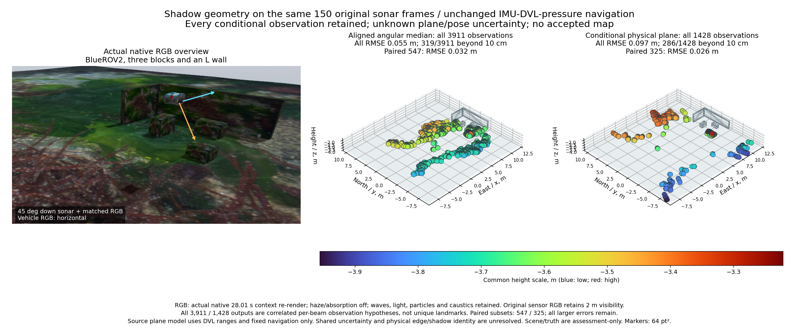
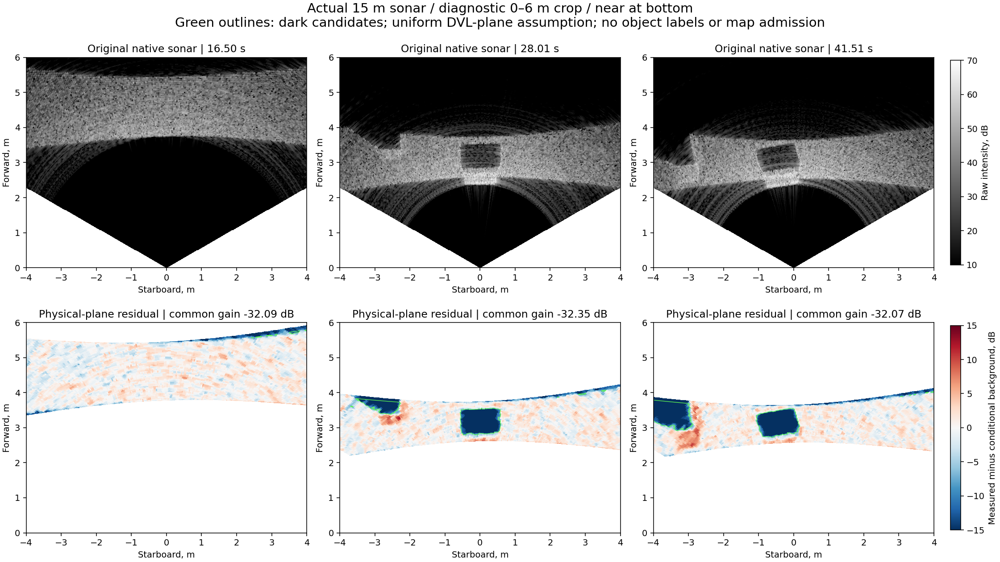

# Conditional sonar shadow geometry

[한국어](README.ko.md)

This offline comparison reuses all 150 original frames from the [45° inspection recording](../sonar-close-view-20261031/README.md), POSIM integration `ffecee9b` and current PR #6/#31–36. IMU/DVL/pressure navigation supplies the same 223 unknown-bias state means to both controls. RGB, terrain meshes and simulator poses are excluded from construction. No native factor, installed SDK, product default or map admission rule changes.

## Measurement model

Four locked DVL ranges fit one local plane using each beam's finite 2° cone minimum. The fit uses 74 pose-supported packets; range variances remain unknown. Each sonar frame uses only an earlier packet, at most 1.01 s old. The plane is extrapolated beyond the DVL footprint, so local nonplanarity and nearer occluders remain possible. Three startup sonar frames lack a supported causal pose/plane; their original input remains.

The control aligns measured ranges to the supplied plane's elevation-aperture entry/exit and subtracts the angular median. The physical variant renders a uniform plane with the existing `SurfacePowerModel`: propagation/incidence, 256 × 256 rays, the Hamming range response and beam mixing. It fits one common log-power gain per frame. No object geometry is supplied. Five-sample median filtering, an empirical 8 dB dark deficit and identical region rules apply to both variants. Unknown reflectivity can also cause a dark region; these settings are not a false-alarm calibration.

For a genuine occluding edge and its ground-shadow endpoint on the same ray, collinearity gives `height = H × (1 − r_edge/r_end)`, where `H` is perpendicular plane distance. The known plane and endpoint range determine elevation when the intersection is unique. Two branches, tangent/absent intersections, and truncated regions remain unresolved. A dark-region boundary is only a hypothesis for the actual occluding edge. Threshold/blur bias, wrong pairings and plane errors are not modeled by the local calculation.

Object/shadow reasoning is established in [Song and Choi, 2016](https://oak.go.kr/central/journallist/journaldetail.do?article_seq=20801). This implementation independently uses elementary collinearity and the existing source-specific power operator; it copies no paper code, text or figures. This is not the paper's complete reflectance/elevation algorithm or a novelty claim.

## Complete outcomes

Each point below is a correlated **observation hypothesis**, not a unique landmark or accepted map point. Every emitted hypothesis, including every large error, remains in the record and full PLY exports. A paired observation has a preceding ≥3 dB excess and a subsequent return within 3 dB of background over the fixed 0.15 m flank. Pairing is an empirical diagnostic label; all other outputs remain.

| Same-input result | Angular-median control | Physical-plane background |
| --- | ---: | ---: |
| Retained region candidates | 1,007 | 675 |
| Truncated regions / closed regions | 542 / 465 | 578 / 97 |
| All conditional points | 3,911 | 1,428 |
| All-point surface RMSE | 0.0553 m | 0.0970 m |
| All points beyond 10 cm | 319 / 3,911 | 286 / 1,428 |
| Paired subset | 547 | 325 |
| Paired surface RMSE | 0.0324 m | 0.0259 m |
| Paired points beyond 10 cm | 9 / 547 | 5 / 325 |

The physical background reduces many small dark deficits, while its complete-output RMSE is larger. The controls emit different populations; neither all-point RMSE nor the better paired subset alone proves a better map. Of the 325 paired physical hypotheses, 320 lie within 10 cm of the first block; none establish coverage of the other two blocks or walls. All five larger errors remain.



Clouds share the isometric direction and a complete Turbo height range, with 64 pt² markers. The field RGB is the actual 28.01 s native context re-render: haze/absorption disabled for assessment, waves, light, particles and caustics retained. Vehicle and camera/sonar directions are marked. Original sensor RGB retains 2 m visibility and is not input. [Matched original RGB/sonar](../sonar-close-view-20261031/sensor-comparison.png).



These fixed examples show a 0–6 m crop of the original 15 m range, with near at the bottom and metre axes. All 599 × 256 original cells remain in each representative NPZ. Residual colour and outlines indicate dark candidates, not object labels or free space. The 16.50 s example precedes close inspection; the other times are 28.01 and 41.51 s.

## Persistence and limits

Only 21/150 frames have any paired physical output. Twenty frame/components have at least three such observations. A retrospective temporal split uses the first ten to estimate one median height, 0.41336 m, and the other ten at least two seconds later only to check repeatability. Their height difference RMSE is 4.50 mm. This is **repeatability**, not absolute accuracy: the authored block is 0.45 m high and the estimated DVL plane is a different, uncertain reference.

Those twenty observations span only 3.97° of viewing bearing around their training centroid and sonar-origin axis spans 0.148 / 0.119 / 0.0258 m. Wide vehicle yaw does not supply wide independent viewpoints. Silhouette locations change with viewpoint and cannot be installed as persistent XYZ landmarks. Shared pose/plane uncertainty, plane extrapolation, correspondence and threshold bias remain unresolved. No native pose update, navigation benefit, accepted map or installed acceptance is claimed.

`shadow_edge()` accepts an explicit full correlated covariance when available. This recording has no DVL range uncertainty model, so no point 3σ is invented. Independent controls cover forward occlusion geometry, derivatives, correlated errors, ambiguity/tangency, gain/scale invariance, aperture extrema, connectivity and valid zero power.

## Reproduction

From a POSIM-SLAM source checkout with `pip install -e '.[diagnostics]'`:

```sh
python docs/diagnostics/sonar-shadow-support-20261031/test_shadow_geometry.py
python docs/diagnostics/sonar-shadow-support-20261031/test_shadow_extract.py
python docs/diagnostics/sonar-shadow-support-20261031/verify.py
```

The verifier refits all 74 supported DVL planes, checks causal transport, reproduces all 5,339 conditional outputs and full PLYs, checks every surface assessment and the narrow-view height split. Raw extraction is reproduced on three complete representative frames; all other raw hashes and derived candidate lists remain. This does not rerun all original images, native acquisition or sensor calibration. Full raw data stays once in the external canonical recording. `plot_comparison.py` and `plot_observations.py` redraw the figures. Shared Orca5-derived scene/RGB assets remain in the referenced records with their [MIT notice](../sonar-inspection-scene-20261031/Orca5-LICENSE.txt).

Next evaluate an explicit shared occlusion/ground-surface observation with joint uncertainty and real translational view support. Review earlier surface/structureless failures; do not turn shadow boundaries into another fixed-point factor. Actual DVL loss/absence, initialization, combinations, platform, VRX and later WAM-V survey gates remain open.
