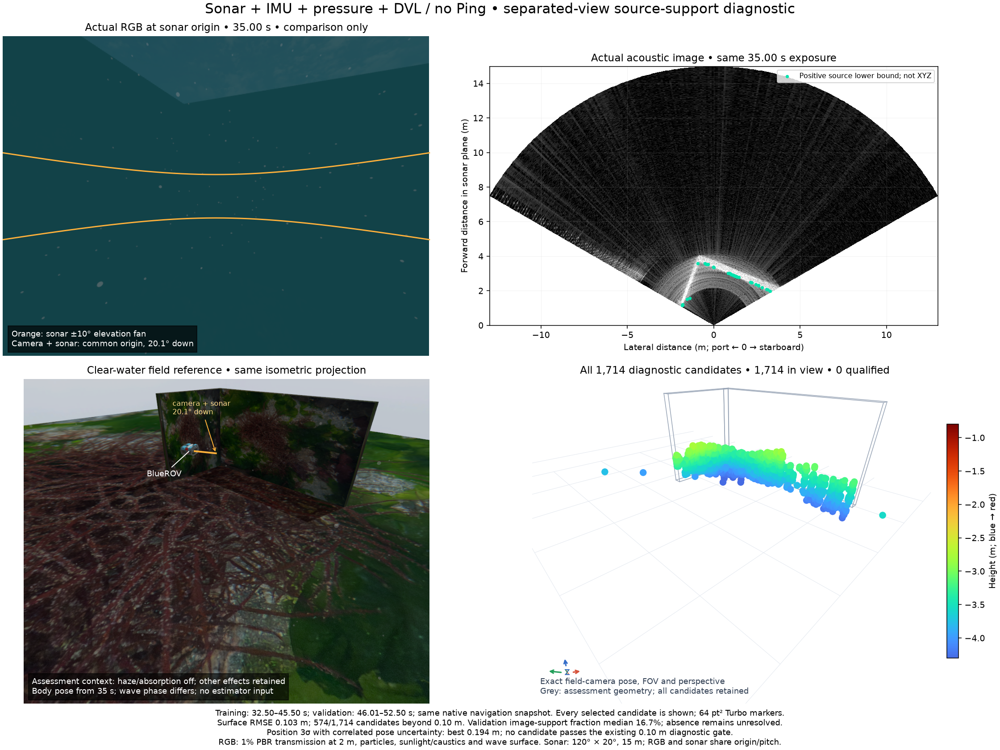

# 소나 반사 기여와 분리 관측의 기하 검증

[English](README.md)

이 기록은 [벽·모서리 입력](../sonar-wall-corner-20261030/README.md)의
**미확정** 복원 진단을 보존합니다. 소나 요인을 설치하거나 지도를 승인하거나
제품 기본값을 변경하지 않습니다. 센서 조합은 소나 + IMU + 수압 + DVL이며,
single Ping과 카메라는 추정 입력에 포함하지 않습니다.

`BeamPhaseBounds.query_image()`는 기존 조건부 진폭 상·하한을 모든 거리·빔
셀에 계산합니다. 곱셈 임시 배열은 8 MiB 이하입니다. 미지의 위상, 거리
사이드로브, 고도각과 실제 반사체의 대응 관계는 해결하지 않습니다. 거리 행과
반사 기여의 상·하한은 독립된 확률 관측이 아닙니다. 하한 0은 기여 미확정을
뜻합니다. 응답과 진폭 오차 구간은 이 시뮬레이터 설정에 대한 가정이며,
실제 장비의 보정 인증이 아닙니다.

## 전체 대조 결과

- 영상 경계 표본 26,802개 중 4,014개에서 원래 빔의 반사 기여 하한이
  양수입니다. 같은 수직 부채꼴의 실제 가시 반사까지 거리 오차 p90은
  3.76 cm이며, 전체 표본은 44.54 cm입니다. 선택된 부분집합의 비교입니다.
  양수 부분집합도 최초 기하 반사까지의 오차 p90은 257.16 cm입니다.
- 곡선 모델 509개의 미사용 빔 잔차는 작지만 368개에 대칭 해가 있습니다.
  다른 관측 시점의 예측 RMS 중앙값/p90은 14.93/141.66 cm입니다.
  조건부 교점 2,494개를 모두 보존하며, 그중 1,033개가 평가 표면에서
  10 cm 이상 떨어져 있습니다. 실패한 곡선 모델과 검사 열 개는 설치 API
  밖인 이 기록에 보존합니다.
- 모든 프레임을 이용한 명목 복원은 후보 353개의 표면 RMSE가 1.50 cm이나,
  모두 한쪽 벽에 있습니다. 차량 위치 불확실성과 미사용 검증 프레임이 없고,
  배정 20,104건이 서로 다른 시각·픽셀 키 8,378개를 공유합니다.
- 32.50–52.50 s의 제한된 native 스냅샷에서 위치·자세 추정값과 **전체 상관
  공분산**을 가져옵니다. 45.50 s까지의 프레임 27개로 후보를 생성하며,
  이후 열네 프레임은 검증에만 사용합니다. 반사 지지가 있는 후보 1,714개를
  모두 보존합니다. 표면 RMSE 10.33 cm, p90 17.50 cm, 최대 42.92 cm이며,
  574개가 10 cm를 초과합니다. 검증 영상의 반사 지지 비율 중앙값은
  16.7%입니다. 지지가 없으면 미확정이며 자유 공간 관측으로 사용하지 않습니다.
- 두 프레임씩 번갈아 나눈 두 번째 분할은 후보 1,852개를 모두 보존합니다.
  표면 RMSE는 10.19 cm이고 546개가 10 cm를 초과합니다. 검증 영상의
  반사 지지 비율 중앙값은 30.0%입니다.
- 후보별로 지지가 있는 생성 프레임을 최대 열여섯 개 등간격으로 선택하여
  선언된 우도 행을 만듭니다. 나머지 프레임은 지지 확인에 사용합니다.
  진단 오차 척도는 기존 0.0250836 m와 0.00821331 rad입니다. 상관된 차량
  위치 불확실성을 포함하면 가장 작은 위치 3σ는 두 분할에서 각각
  19.45/19.72 cm입니다. 기존 10 cm 진단 한도 안의 후보는 없습니다.
  이 국소 가우시안 계산에는 대응 관계, 고도각 분기와 응답 보정의 불확실성이
  포함되지 않습니다. 차량 위치를 서로 독립으로 취급하면 이 사례에서는
  더 큰 값이 나오므로, 상관관계를 추측해서 대체할 수 없습니다.
- 생성 관측만으로 픽셀 지지가 겹치지 않게 고른 부분집합은 391/399개입니다.
  이 후보도 미확정입니다. 중복 사용 방지만으로 실제 점의 대응 관계를
  증명하거나 분포된 반사를 단일 산란체로 만들지는 않습니다.

## 같은 시점의 비교



RGB와 소나는 35.00 s의 노출 시각, 원점과 아래 방향 20.1° 시선을 공유합니다.
주황 선은 소나의 고도각 ±10° 범위입니다. 소나 영상은 미터 단위이며 아래가
가까운 거리입니다. 녹색 표시는 반사 기여 하한이 양수인 표본입니다.
소나는 거리 15 m, 수평 빔 256개, 수직 ray 256개와 시야 120° × 20°를
사용합니다. RGB에는 2 m에서 PBR 투과율 1%, 부유 입자, 햇빛·해저 집광무늬와
수면 파도가 적용됩니다. 별도의 현장 참조는 안개·흡수를 끄고 차량 자세와
다른 효과를 유지한 렌더링이며 파도 위상은 다릅니다. 점군은 현장 참조와
같은 카메라 자세·시야·원근 투영을 사용하고, 공통 높이 범위의 파랑→빨강
Turbo와 64 pt² 점으로 표시합니다. 후보 1,714개가 모두 화면 안에 있고,
승인된 지도점은 0개입니다. 회색 형상과 정답은 사후 평가에만 사용합니다.

## 재현과 한계

Python 3.10 이상과 NumPy를 갖춘 독립 라이브러리 루트에서 실행합니다.

```sh
PYTHONPATH=src python3 docs/diagnostics/sonar-source-support-20261030/verify.py
PYTHONPATH=src python3 docs/diagnostics/sonar-source-support-20261030/test_curve_model.py
```

검증기는 두 분할의 후보 선택과 위치 주변 공분산을 다시 계산하고 모든 출력
배열을 비교합니다. 검증용 영상을 바꿔도 후보 생성이 변하지 않는지 확인하고,
픽셀 지지 중복과 후보 전체의 기하 오차를 검사합니다. 공개 라이브러리 코드와
준비된 수치 입력만 사용합니다. Gazebo 재실행, 실제 장비·모델 보정, 반사체
대응 관계, 실시간 처리와 유용한 지도 범위를 입증하지는 않습니다.
30초 전체 위치 조회와 블록 조회 시도는 기존 native 복구 작업공간을 초과하며,
실패 로그 전체는 앱 검증 기록에 남습니다. 평가한 20초 조회는 한도 안입니다.

카메라·소나·IMU·DVL·수압 원본은 외장 디스크의 기준 기록에 한 번만 보관합니다.
`data/`는 유도한 반사 지지 마스크·상하한과 같은 스냅샷의 위치 사전분포를,
`results/`는 후보 전체와 진단 부분집합을, `legacy/`는 실패한 대안을 보존합니다.
비공개 앱의 수집·렌더링·재생 구현은 이 라이브러리 기록에 포함하지 않습니다.
고정한 소스와 별도 설치한 wheel에서 각각 526개 검사를 실패 없이 실행하며,
선택 의존성 검사 열여섯 개는 명시적으로 건너뜁니다. Native 구현은 동일합니다.

다음 검증 대상은 센서만으로 정한 대응 관계와 관측 가능한 방향을 구분하는
소나 영상 쌍의 이동 제약입니다. 이를 확인한 뒤 최적화기를 확장하거나 점을
확정합니다. 유용한 3차원 지도, 항법 개선, 손실·복구와 패키지 검증은 남아 있습니다.
