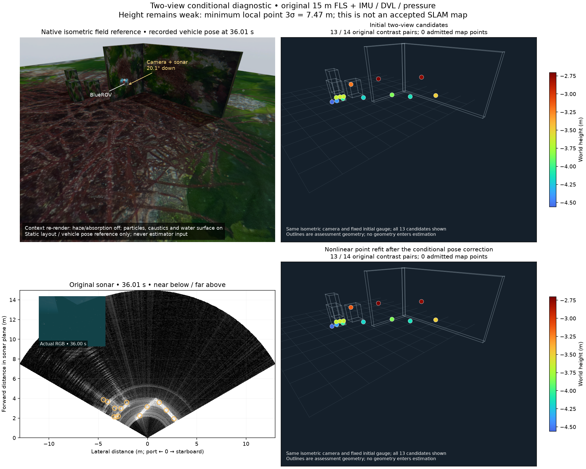

# 소나 조건부 결합과 동일 시각 DVL 대조 실험

[English](README.md)

아직 지도 품질을 승인하지 않은 수치·기록 재생 진단입니다. 네이티브 소나
결합, 지도점 승인 조건, 센서 잡음, 공급자와 제품 기본값은 바뀌지 않습니다.
[앞선 대응점 기록](../sonar-pair-correspondence-20261030/README.ko.md)은
원본 영상과 모든 후보를 보존합니다. 여기의 준비된 배열은 WWW-POSIM을
가져오지 않고 새 조건부 계산을 재현하는 데 사용합니다.

## 하나의 추정 결과에 새 관측만 결합

유한 물체 장면의 고정 구간인 35.50 / 36.01초를 사용합니다. 네이티브 재생은
앞부분 상태 108개가 원래 재생과 일치하며, 36.01초에 스냅샷 하나를 보존합니다.
두 자세의 평균, 전체 12 × 12 공분산과 두 자세 사이 상관관계를 모두 이
스냅샷에서 가져옵니다. 조회 메모리는 기존 32 MiB 제한 안의 4,976,768바이트입니다.
네이티브 정보 행렬은 열 수·계수가 모두 226이며, 조회한 자세 주변분포에는
무한 불확실성 방향이 없습니다. 원본 해시는 `pair-joint.json`에 있습니다.

`structureless.py`는 공개 POSIM-SLAM 거리·방위각 미분을 스냅샷의 고정된
왼쪽 회전 좌표로 변환합니다. 전체 측정 공분산으로 정규화한 다음, 기존
제곱근 정보 분해로 미지의 점 좌표를 제거합니다. 항법 추정은 한 번만
사용하며, 맞춰 놓은 점을 독립 사전정보로 더하지 않습니다. 독립 검증 7개는
좌표 미분, 전역 위치·회전의 6개 비관측 방향, 측정·자세의 상관관계,
전체 결합 최소제곱 계산과의 평균·공분산·점 역대입 일치, 순수 선회에서의
높이 퇴화, 빈 입력, 잘못되거나 무한한 불확실성을 검사합니다.

특징점 좌표를 영공간으로 제거하는 계산은
[OpenVINS에도 설명된 기존 방법](https://docs.openvins.com/update-null.html)입니다.
[관측 가능성 설명](https://docs.openvins.com/fej.html)은 일관되지 않은
선형화가 가짜 정보를 만드는 위험도 다룹니다. OpenVINS 코드는 복사·가져오기·
번들링하지 않습니다. 이 진단은 연속 갱신의 FEJ 일관성, 물리적 대응점이나
실제 하드웨어 잡음 모형을 승인하지 않습니다.

## 보존한 전체 결과

기존 학습 비용 경계 9와 고도각 초기값 9개를 유지합니다. 원래 25/14개
대응점, 실패한 적합, 선택 마스크와 방식별 10개 표본 모드를 모두 보존합니다.
모든 가능한 모드의 혼합을 계산한 것은 아닙니다. 두 방식은 별도 대조군이며,
서로 겹치는 원본 픽셀을 함께 결합하지 않습니다. 거리·방위각 표준편차는
0.0250836117 m / 0.00821331413 rad인 진단용 대각 가정입니다. 반향 사이의
상관관계나 하드웨어 보정을 뜻하지 않습니다. 정답 자세와 물체 형상은 별도
평가와 그림에만 사용합니다.

| 고정된 최저 비용 모드 | LK, 소스 기여 하한 | LK, 소스 대비 |
| --- | ---: | ---: |
| 원래 대응점 / 선택 | 25 / 20 | 14 / 13 |
| 상대 이동 오차 전 → 후 | 2.131 → 2.149 mm | 2.131 → 1.214 mm |
| 상대 회전 오차 전 → 후 | 0.06131 → 0.06008° | 0.06131 → 0.06032° |
| 선형 역대입 후 두 시야 안에 남은 점 | 5 / 20 | 2 / 13 |
| 점 위치의 최소 국소 3σ | 7.465 m | 7.466 m |
| 비선형 재적합 표면 RMSE | 0.2501 m | 0.1441 m |
| 별도 C 영상 일치 전 → 재적합 후 | 17 → 18 / 20 | 10 → 10 / 13 |

표본 모드 10개를 모두 평가했습니다. 자세 보정이 작아도 선형 점 보정은
물리적으로 유효하지 않을 수 있으며, 여기서는 대부분 소나 시야 밖으로
벗어났습니다. 보정된 자세에서 원래 A/B 관측을 다시 비선형 적합하면
20/13개가 물리 범위 안에 남지만, 형상과 불확실성은 유용한 지도 기준에
미치지 못합니다. 이 재적합은 별도 계산이며 조건부 점 분포의 평균이 아닙니다.
검증 C 영상에는 기록 당시 항법 평균만 사용하고 그 공분산을 B 스냅샷과
섞지 않습니다. 원래 초기 좌표 정렬을 유지하며 두 자세나 전체 궤적에 맞춰
다시 정렬하지 않습니다.



네이티브 등각 장면에는 기록된 36.01초 자세의 BlueROV가 있습니다. 후보 뷰는
같은 등각 카메라·초기 좌표 정렬·Turbo 높이 범위와 64 pt² 점 크기를 사용하며,
선택된 13개를 모두 표시합니다. 승인된 지도점은 0개입니다. 원본 RGB와 15 m
소나는 같은 원점과 아래쪽 0.35 rad 시선을 사용하며 가까운 거리를 아래에
표시합니다. RGB에는 시정 2 m, 부유물, 해저 집광무늬와 수면 효과가 있습니다.
배치를 보여 주는 별도 장면 재렌더링만 안개·흡광을 끕니다. 파도 위상은
원래 노출과 다르며 추정 입력으로 사용하지 않습니다. 시각·표시 범위는
`comparison.json`에 보존합니다.

## 원래 전체 시각을 유지한 DVL 대조군

앱 재생의 `--dvl-clock-only`는 같은 원본 DVL 표본을 검증하고 상태 이벤트
시각을 유지하되, 네이티브 DVL 패킷과 보정 정보를 전달하지 않습니다.
`--joint-dvl`과 동시에 선택할 수 없습니다. 소나 요소를 생략하는 대조군에서
DVL 결합을 강제하던 잘못된 제약도 제거합니다. 중력 초기화에는 원본 IMU를
사용하며 DVL 속도나 자세로 대체하지 않습니다.

두 전체 재생은 원본 입력, 소나 추적 바이트, 상태 시각 175개와 압력 최적화
상태 54개가 같습니다. DVL 패킷 55개를 사용하는 대조군은 원래 모든 상태
평균과 2e−9 이내에서 일치합니다. 시각만 유지하는 대조군은 DVL 패킷·
소유자 수신·최적화 상태가 모두 0개입니다.

| 오프라인 대조군 | 전체 궤적 위치 RMSE | 최대 오차 |
| --- | ---: | ---: |
| IMU + 압력 + DVL, 소나 요소 생략 | 0.013608 m | 0.024937 m |
| 동일 시각, 모든 DVL 요소 생략 | 19.223638 m | 41.582245 m |

이 기록에서 DVL의 기여를 분리한 결과입니다. 소나 개선 결과나 실제 바닥 잠금
상실·하드웨어 부재 시험은 아닙니다. 두 대조군은 명시적인 무잡음 시뮬레이터
바이어스 보정을 공유하므로 하드웨어 초기화 성능으로 일반화하지 않습니다.
재생 명령은 모두 0으로 종료하며, 작업자는 기존 대조군과 같이
`LiveClient.close`가 의도한 SIGTERM(−15)으로 종료합니다. 비공개 준비 경로의
실패와 평가 도구가 작업자 종료값을 0으로 잘못 가정한 실패도 전체 로그와
함께 보존합니다.

## 재현과 다음 검증

WWW-POSIM에서는 NumPy와 공개 컴포넌트를 사용합니다.

```sh
PYTHONPATH=libraries/posim-slam/src python3 scripts/run_checks.py docs/validation/sonar-structureless-update-20261030/test_structureless.py docs/validation/sonar-structureless-update-20261030/verify.py
```

POSIM-SLAM에서는 `PYTHONPATH=src`와 대응하는
`docs/diagnostics/sonar-structureless-update-20261030/` 경로를 사용합니다.
검증기는 조건부 결합·모든 점·동일 시각 평가 수치 204개를 비교합니다.
공유 파일은 `sha256.json`으로 묶습니다. 기록 입력은 라이브러리 `8ea4368`,
고정 네이티브 소스 `44aa93e`, Basalt
`0f3b2b52c807f70ff4e2973ce253c73329eea7bc`이며 새 네이티브 빌드는 없습니다.

원본 센서는
`/Volumes/ExternalHDD/POSIM/validation-data/posim-slam/sonar-finite-objects-20261030b/complete`에
한 벌만 유지합니다. 새 스냅샷·모드 기록과 DVL 재생은 이웃한
`sonar-structureless-update-20261030`, `sonar-dvl-ablation-20261030`에 있습니다.
원본 네이티브 재생에는 이 데이터와 기록된 SDK·작업자가 필요하며, 위의
준비된 수치 검증에는 필요하지 않습니다.

다음에는 더 긴 지속 추적과 별도 후속 관측, 실제 소나 시야 지지를 검증한 뒤
네이티브 관측식이나 XYZ 승인을 판단합니다. 같은 시각의 DVL 손실·부재 조건에서
소나의 기여를 비교하고 대표 Orca5 지형과 실제 손실·복구 시험으로 돌아갑니다.
짧은 두 영상의 한계를 감추려고 큰 시험군, 맞춘 6자유도 자세, 높이·항법
사전정보를 추가하지 않습니다. 제품·설치형 앱, VRX와 이후 WAM-V 측량 검증은
계속 남아 있습니다.
