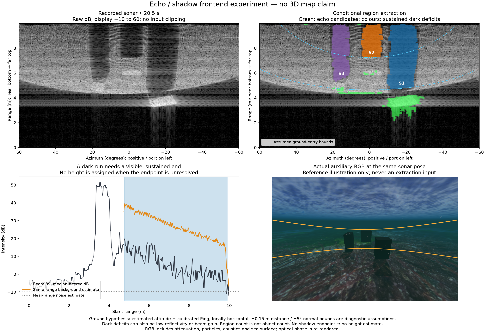
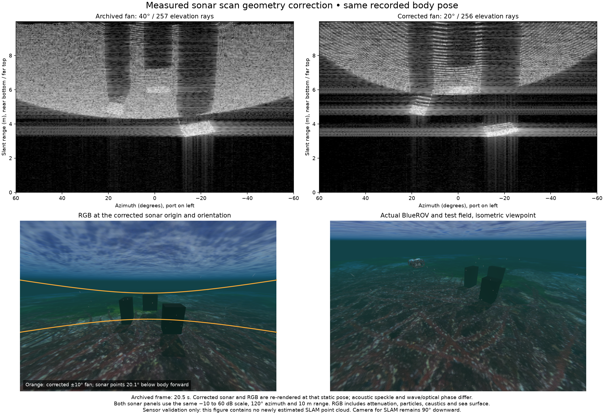

# Echo, shadow and ground-onset reconstruction

The archived 119-frame experiment uses a mismatched renderer/calibration fan
(40° actual / 20° assumed). Its region counts and timing remain recorded, but
its ground geometry is unqualified. A fitted slope can absorb this sensor error,
so low fitting residual is insufficient. [Scan check](sonar-scan-geometry.json).

보존한 119장 실험은 실제 40°·가정 20°의 시야 불일치를 포함합니다.
영역 수와 처리 시간은 당시 기록으로 남기지만 해저 기하는 검증되지 않았습니다.
평면 기울기가 센서 오차를 흡수할 수 있으므로 작은 적합 잔차만으로 통과시키지 않습니다.

The region extractor below is an offline experiment. Multi-view surface
reconstruction remains a research direction, not a qualified mapping mode.
The [measured example](measured-sonar.md) still uses intensity corners and flow.
Its four exported hypotheses do not recover the physical box surfaces.

## Findings from primary research

- [Song and Choi, 2016](https://oak.go.kr/central/journallist/journaldetail.do?article_seq=20801)
  detect object/shadow pairs relative to an estimated seabed intensity, then use
  shadow length and a Lambertian reflection model to recover elevation. They
  report underwater experiments. Their assumptions about diffuse reflection and
  limited surface interference need testing in POSIM's scene.
- [Westman, Gkioulekas and Kaess, IROS 2020](https://www.cs.cmu.edu/~kaess/pub/Westman20iros.pdf)
  reconstruct particular boundary/specular points from the change in return
  range as the sensor translates. They prefer translation along the sonar's
  vertical axis. Section III-D explicitly warns that elevation-FOV boundaries
  can create intensity discontinuities that produce false 3D points. Their
  model assumes single-bounce returns; arbitrary bright corners do not qualify.
- [Teixeira et al., IROS 2019](https://www.cs.cmu.edu/~kaess/pub/Teixeira19iros.pdf)
  jointly model echo segmentation, vehicle poses and surface elements in factor
  graphs, evaluated on ship-hull inspection data. This supports treating sonar
  measurement uncertainty and surface geometry together; its hull assumptions
  do not establish accuracy on arbitrary terrain.
- [Xie et al., 2024](https://arxiv.org/html/2404.14819v1)
  reconstruct a bathymetric height field from imaging-sonar intensity using
  neural volume rendering. The paper requires accurate navigation and describes
  the method as mostly offline; joint SLAM remains future work. It is an offline
  comparison candidate, not the initial low-resource frontend.

## Geometry to use

For a horizontal seabed, sonar altitude `h`, downward centre angle `alpha` and
vertical half-aperture `beta`, the first possible bottom intersection in the
central azimuth plane is `r_near = h / sin(alpha + beta)`, provided that ray
points down and the intersection is within range. This is a geometric prediction,
not an intensity threshold or a measured object boundary. For nonzero azimuth,
roll or sloped terrain, intersect each calibrated fan direction `u` with the
local plane: `r = -(n·S + d) / (n·u)`, retaining only positive in-range solutions.
Use estimated attitude and a local plane with uncertainty. One Ping return alone
does not determine the plane normal. Pressure gives depth relative to water, not
altitude above the seabed.

A dark-to-bright transition near that prediction can support a ground-return
classification. A closer object, weak reflectivity, gain changes, multipath or
FOV clipping can also create such transitions. Keep ground entry separate from
physical object edges. In the current example, the broad seabed onset and three
dark trails are useful candidates; their visual appearance alone does not prove
three correct object/shadow associations.

For an ideal vertical occluder on flat ground, let `D` be the horizontal distance
to its occluding top edge's ground projection, and `L` the horizontal ground
shadow length. Similar triangles give `H = h L / (D + L)`. This independent
geometric relation requires a visible shadow end, known altitude, and correct
edge pairing. Sonar range-bin differences are slant distances, not `L`. If the
shadow continues beyond the 10 m cap, retain a bound rather than inventing an
endpoint. Sloping ground and overlapping occluders invalidate this simple form.
Shadow boundaries move with viewpoint and must not be registered directly as
fixed physical landmarks.

## Recommended lightweight experiment

1. Predict a band of possible ground-entry ranges from estimated IMU attitude,
   calibrated sonar mount and a Ping-supported local surface, including uncertainty.
2. Estimate range-dependent noise/background. Extract coherent echo regions,
   following dark runs and reappearance of the background across adjacent beams.
3. Track regions and geometric edges across views. Treat echo/shadow pairing as
   a hypothesis and reject clipped or contradictory height estimates.
4. Fit surface/occluder constraints over multiple estimated poses; preserve
   elevation intervals and unknown occluded space until the data resolve them.
   FOV-induced ground boundaries provide plane constraints, not fixed point IDs.
5. Compare with the corner/flow baseline on the same recordings: physical-surface
   distance, false obstacles, coverage, height error, repeatability and CPU/memory.
   Trajectory error and point count alone cannot qualify the map.

Include empty flat ground, slopes, three boxes, varied altitude, weak reflectors,
overlapping shadows, range-clipped shadows and surface effects. Ground truth may
score these tests but must not supply frontend geometry. Record whether each
simulator effect is acoustic or optical; optical caustics are not acoustic echoes.
No external implementation, dataset or figure is imported by this research note.

## 한국어

현재 네이티브 예시는 강도 특징점과 광류를 사용합니다. 별도 영역 검출기는
오프라인 실험으로 구현되어 있으며, 다중 시점 표면 복원은 연구 제안입니다.
구현·검증 완료된 지도 모드는 아닙니다.

Song·Choi(2016)는 해저 강도를 기준으로 물체와 그림자를 검출하고 그림자 길이와
Lambert 반사 모델로 높이를 추정합니다. Westman 등(2020)은 센서 이동에 따른
반사 거리의 변화로 특정 경계·정반사점을 복원합니다. 특히 수직 시야 끝이 만든
강도 경계를 물체 경계로 오인하면 잘못된 3D 점이 생긴다고 설명합니다.
Teixeira 등(2019)은 반사 분할·자세·표면을 함께 추정하지만 검증 대상은 선체입니다.
Xie 등(2024)의 신경망 해저 복원은 정확한 항법과 주로 오프라인 처리를 전제로
하므로 저사양 실시간 프런트엔드의 첫 선택으로 삼지 않습니다.

평평한 해저의 중심 방위각에서 첫 교차 경사거리는
`r_near = h / sin(alpha + beta)`로 예측할 수 있습니다. `h`는 해저 위 고도,
`alpha`는 하향 중심각, `beta`는 수직 반시야각입니다. 기울어진 해저·차량 자세와
다른 방위각은 보정된 광선과 국소 평면의 교차로 계산합니다. 단일 Ping 관측만으로
평면 법선을 정할 수 없으며 압력 수심도 해저 위 고도와 다릅니다.

예측 부근에서 어두움이 밝음으로 바뀌면 해저 반사의 시작을 뒷받침하지만,
물체·반사율·이득·다중경로·시야 경계도 같은 변화를 만듭니다. 해저 시작점과
실제 물체 모서리를 구분해야 합니다. 현재 영상의 넓은 해저 시작 경계와 세 개의
어두운 띠는 후보이며, 눈으로 보인다는 사실만으로 대응 관계가 검증되지는 않습니다.

평평한 해저와 수직 물체를 가정하면 `H = h L / (D + L)`입니다. `D`는 가리는
상단 모서리의 해저 투영까지의 수평거리, `L`은 해저에서 잰 수평 그림자 길이입니다.
거리 빈의 차이를 그대로 `L`로 쓸 수 없습니다. 그림자가 10 m 범위 밖까지
이어지면 높이 범위만 남깁니다. 경사·중첩 가림은 단순식의 가정을 깨며,
시점에 따라 움직이는 그림자 경계를 고정 랜드마크로 등록해서는 안 됩니다.

권장 순서는 해저 시작 거리 범위 예측, 인접 빔의 반사·그림자 영역 검출,
여러 시점의 영역·기하 경계 대응, 불확실성을 포함한 표면·가림 물체 추정입니다.
가려진 공간은 미확인 상태로 보존합니다. 같은 기록에서 표면 거리·허위 장애물·
복원 범위·높이 오차·반복성·CPU/메모리를 비교해야 하며 점 수나 위치 오차만으로
통과시키지 않습니다. 평지·경사·상자·고도 변화·약한 반사·중첩 및 잘린 그림자·
수면 효과를 시험하고 참값은 평가에만 사용합니다. 광학 집광무늬와 음향 반사도
구분합니다. 이 문서는 외부 코드·데이터셋·그림을 포함하지 않습니다.

## Implemented region experiment / 구현한 영역 검출 실험

`sonar_surface.ground_entry_band` computes analytic plane/fan intersection bounds.
`segment_surface` uses raw dB, separable three-sample medians, same-range 70th
percentiles and sustained runs across at least three neighbouring beams. Echo
excess is 8 dB; shadow deficit is 10 dB. Near-range noise (0.2–1 m) sets a 12 dB
return margin. Minimum echo/shadow extent is 0.075/0.30 m; an observed shadow end
requires 0.15 m of background recovery. These are diagnostic defaults. Uniform
gain changes preserve detections; spatial beam gain and weak reflectors remain
ambiguous. A prior-mask boundary is never labelled as an observed start.

The offline replay uses exact-time estimated native attitude and calibrated Ping
with a locally horizontal hypothesis, ±0.15 m distance and ±5° normal bounds.
These are assumptions, not a fitted plane or covariance. It processes 119 frames,
skips 10 without exact pose/Ping and takes 19.70 ms median / 23.57 ms p95 for the
core frontend on the tested Mac. No simulator truth or RGB enters extraction.
At 20.5 s, three dark regions have unresolved endpoints, so no heights or 3D
points are produced. Full-record region counts vary from 0 to 12 and are not
object counts. Echo/shadow association and multi-view mapping remain unfinished.
[Evidence and parameters](sonar-surface-summary.json).

`ground_entry_band`는 평면과 전체 수직 팬의 교차 범위를 해석적으로 계산합니다.
`segment_surface`는 원본 dB, 3표본 중앙값, 같은 거리의 70분위수와 인접 3빔
이상의 연속 구간을 사용합니다. 반사 초과는 8 dB, 그림자 부족은 10 dB이며,
0.2–1 m 잡음보다 12 dB 높은 반사를 요구합니다. 최소 반사·그림자 길이는
0.075·0.30 m, 그림자 끝의 배경 회복 길이는 0.15 m입니다. 진단용 기본값이며
공간별 빔 이득·약한 반사는 아직 구분하지 못합니다. 가정한 범위 경계를 실제
관측한 시작점으로 표시하지 않습니다.

오프라인 실험은 같은 시각의 네이티브 추정 자세와 보정된 Ping, 국소 수평 해저
가정 및 ±0.15 m·±5° 범위를 사용합니다. 적합된 평면이나 공분산이 아닙니다.
119장을 처리하고 정확한 자세·Ping이 없는 10장은 건너뛰었습니다. 시험한 Mac의
핵심 처리 시간은 중앙값 19.70 ms, 95분위수 23.57 ms입니다. 참값이나 RGB는
검출에 넣지 않습니다. 20.5초의 세 어두운 영역은 끝을 확정하지 못해 높이·3D
점을 생성하지 않습니다. 전체 기록의 후보 수는 0–12개이며 물체 수가 아닙니다.
반사·그림자 대응과 다중 시점 지도 복원은 아직 완료되지 않았습니다.

## Corrected static capture / 수정한 정적 촬영

[Capture hashes / 촬영 해시](sonar-scan-comparison.json).

The right sonar image is re-rendered with the corrected 20°/256-ray fan at the
same recorded body pose. The seabed onset moves outward, as the narrower fan
predicts. RGB shares the sonar origin and orientation; orange curves are ±10°.
The overview shows the physical vehicle and targets. Speckle and optical/wave
phase differ from the archived left image. This is a static sensor check, not a
new multi-view map or an accuracy result. Corrected moving data are still needed.

오른쪽 소나는 같은 기록 자세에서 수정된 20°·256광선으로 다시 촬영했습니다.
좁아진 시야에 맞게 해저 반사 시작점이 먼 쪽으로 이동합니다. RGB는 소나와
위치·방향이 같고 주황색 경계는 ±10°입니다. 개요에 차량과 물체를 함께 표시합니다.
왼쪽 보존 영상과 스펙클·광학 효과·파도의 위상은 다릅니다. 정적 센서 검사이며
다중 시점 지도나 정확도 결과가 아닙니다. 수정된 센서의 주행 기록이 필요합니다.
