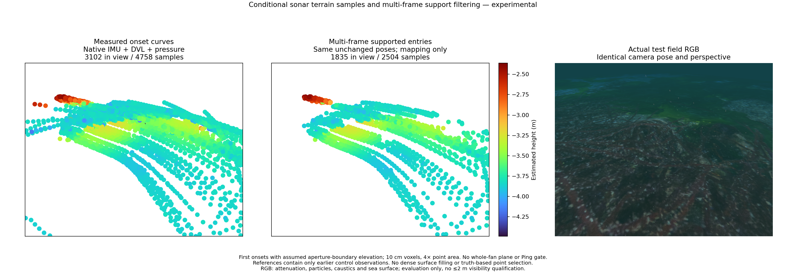
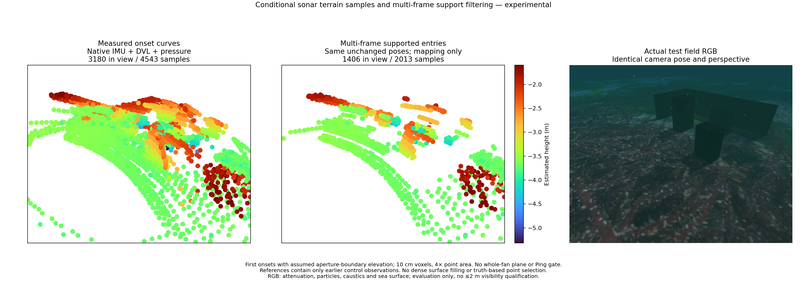
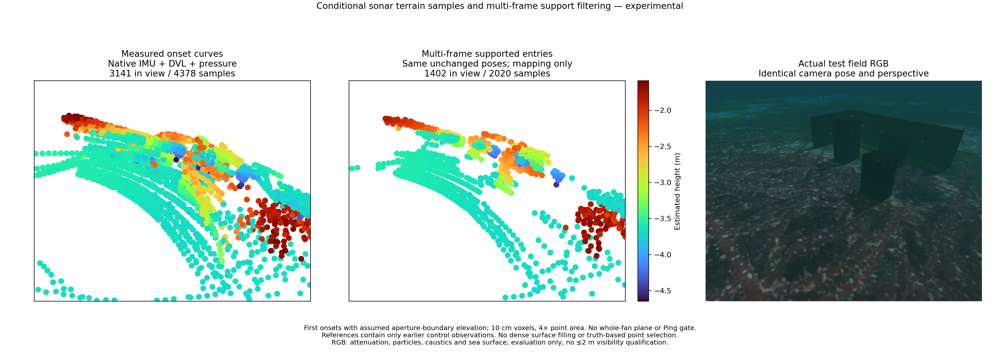

# Supported terrain samples and local registration

This experimental NumPy implementation separates conditional sonar samples, local surface support and pose registration. It is not connected to the application estimator. No new dependency or third-party code is introduced.

`ground_entry_curve` retains observed ranges and beam identifiers under an explicit aperture-boundary elevation assumption. It does not require a whole-fan plane. `surface_matches` fits local PCA planes to earlier observations, requires at least three frames, caps each frame at four neighbours, rejects line-like/nonplanar neighbourhoods, and only interpolates inside their tangent-plane convex hull. The reference holds at most 4,096 samples; a query holds at most 128.

The fixed search radius is 0.75 m, minimum tangent spread 0.05 m and surface-model scale 0.05 m. These are experimental geometric settings, not calibrated probabilistic confidence. The map filter keeps supported original samples without moving them or filling a mesh. It does not establish seabed identity when obstacles are present.

## Mapping on unchanged poses

[Measurements and settings](sonar-terrain-support.json) use the same native IMU + DVL + pressure poses, original clocks and zero RGB input. The table reports distance to the **seabed only**. A/B contain objects, so their figures do not evaluate distance to all physical surfaces. They demonstrate that local support alone is insufficient to identify ground.

| Case | Raw p90, m | Supported p90, m | Kept points |
|---|---:|---:|---:|
| A, objects | 1.441 | 1.393 | 2,013 |
| B, objects | 1.331 | 1.384 | 2,020 |
| Relief | 0.627 | 0.090 | 2,504 |

On relief, 2,269 of the 2,504 retained 10 cm voxels lie within 10 cm of the seabed. Outliers remain, and these are sparse observed curves rather than reconstructed surface area. No truth-based point selection occurs. The shared isometric camera view uses Turbo height colour and 4× marker area. RGB contains attenuation, suspended particles, caustics and sea surface, and is evaluation-only.

[Relief PLY](../data/sonar-supported-relief.ply), in the native local metric frame; experimental and unqualified.

[A PLY](../data/sonar-supported-a.ply).

[B PLY](../data/sonar-supported-b.ply).

## Registration is not adopted

Point-to-plane ICP uses Huber loss, range-normalized rotation coordinates and numerical SVD nullspace removal. A perfect plane preserves unobservable horizontal translation/yaw; a synthetic curved surface recovers a known translation. The information spectrum is conditional on selected correspondences, not a calibrated covariance. The implementation follows established [point-to-plane ICP principles](https://arxiv.org/abs/1410.7632); it is not a novel SLAM method.

Registration rematches only against previous control observations. It rejects loss of support, corrections outside the 0.375 m / 10° trust region, and reaching the ten-iteration budget without convergence. It does not silently accept a last iterate. Nine geometry/limit tests pass. The ground-curve refactor preserves every output of the existing plane frontend on all 420 frames from A/B/relief.

Only 5/142 A probes and 4/138 B probes converge; none of 140 relief probes converge within the support/trust/budget conditions. Independent corrections worsen same-stamp position RMSE from 0.04255 to 0.04309 m in A and 0.02007 to 0.02335 m in B. Relief remains 0.06992 m because no correction is admitted. These are independent probes on an unchanged control reference map, **not closed-loop fused trajectories**. A preliminary probe that treated the iteration limit as success was rejected; all 64 apparent relief successes had reached that limit.

Pose-probe figures: [A](../images/sonar-registration-a.png), [B](../images/sonar-registration-b.png), [relief](../images/sonar-registration-relief.png). Camera-free live startup, RGB visibility ≤2 m, DVL loss, reliable surface association and loop closure remain unqualified.

## Why elevation freedom alone is insufficient

A separate truth-only relief diagnostic samples 401 elevations across the full nominal sonar aperture at each observed range/bearing. It compares vertical gaps with the actual triangle-interpolated seabed. Of 7,117 onset samples, 6,083 are within 10 cm under the boundary assumption; allowing any aperture elevation brings that count to 6,307. Another 810 remain more than 10 cm above the seabed throughout the sampled arc. The p90 minimum vertical gap remains 0.667 m.

This diagnostic supplies nothing to estimation and does not model the finite azimuth beam width. It shows that simply assigning an unknown elevation cannot explain every onset on the nominal bearing. Angular beam mixing, echo selection and surface identity still need investigation; it does not isolate a single simulator or frontend fault. Multi-view association must retain range/bearing ambiguity instead of treating each onset as a fixed 3D landmark.

## 한국어

실험용 구현은 소나 시작점 곡선, 국소 표면 지지, 위치 정합을 분리합니다. 앱 추정기에는 연결하지 않았습니다. NumPy와 자체 Apache-2.0 코드만 사용하며 새 외부 의존성은 없습니다.

시작점 곡선은 실제 거리와 빔 번호를 유지하지만 높이는 수직 빔 경계라는 가정입니다. 부채꼴 전체를 평면으로 적합하지 않습니다. 국소 PCA 평면에는 과거 프레임 세 개 이상이 필요하며 프레임당 이웃 네 개, 전체 이웃 24개를 상한으로 둡니다. 선 형태·비평면 지지와 관측 영역 밖 외삽을 거부합니다. 참조는 최대 4,096점, 현재 입력은 최대 128점입니다. 탐색 반경 0.75 m, 최소 접선 방향 퍼짐 0.05 m와 표면 모델 척도 0.05 m는 실험 설정이며 보정된 확률적 신뢰도가 아닙니다.

위 표와 그림은 IMU + DVL + 수압 자세를 그대로 사용한 지도 점 선별입니다. 굴곡 지형에서 해저 거리 p90이 0.627 m에서 0.090 m로 줄고 2,504점 중 2,269점이 해저에서 10 cm 이내입니다. 이상점이 남으며 점의 수는 복원한 표면 면적을 뜻하지 않습니다. A/B는 장애물이 있는 장면이며 지표는 해저까지 거리만 측정합니다. 이 결과는 국소 지지만으로 해저를 식별할 수 없음을 보여 줍니다. 실제 물체 전체에 대한 표면 오차로 해석하면 안 됩니다. 점을 이동하거나 지형을 채우지 않았고 실제 지형으로 점을 선별하지 않습니다.

그림의 두 점군과 RGB는 같은 등각 방향 원근, Turbo 높이 색상과 4배 점 면적을 사용합니다. RGB에는 감쇠·부유입자·집광무늬·수면이 포함되며 평가에만 사용합니다. PLY는 미터 단위의 네이티브 로컬 좌표계이고 검증된 지도가 아닙니다.

점-평면 ICP는 Huber 손실과 SVD를 사용합니다. 완전한 평면에서는 수평 이동·방향의 관측 불가능성을 유지하며 합성 굴곡 지형에서는 알려진 이동을 복원합니다. 대응점 조건부 정보값을 보정된 자세 공분산으로 사용하지 않습니다. 0.375 m·10° 범위를 벗어나거나 지지를 잃거나 10회 내 수렴하지 않으면 보정을 거부합니다. 기하·자원 제한 시험 아홉 개를 통과했고, 기존 평면 추출기 출력은 세 기록의 420프레임에서 완전히 같습니다.

A에서는 142회 중 5회, B에서는 138회 중 4회만 수렴했습니다. 개별 보정을 적용한 위치 RMSE는 각각 0.04255→0.04309 m, 0.02007→0.02335 m로 악화됩니다. 굴곡 지형의 140회는 모두 지지·보정 범위·반복 제한 조건에서 거부되어 0.06992 m를 유지합니다. 이전 제어 자세로 만든 참조에 대한 독립 보정 시험이며 폐루프 융합 궤적이 아닙니다. 초기 시험에서 성공으로 처리됐던 굴곡 지형 64회는 모두 반복 제한 도달 상태여서 채택하지 않았습니다.

실제 자세와 지형을 평가에만 사용한 별도 분석은 명목 방위각에서 수직각 401개를 확인합니다. 7,117개 시작점 중 빔 경계 가정에서는 6,083개, 전체 수직각을 허용하면 6,307개가 해저의 10 cm 이내입니다. 나머지 810개는 표본화한 수직각 전체에서 해저보다 10 cm 넘게 위에 있습니다. 최소 수직 간격 p90도 0.667 m입니다. 유한한 수평 빔 폭은 분석에 포함하지 않았습니다. 높이각 자유도만 추가해서 모든 시작점을 설명할 수는 없으며, 각도별 빔 혼합·반사 선택·표면 식별을 함께 검토해야 합니다. 이 결과만으로 특정 오류 하나를 원인으로 단정하지 않습니다.

RGB 없는 실제 앱 시작, 가시거리 2 m 이하, DVL 손실, 신뢰할 수 있는 지형 대응과 루프 폐쇄는 아직 검증되지 않았습니다. 기본 추정기·센서 임계값은 바꾸지 않았으며 연구 신규성을 주장하지 않습니다.
