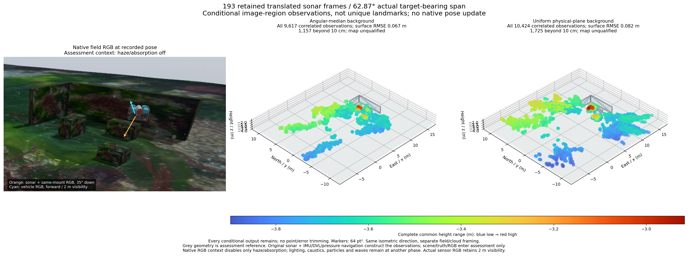
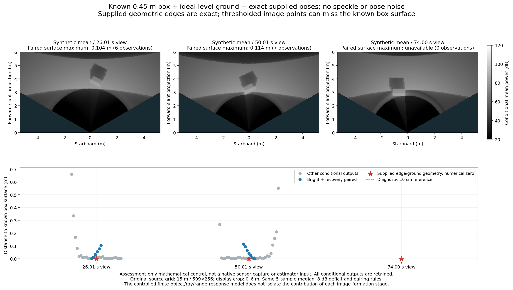

# Shadow-boundary measurements across translated views

[한국어](README.ko.md)

This diagnostic reuses all 193 original frames and the 286 IMU/DVL/pressure
navigation states from the [translated inspection](../sonar-translated-view-20261031/README.md).
It tests the existing image-region interpretation before another native factor.
It changes no recorded input, sensor setting, SDK, noise or map admission rule.



The angular-median background produces **9,617** conditional observations with
0.06669 m complete surface RMSE and **1,157** beyond the diagnostic 10 cm cutoff.
The uniform physical-plane background produces **10,424**, with 0.08219 m RMSE
and **1,725** beyond 10 cm. All observations remain in the complete PLYs:
[angular median](angular_median-all.ply), [physical plane](physical_plane-all.ply).
These are correlated observation hypotheses, not unique reconstructed landmarks.
Small nearest-surface error alone does not establish physical identity or SLAM.

Bright-before/dark/recovery pairing selects 1,005/534 observations, with
0.04789/0.05637 m RMSE and 60/47 errors above 10 cm. Their frames span
62.69°/60.64° around the first block in the separate assessment. Pairing does
not identify a common physical point across those views. All other outputs
remain; the two backgrounds emit different populations and neither is an
accepted improvement. Navigation remains the same 0.04791 m baseline; no
acoustic update is applied by this diagnostic.

## Construction and actual inputs

The existing continuous finite-cone mean fit supplies 96 pose-supported DVL
planes from 97 packets. One early DVL packet has no native pose. Each sonar
frame uses only an earlier plane at most 1.01 s old; two startup frames remain
unsupported. Original DVL range variance is unavailable. The static calibration
record does not qualify this moving, nonplanar extrapolation or shared pose
uncertainty.

Both controls retain the same five-sample median, 8 dB deficit, three-sample/
three-beam/minimum-area rules and 0.15 m bright/recovery flanks. The physical
background uses the public source-profile finite-surface power operator and
one fitted common log-power gain. A dark component is not proof of occlusion.
The collinearity formula requires an actual corresponding occluding edge and
ground-shadow endpoint; thresholded pixel boundaries do not certify that pair.

The 15 m / 599×256 source, 256 vertical rays and explicit 35° inspection mount
remain unchanged. IMU, pressure and DVL are original streams; Ping is absent.
The RGB field reference is the same native render as the parent record, with
only haze/absorption disabled. Lighting, caustics, particles and waves remain at
a different phase. Actual sensor RGB retains 2 m visibility and is not input.
Vehicle/sonar/camera directions, full common height range, blue-to-red Turbo
colours and 64 pt² markers accompany every output. The grey mesh is assessment
reference. Scene, RGB and pose truth are excluded from recorded construction.

## Known-geometry mean-image control



A separate mathematical control supplies one known 0.45 m box, an ideal level
plane and exact poses at three preselected viewing times. The conditional mean
contains no speckle or pose noise. It is not a native sensor capture or an
estimator input. All twelve supplied geometric edge/ground pairs recover their
known corners to floating-point precision.

The mean operator uses ideal intersections/normals and excludes native
rasterization, source normal estimation and multipath. This mathematical
control does not calibrate the native renderer or a commercial sonar.

Applying the original image-boundary rules to those mean images emits 74
conditional points, including 13 paired points; the third view has no paired
height. Two paired points lie more than 10 cm outside the known box surface
(maximum 0.11406 m). The complete 74-point control has ten such errors and a
0.66153 m maximum. The paired height medians are 0.38482/0.38991 m; these are
descriptive edge-point statistics, not estimates of maximum object height.
Surface distance provides the independent geometry check.

A 2×2 counterfactual removes cross-beam mixing and/or the median operation in
the mathematical model only. It retains the range response and original ray/
range grid. The two views still retain a paired surface error above 10 cm in
each case; the third remains unavailable. Disabling either stage does not
repair the observation definition. These controls do not isolate every
contribution from finite aperture, range response, silhouette shape or pairing.
They do not authorize changing real sensor physics or the recorded detector.

The next observation model must predict finite-object/ground power and
visibility, retaining unresolved elevation and correlated range/plane/pose
uncertainty. A fixed height correction or another fixed-XYZ interpretation is
not established by this result. Public `SurfacePowerModel` and the existing
joint surface transport are the starting implementations; native promotion
still needs held-out physical support and actual DVL-loss/absence benefit.

## Preservation and reproduction

Source integration remains `ffecee9b`, with POSIM #6/#31–36 included and
unmerged. Capture application `06ad1d2b` and library `7f485964` remain the
acquisition identities. Public helpers are selected at `dcdbda2`; actual private
producer hashes are retained without copying application implementations.
The parent record supplies the original source/binary traces, complete raw
inventory, terrain/Orca5 asset provenance and third-party notices.

Large JSON is losslessly gzip/XZ compressed with exact original byte hashes.
All regions, unavailable cases, point metadata, complete PLYs and assessments
remain. Full raw input stays once externally; three original frames are in this
portable record. With POSIM-SLAM and its diagnostic dependencies installed:

```sh
python docs/diagnostics/sonar-translated-shadow-20261031/verify.py
# Also re-extract every original frame from the retained canonical input:
python docs/diagnostics/sonar-translated-shadow-20261031/verify.py --raw-root /path/to/record/inputs
```

The verifier recomputes every plane, point/error and complete PLY, selected
raw extraction, every ideal-model intervention and all twelve exact-edge
witnesses. It does not reacquire sensors or rerun native navigation. No map,
physical correspondence, joint uncertainty, navigation benefit or installed
acceptance is claimed.

`render.py` redraws both figures from the public data with optional Matplotlib
and Pillow. The ideal mean images are regenerated from their supplied geometry.
