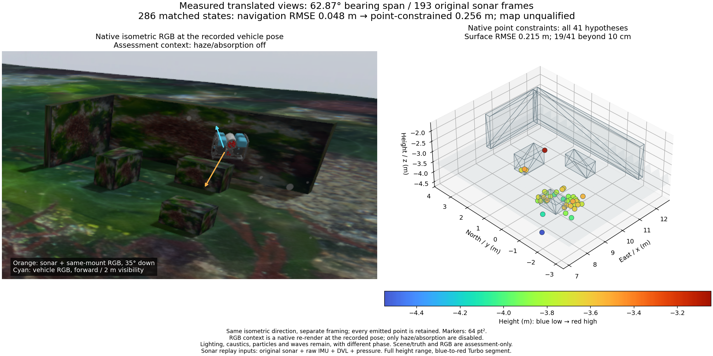
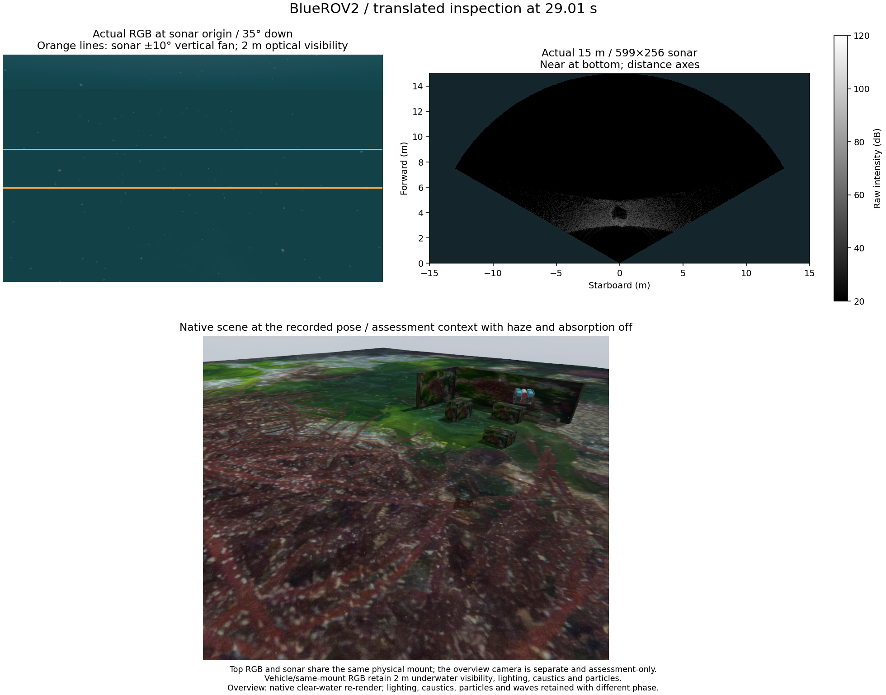

# Translated sonar views and complete failed-map control

[한국어](README.ko.md)

This diagnostic records an actual BlueROV2 lateral inspection beside the three
grounded blocks and L wall. It tests whether a wider physical viewing baseline
resolves the earlier narrow-view result. It retains every emitted point.



The source moves through **62.87° of target viewing bearing**, measured from
recorded body poses and the actual sonar lever arm. Of 193 original sonar
frames, 114 lie in the planned inspection corridor; the target centre is in the
fan in 113 and the complete top/flat-ground shadow design envelope in 106.
This geometric support does not establish persistent physical reflector identity.

Both native replays use the same 286 state times, raw IMU, pressure and DVL
velocity, with the existing unknown-bias initialization. Navigation position
RMSE is **0.04791 m**. Adding existing intensity-track fixed-point constraints
worsens it to **0.25628 m**. All 41 emitted hypotheses remain in
[the original local-frame PLY](native-map.ply) and
[the assessment-aligned PLY](world-aligned-assessment.ply).
Their complete surface RMSE is **0.21467 m**, maximum **0.87659 m**;
**19/41** exceed the diagnostic 10 cm cutoff. No map is accepted.
The cutoff describes this record; it is not a universal marine SLAM standard.

## Sensors, operation and figure



The original 15 m sonar contains 599 range cells × 256 beams, 256 vertical
rays, a 120° × 20° fan, 700 kHz and a 2 Hz configured rate. An explicit
**35° downward inspection mount** and six target-facing lateral waypoints at
1.5 m depth change this trial's operation; product defaults remain unchanged.
The actual pressure, IMU and DVL streams are retained. DVL reports bottom lock
throughout these 97 packets. Single Ping is physically absent. The 0.01 s
physics step produces 100 Hz recorded IMU samples despite its 1,000 Hz sensor
declaration; no resampling supplies missing measurements.

The top RGB and sonar share the same physical mount. They are separated by at
most 10 ms. RGB keeps **2 m underwater visibility**, lighting, stronger caustics
and particles. The bottom overview and the cloud comparison use a separately
labelled native context render at the recorded pose, with only haze/absorption
disabled. Lighting, caustics, particles and waves remain, at a different phase.
[The original foggy overview](sensor-comparison-recorded.png) is also retained.
The cyan arrow is the actual forward vehicle RGB camera; orange is the sonar
and same-mount assessment RGB. The same isometric direction, full height range,
blue-to-red Turbo colours and 64 pt² markers expose every cloud point.
No RGB, scene mesh or pose truth enters either sonar replay.

The mission uses simulated Gazebo external navigation. Native terrain planning
reports 1.739 m minimum clearance; separate continuous box checks give 2.964 m
minimum centreline clearance against a 0.5 m body envelope. The field host exits
with code 0, no forced shutdown and no surviving member in its four owned
process groups. Native replay drivers complete successfully after all state
acknowledgements; their existing client close terminates each worker with
SIGTERM (**−15**). Normal-zero-exit native replay lifecycle is not qualified.

## Sources, preservation and reproduction

Capture application `06ad1d2b`, public library `7f485964` and acoustic integration
`ffecee9b` remain the acquisition identities. Every current POSIM #6/#31–36 head
is an ancestor of that integration and remains unmerged. Actual loaded acoustic
library hashes and dyld trace lines are retained. Analysis application
`1e9cb573` corrects common source-layout resolution and hashes the imported
package rather than a guessed checkout. The original reporting failure retains
all 286 states and its map. Corrected replay output is numerically identical
to those original navigation states. A separate earlier pre-mission fixture
failure and its raw files remain externally. These are data/provenance fixes,
not changes to the estimator, sensor noise, admission or installed SDK.

The bounded record includes every-frame audits, complete replay receipts,
component/tool hashes, every trajectory state, every point assessment and
selected original sensor NPZ files. Complete raw input remains once on the
external disk at the location in `source-identity.json`; `raw-input-hashes.json`
identifies all files. Large JSON uses deterministic lossless gzip with original
byte hashes in `data-identities.json`. Scene geometry is shared with the
[earlier inspection record](../sonar-inspection-scene-20261031/README.md),
including its asset provenance and third-party notices. No private application
implementation is included in this public record.

With POSIM-SLAM installed and NumPy available, run:

```sh
python docs/diagnostics/sonar-translated-view-20261031/verify.py
```

The verifier recomputes all state/point errors and actual viewing-bearing span
using public helpers. It verifies retained files and original replay equality;
it does not rerun native estimation or reacquire the world. The wider baseline
alone does not repair the existing point model. Next evaluate persistent
physical regions, edges/occlusion and a shared surface observation on this same
record, retaining unresolved elevation and range/plane/pose uncertainty. An
additional fixed-XYZ patch or adjusted noise threshold is not justified by this
result. Useful mapping, physical DVL loss/absence benefit, independent scenes
and application/platform acceptance remain open.
