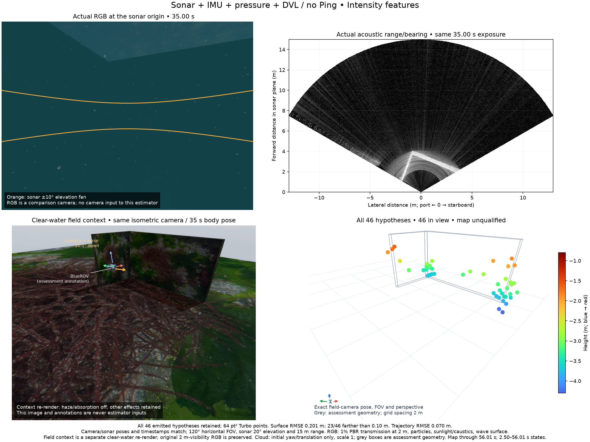

# Wall/corner operating-geometry and point-identity control

A short source-bound BlueROV2/ArduPilot run completes a 12.99 m physical path
with 49.24° heading span, lateral motion and a commanded 0.5 m depth change.
Two perpendicular walls and a flat floor isolate geometry. The real collision
floor and the owned navigation grid both have a −4 m top; space outside the
40 × 40 m floor remains unknown to the planner. Existing route/body-clearance
limits remain unchanged. The minimum planned clearance is 1.2 m.

The diagnostic camera shares the sonar's origin, 20.1° downward pitch and 120°
horizontal FOV. The sonar uses the 15 m preset, 256 horizontal beams and 256
vertical rays at 2 Hz; raw bins end at 14.974916 m. Ping is physically absent.
All 110 sonar frames, 276 RGB frames, 5,521 raw IMU samples, 55 DVL reports,
552 pressure samples and 56 field-camera frames are retained. Callback errors
are zero. Acquisition and context rendering exit normally without escalation;
every owned acquisition group becomes empty. The original 15 m regression
record is untouched. New raw inputs, including both setup failures, live once
at the external paths and checksums in `data-pointer.json`.

## Same-record controls

All three completed replays retain the same 177 state timestamps, original
sensor values, mounting, noise densities/random walks and sixteen-state budget.
RGB and simulator truth are excluded from estimation. Initial yaw and
translation alone align assessment; scale is one and roll/pitch errors remain.

- **Explicit initial calibration, IMU/DVL/pressure:** position RMSE 1.5644 cm;
  rotation RMSE 0.1072°. The optional native surface owner consumes only the
  generated noiseless-model bias certificate. At 52.5 s its local position 3σ
  major axis is still 15.09 cm and rotation 3σ is 3.69°. Small mean error does
  not qualify map uncertainty or general initialization readiness.
- **Generic initial bias prior, IMU/DVL/pressure:** position RMSE 3.0899 cm;
  rotation RMSE 1.0626°.
- **The same generic-prior profile plus intensity point factors:** position
  RMSE 7.0351 cm; rotation RMSE 0.7556°. All 46 emitted hypotheses remain.
  Surface RMSE/p90/max are 20.13/33.70/62.83 cm; 23/46 lie farther than 10 cm
  from the nearest assessed floor/wall surface. This is a failed map control.

The two generic-prior controls isolate the point-factor effect. The calibrated
navigation profile is a separate comparison: its native surface-owner contract
rejects legacy point snapshots as `worker_sonar_snapshot_unsupported`. That
three-state failed replay is retained; neither the capability guard nor its
reported failure is suppressed. No conclusion is based on comparing different
bias profiles as though only the point factors changed. Completed offline
clients close with SIGTERM; this is separate from normal-zero acquisition.

A post-estimation diagnostic refits every one of the 46 submitted histories
while conditioning on independent truth poses. Range RMS median/p90 is
1.45/5.94 cm, but fitted surface-error p90 is still 30.90 cm. Eleven fits leave
the vertical fan; every optimistic point 3σ major axis exceeds 10 cm. This
shows that better navigation alone does not resolve the retained point model.
A successful residual fit also does not establish physical reflector identity.
Truth enters only this assessment after native replay has finished.

## Matched views

RGB and sonar have the exact same 35.00 s exposure, sensor origin and mounting.
RGB contains 1% scene transmission at 2 m, suspended particles, sunlight/caustics
and wave water. Orange curves show the sonar elevation fan. Sonar uses lateral
and forward distances, with near at the bottom. The field context freezes the
recorded 35 s body pose in a separate render with haze/absorption disabled;
other effects remain and its wave phase is separate. The original foggy field
frame remains in the raw record. The point panel uses the exact context-camera
pose, perspective and FOV. All 46 points are in view, with 64 pt² Turbo markers;
grey geometry and the 2 m grid are assessment annotations. The cloud spans the
complete 2.50–56.01 s replay. No point is removed or relabelled an accepted map.
Orca5 vehicle/texture and Google Turbo attribution remain in the
[third-party notices](https://github.com/IOES-Lab/POSIM-SLAM/blob/44aa93edb8a1fc8b914b762c67639f14ffdf23f8/THIRD_PARTY.md).

## Sources, failures and reproduction

POSIM-SLAM implementation is `44aa93e`; Basalt is pinned at
`0f3b2b52c807f70ff4e2973ce253c73329eea7bc`. Native source and binary identity
match the preceding initial-calibration worker. The selected engine main is
`8c47601`; acoustic integration `867d214` supplies the separately checked
system/rendering binaries. The development SDK's base is `332f629`, with the
recorded custom-sensor, plugin-loader and underwater overrides. This is not
qualification of an updated installed SDK/provider or a general product run.
The two initial setups fail before mission start: a hold below the existing
three-second API minimum, then an unchanged Orca5 navigation grid under the
new flat physical floor. Their raw data, HTTP reasons and normal shutdowns
remain in `prior-attempts/`. The final fixture makes both floors consistent
without changing production routing or admission policy.

With NumPy installed, run `python verify.py` in this directory. It independently
checks every complete trajectory, all 46 surface distances, the fitted range/
azimuth residuals, optimistic information bounds, fan failures, timestamps and
shutdown receipts. It imports no application modules and needs no simulator.
Compressed events, complete frontend/submitted histories, snapshots, emitted
points and all measured failures remain. This verifier reproduces the retained
assessment; it does not certify sensor noise, hardware accuracy or a map.

## Next decision

Preserve these controls. Compare surface/edge or sonar-pair observations with
explicitly unobserved elevation before adding optimizer constraints. Separate
forward-looking wall returns from the DVL floor instead of forcing a shared
plane. Require sensor-only association, original support, declared noise and
complete error distributions. Do not use truth or fitted diagnostic points as
estimator inputs. Useful 3D mapping, live throughput, matching providers,
installed recovery/export, BlueROV/product/VRX acceptance and the later WAM-V
survey remain open. This is a standard observability/association diagnostic,
not an academic novelty claim.

한국어: 실제 회전·횡이동·수심 변경을 포함한 짧은 벽·모서리 시험입니다.
보정된 항법 RMSE는 1.56 cm입니다. 동일한 일반 초기 바이어스 조건에서는
소나 점 제약을 넣으면 3.09 cm에서 7.04 cm로 커집니다. 46점을 모두 평가했고
23점이 표면에서 10 cm 넘게 벗어납니다. 정답 자세를 사용하는 사후 진단도
고도각의 불확실성을 해소하지 못합니다. 점 제약을 더 보정하기 전에 벽·바닥의
관측 모델과 물리적 대응을 점검합니다. 원본·실패·기존 기준을 모두 보존합니다.
