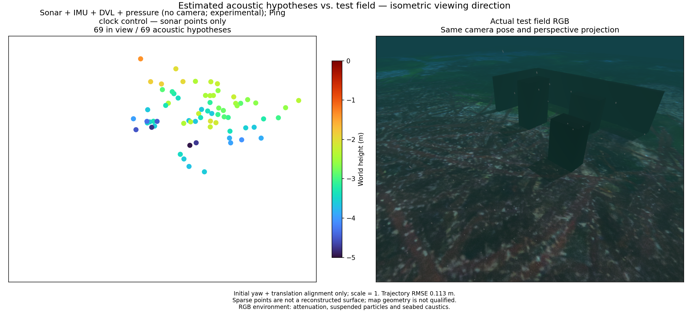
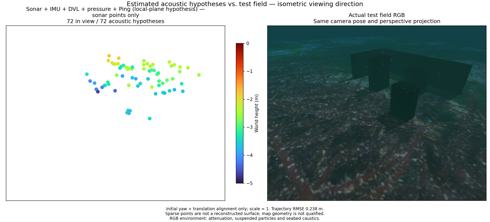

# Local Ping planes / 국소 Ping 평면

[Metrics and hashes](terrain-ping.json) · [Native contract](../../native/basalt/README.md#camera-free-local-ping-planes--카메라-없는-국소-ping-평면)

This experiment adds unknown local planes constrained by original downward Ping
ranges to camera-free sonar + IMU + DVL + pressure. It has no FLS point-to-plane
associations, terrain loop closures or terrain-map export. The simulator mesh
and poses are evaluation-only. A horizontal normal is a numerical seed, with no
normal/height prior. Local planarity is an explicit assumption, not a measured
surface identity. The mode remains off by default and outside the app selector.

이 실험은 카메라 없는 소나·IMU·DVL·수압 추정기에 원본 하향 Ping 거리로
제약하는 미지 국소 평면을 추가합니다. 전방 소나 점과 평면의 연결, 지형 루프
폐쇄, 지형 지도 내보내기는 없습니다. 시뮬레이터 메시와 자세는 평가에만 씁니다.
수평 법선은 계산 시작값이며 법선·높이 사전 제약은 없습니다. 국소 평면은 명시적
가정이며 관측 대상의 동일성을 입증하지 않습니다. 기본값은 꺼짐이며 앱 선택기와
연결되지 않습니다.

## Matched recordings / 같은 기록의 대조

A lasts 64.5 s; B lasts 67 s with a different depth and outbound distance. Each
control/plane pair has identical raw inputs, native binary, measured frontend
trace and state times (220/218). No camera frames enter either estimator. Both
retain the 0.5 s original-Ping clock; only plane mode inserts its ranges. Pose
alignment uses initial yaw/translation, fixed scale 1, with no trajectory fit.
Point distance is to physical collision surfaces; it does not establish correct
scatterer identity or area coverage. All six variants have zero duplicate
original sonar source/timestamp measurements in an independent ownership audit.

A는 64.5초, B는 수심과 전진 거리를 바꾼 67초 기록입니다. 각 대조군/평면 쌍은
원본 입력·네이티브 바이너리·영상 추적 결과·상태 시각(220/218개)이 같습니다.
카메라 영상은 추정기에 들어가지 않습니다. 두 모드 모두 0.5초 간격으로 선택한
원본 Ping 시각을 유지하고 평면 모드만 거리를 사용합니다. 초기 요각·이동만
정렬하며 축척은 1입니다. 표면 거리는 물리 충돌면까지의 거리이며 반사점 동일성이나
면적 복원을 증명하지 않습니다. 독립 감사에서 여섯 결과 모두 원본 소나 관측의
중복 반영은 0건입니다.

| Path | Variant | Position RMSE (m) | Attitude RMSE (°) | Points within 10 cm / total | Surface p90 (m) |
|---|---|---:|---:|---:|---:|
| A | control | 0.113 | 1.10 | 41/69 | 0.486 |
| A | undamped | 0.692 | 3.52 | 4/12 | 0.731 |
| A | plane | 0.200 | 1.19 | 23/45 | 0.426 |
| B | control | 0.200 | 3.51 | 44/73 | 0.358 |
| B | undamped | 0.884 | 2.91 | 3/25 | 0.613 |
| B | plane | 0.238 | 2.60 | 45/72 | 0.251 |

`control`: Ping clocks only. `undamped`: preserved failed plane experiment.
`plane`: eliminated nuisance increments also receive LM damping. Damping is
removed from marginal-prior rows. The initialization correction excludes empty
0-second IMU placeholders for every mode; the first DVL observation can update
velocity immediately.

`control`은 Ping 시각만 유지하는 대조군, `undamped`는 보존한 실패 실험,
`plane`은 소거되는 평면·특징점 증분에도 LM 감쇠를 적용한 결과입니다. 주변화에는
감쇠를 넣지 않습니다. 모든 모드에서 길이 0초의 IMU 초기화 임시 구간을 제외하며
첫 DVL 관측부터 속도를 갱신합니다.

**Neither recording demonstrates a successful terrain-aided map.** Damped
planes reduce surface p90 against control, but worsen position RMSE on both
paths and reduce A's supported point count. Surface distance alone cannot be
used to accept the method. The 0.03 m return/model sigma, 0.75 m origin radius,
2 s age and 5-sigma innovation gate are diagnostic assumptions, not calibrated
uncertainty or proof of planarity. A flat bottom supplies no horizontal/yaw
information; straight motion leaves cross-track slope unobserved. Plane ranks
are conditional on pose estimates. The frozen flat-reference Jacobians and
weak plane associations limit this experiment; camera-free operation alone
does not establish reliable high-turbidity navigation.

**두 기록 모두 지형 보조 지도 생성에 성공했다고 볼 수 없습니다.** 감쇠를
적용하면 대조군보다 표면 거리 p90은 줄지만 두 경로 모두 위치 RMSE가 나빠지고
A의 표면 근처 점 수도 줄어듭니다. 표면 거리만으로 합격시킬 수 없습니다.
0.03 m 거리/모델 시그마, 0.75 m 원점 반경, 2초, 5시그마 잔차 문턱은 진단 가정입니다.
평탄한 바닥은 수평 이동·요각 정보를 주지 않으며 직선 이동으로는 횡방향 경사를
알 수 없습니다. 평면 랭크는 자세 추정값을 고정한 조건부 값입니다. 수평 기준에
고정된 야코비안과 약한 평면 연결이 한계입니다. 카메라 없는 실행만으로 고탁도
항법 신뢰성이 입증되지는 않습니다.

## Field/map comparison / 현장·점군 비교

Both panels share the camera pose and perspective. Points use Turbo height
colour and 64 pt² marker area (4× the initial comparison). RGB is a static
scene reference captured after the mission; attenuation, particles, caustics
and sea surface are enabled, with the optical phase re-rendered. It is not a
2 m visibility acceptance run. No plane surface is drawn as recovered terrain.

두 패널은 카메라 위치·방향과 원근 투영을 공유합니다. 점은 Turbo 높이 색상과
64 pt² 면적(최초 비교의 4배)으로 표시합니다. RGB는 임무 뒤 촬영한 정적 장면
참조이며 감쇠·입자·집광무늬·수면이 켜져 있고 광학 효과 위상은 다시 렌더링합니다.
가시거리 2 m 합격 시험은 아닙니다. 추정 평면을 복원 지형처럼 그리지 않습니다.

## Research direction / 연구 방향

Known-map terrain-aided navigation matches measured bathymetry to an existing
map. Map-free bathymetric SLAM must estimate terrain and pose together. FLS
lacks per-pixel elevation; adding vertical simulator rays does not expose those
rays to the estimator. [Wang, Shan and Englot (ICRA 2019)](https://personal.stevens.edu/~benglot/Wang_ICRA_2019.pdf)
combine FLS tracking with GP terrain smoothness factors. This is relevant prior
art for jointly constraining sonar elevations, not evidence that this local
Ping experiment implements that method. Next qualification requires physical
FLS terrain association, uncertain surface support, flat/repeated/relief scenes,
and initialization with camera visibility limited to 2 m or no camera at all.

기존 지도를 쓰는 TAN은 관측 수심을 지도에 맞춥니다. 지도 없는 bathymetric
SLAM은 지형과 위치를 함께 추정해야 합니다. 전방 영상 소나에는 픽셀별 고각이
없으며 시뮬레이터 수직 광선을 늘려도 추정기가 그 광선을 직접 받지는 않습니다.
Wang 등의 ICRA 2019 연구는 전방 소나 추적과 GP 지형 평활 제약을 결합합니다.
이는 소나 높이를 공동 제약하는 관련 선행연구이며 이번 Ping 실험이 그 방법을
구현했다는 뜻은 아닙니다. 다음 검증에는 물리적으로 타당한 소나·지형 연결,
불확실한 표면 지지, 평지·반복 지형·굴곡 지형, 가시거리 2 m 또는 카메라 없는
초기화가 필요합니다.
