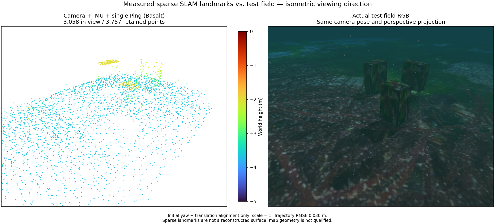

# Two-lane survey and surface proximity

Camera + raw IMU + single Ping uses Basalt revision
`0f3b2b52c807f70ff4e2973ce253c73329eea7bc`. A 1.5 m initial dive precedes
survey legs at depth 1.2 m, separated by 3.2 m over a 7 m length. Geographic
waypoints are derived from the controller preview's start and heading, not
from known object coordinates. The mission completes during the 90-second
recording; position RMSE is 0.030266 m, maximum error 0.054064 m. Export
contains 3,757 points; 3,058 are visible below. Recovery, export and clean
process shutdown pass. Map geometry remains unqualified.

The actual RGB and PCL use the same isometric viewing direction and perspective
projection. Underwater attenuation, particles and caustics remain enabled.
Alignment uses initial yaw and translation with scale fixed to 1.

The surface diagnostic samples each physical box face at 49 positions.
It reports samples inside the camera frustum and facing it on at least three
recorded poses, then counts samples within 0.1 m of any exported point.
This is proximity only: visibility omits terrain/object occlusion, edge samples
can be close to adjacent faces, and proximity does not prove correspondence,
precision, dense surfaces or sensor accuracy. No map acceptance flag is enabled.

For target 2, the -y/+y faces have 29/47 and 32/45 observed samples near a map
point. Those faces are not observed on the straight reference route. Its top
face has only 5/30 near samples, compared with 42/49 in that reference. Better
coverage in one direction does not imply complete recovery. The reference and
two-lane routes also differ in depth and duration and are independent runs;
this is not an isolated causal estimate of lane width.

## 한국어

위 Basalt 리비전으로 카메라·원시 IMU·단일 Ping을 처리합니다. 1.5 m 초기
잠항 후 깊이 1.2 m에서 길이 7 m, 간격 3.2 m의 두 경로를 이동합니다.
경로는 제어기의 미리보기 출발점과 진행 방향으로 만들며 표적 정답 위치를
사용하지 않습니다. 90초 기록 안에 임무를 완료했고 위치 RMSE 0.030266 m,
최대 오차 0.054064 m입니다. 3,757점을 저장했으며 비교 화면에는 3,058점이
보입니다. 복구·다운로드·정상 종료를 확인했지만 지도 형상은 미검증입니다.

RGB와 점군은 같은 등각 관찰 방향의 원근 투영을 사용합니다. 수중 감쇠·입자·
해저 집광무늬를 유지하며, 축척 1에서 초기 요각과 평행이동만 정렬합니다.

표면 진단은 상자 각 면의 49개 표본 중 세 번 이상 카메라를 향해 시야에
들어온 표본을 고른 뒤, 저장 점이 0.1 m 이내에 있는지 셉니다. 이는 근접도일
뿐입니다. 지형·다른 물체에 의한 가림은 반영하지 않으며 모서리 표본은 인접
면의 점과 가까울 수 있습니다. 특징 대응·정밀도·면 복원·센서 정확도를
입증하거나 지도 준비 완료 표시를 켜는 기준이 아닙니다.

세 번째 표적의 -y·+y 면은 관측 표본 47·45개 중 29·32개에 가까운 점이
있습니다. 직선 참조 경로에서는 이 면들이 관측되지 않습니다. 반면 윗면은
5/30개로, 직선 경로의 42/49개보다 적습니다. 한 방향의 관측 개선이 전체
복원을 뜻하지 않습니다. 깊이와 시간도 다른 별도 주행이므로 경로 간격만의
인과적 효과로 해석하지 않습니다.
