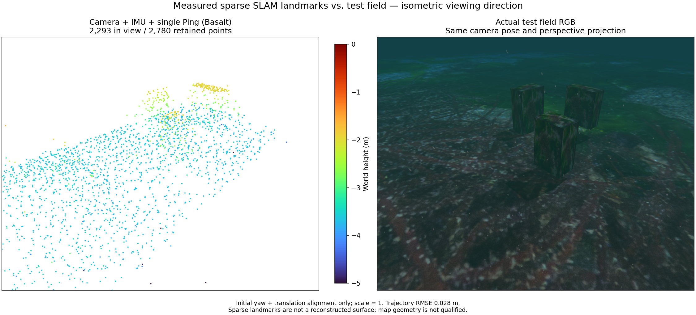

# Vertical excursion before a shallow survey

The same camera + raw IMU + single Ping combination uses Basalt revision
`0f3b2b52c807f70ff4e2973ce253c73329eea7bc`. The bounded test request dives to
1.5 m, holds for 3 seconds, rises to the 0.5 m survey depth, travels 7 m,
returns and surfaces. This is an opt-in validation route, not an automatic
vehicle action or a qualified initialization procedure.

Two independent 60-second recordings complete the mission and position gate.
Their position RMSE is 0.027669 / 0.078395 m and maximum error is
0.082782 / 0.111627 m. The earlier 0.5 m survey without this excursion has
RMSE 0.296592 m. This supports further evaluation of motion-dependent
initialization; it does not isolate every stochastic rendering or tracking
variation or prove the initialization covariance is calibrated.

Both runs preserve top-face exposure: 28/21/49 and 28/22/49 out of 49 sampled
locations per target. They export 2,780 and 2,771 sparse landmarks. The views
show 2,293 and 2,232 points, respectively. Complete box surfaces remain absent;
map geometry is not qualified. The native process recovery, export and owned
process cleanup pass in both runs.

The figures use the same textured test field, underwater attenuation,
particles and caustics. RGB and PCL share the isometric viewing direction and
perspective projection. Evaluation uses initial yaw and translation only,
with scale fixed to 1; truth is never estimator input.

## 한국어

위 Basalt 리비전으로 카메라·원시 IMU·단일 Ping을 처리합니다. 시험 경로는
1.5 m 잠항과 3초 정지 후 0.5 m로 상승해 7 m를 이동하고 복귀·부상합니다.
검증 도구에서 선택하는 경로이며 차량의 자동 동작이나 검증된 초기화
절차를 뜻하지 않습니다.

독립된 두 번의 60초 기록에서 임무와 위치 기준을 통과했습니다. 위치 RMSE는
0.027669·0.078395 m, 최대 오차는 0.082782·0.111627 m입니다. 수직 움직임
없는 0.5 m 경로의 RMSE는 0.296592 m였습니다. 움직임에 따른 초기화 개선을
더 검증할 근거이며, 렌더링·추적의 모든 변동을 분리하거나 초기화 공분산의
정확성을 입증한 결과는 아닙니다.

상자별 윗면 표본 49개 중 관측 범위는 28·21·49개와 28·22·49개로 유지됩니다.
저장 점은 2,780개·2,771개이며 비교 화면에는 2,293개·2,232개가 보입니다.
상자 표면 전체가 복원되지 않아 지도 형상은 아직 검증되지 않았습니다.
두 주행 모두 프로세스 복구, 다운로드와 소유 프로세스 정상 종료를 확인했습니다.

같은 텍스처 표적과 수중 감쇠·입자·해저 집광무늬를 사용합니다. RGB와 점군은
같은 등각 관찰 방향의 원근 투영으로 비교하며 축척은 1로 고정합니다.
평가는 초기 요각과 평행이동만 정렬하고 정답값을 추정기에 전달하지 않습니다.
