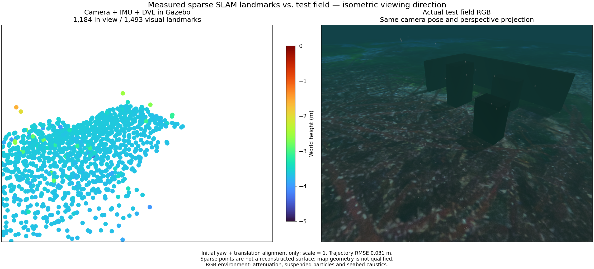
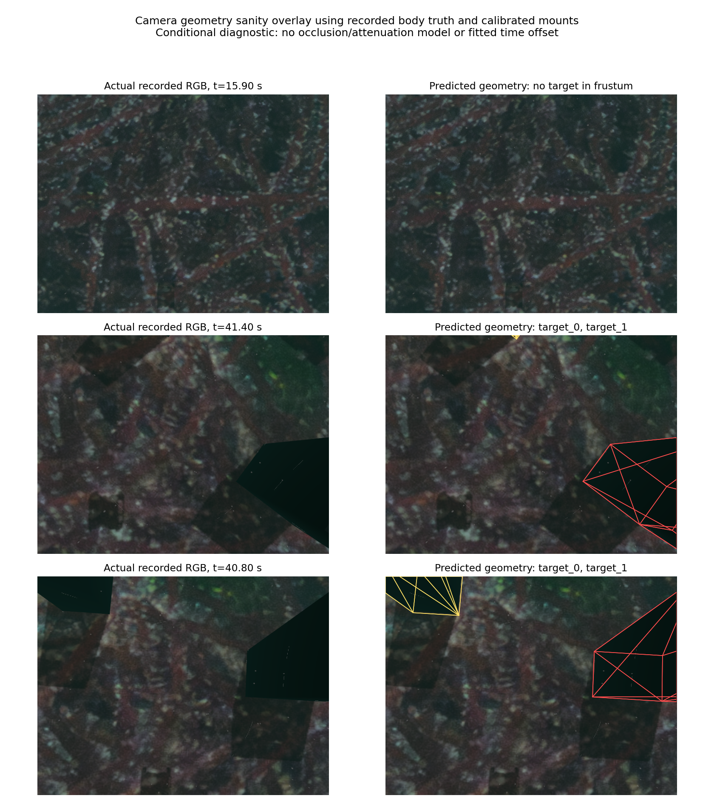

# Visual-map depth support / 시각 지도의 깊이 지지

[Complete candidate local-frame PLY](../data/visual-depth-admission.ply).

The native archive uses optimized-window full-weight camera observations and an SVD of pixel-noise-whitened point Jacobians. It requires rank three and a positive three-sigma inverse-range interval, then three distinct eligible inlier exposures. Active points that lose support are withdrawn and require fresh admission. Retired qualified points retain their last coordinates. Streaming and recorded Ping-patch inspection share this rule. Camera poses are fixed in this conditional test, so pose uncertainty is excluded; it cannot certify map accuracy. There is no metric distance cap or truth-based trimming.

Separate 1x ROS camera/IMU/DVL runs on the same raw recording export 1,412 control and 1,418 candidate points. Maximum physical-surface distance falls from 33.938 m to 1.784 m; median/p90 changes from 0.00869/0.08143 m to 0.00943/0.08427 m. Both retain 122 points outside 10 cm. Position RMSE is 0.00898/0.01414 m using initial yaw/translation only and scale one. Asynchronous initialization differs, so this is not an identical-state ablation. Both pass DVL-silence clearing/new-frame recovery and shutdown; new SDK/installed-GUI acceptance is separate.

The two extreme control IDs have under 0.081-degree parallax and relative depth sigma above one. Exact snapshot sidecars establish their IDs without inferring from a historical union. The candidate's worst remaining ID has 13 observations and 1.576-degree parallax but lies 1.784 m from collision geometry. Depth conditioning does not prove a static physical feature. Dynamic particles, caustics and false associations need investigation. The map remains unqualified, with poor target/wall coverage.

The figure uses the same actual isometric camera pose/perspective, Turbo -5 to 0 m and 64 pt² markers. RGB includes attenuation, suspended particles and seabed caustics. All exported points, including offscreen ones, enter surface scoring. Analytical covariance/degeneracy and rotation/scale invariance probes, archive withdrawal/readmission tests and 48 affected native tests pass. No new third-party dependency is added; existing Basalt/Eigen notices apply.

## 한국어

네이티브 지도는 현재 최적화 창의 정상 가중치 관측으로 픽셀 잡음 백색화 점 Jacobian을 만들고 SVD로 완전 계수와 양의 역거리 3시그마 조건을 확인합니다. 조건을 통과하는 서로 다른 관측 세 장이 필요하며 활성 점이 깊이 지지를 잃으면 제거하고 다시 검사합니다. 추정 창에서 빠진 적합 점은 마지막 좌표를 유지합니다. 스트리밍과 기록 Ping 패치 검사의 기준은 같습니다. 카메라 자세를 고정한 조건부 검사여서 자세 불확실성은 포함하지 않으며 지도 정확도를 보증하지 않습니다. 거리 상한이나 정답 형상을 이용한 제거는 없습니다.

동일 원본의 별도 1배속 카메라·IMU·DVL ROS 실행에서 점 수는 1,412/1,418개, 최대 표면 거리는 33.938/1.784 m입니다. 중앙값·90백분위 거리는 0.00869/0.08143 m와 0.00943/0.08427 m이며 두 실행 모두 10 cm 밖에 122점이 남습니다. 위치 RMSE는 0.00898/0.01414 m입니다. 초기 방위각·위치만 정렬하고 축척은 1입니다. 비동기 초기화 시각이 달라 동일 상태의 엄밀한 대조 실험으로 해석하지 않습니다. DVL 통신 중단의 지도 비우기·새 프레임 복구와 종료는 통과했으며 새 SDK·설치형 GUI 검증은 별도입니다.

대조군의 큰 이상점 두 개는 시차가 0.081° 미만이고 상대 깊이 표준편차가 1을 넘습니다. 정확한 스냅샷 ID 기록으로 대응 관계를 확인했습니다. 수정 후 최대 이상점은 관측 13개·시차 1.576°에도 실제 충돌 표면에서 1.784 m 떨어집니다. 깊이 추정 조건만으로 정적 물체의 대응점을 증명할 수 없습니다. 입자·집광무늬와 잘못된 대응점 가능성을 조사해야 합니다. 물체·벽 복원은 약하며 지도는 여전히 미통과입니다.

점군과 RGB는 실제 같은 등각 방향 카메라 원근을 사용하며 Turbo -5~0 m와 점 면적 64 pt²를 사용합니다. RGB에는 수중 감쇠·입자·해저 집광무늬가 포함됩니다. 화면 밖 점도 표면 평가와 PLY에 보존합니다. 해석적 공분산·퇴화·회전/축척 불변성, 지도 제거·재채택 검사와 관련 네이티브 시험 48개를 통과했습니다. 새 의존성은 없으며 기존 Basalt·Eigen 고지를 유지합니다.

## Actual native SDK execution / 실제 네이티브 SDK 실행

[Complete staged native PLY](../data/visual-depth-native.ply). The Apple Silicon development SDK runs the actual terrain demo/controller with camera, raw IMU and measured DVL; Ping is transport-only. The rewritten staged worker is retested through ROS DVL loss/return and actual simulator recovery/export before SDK registration. The run after integration with WWW-POSIM's GNSS-enabled main evaluates 59.8 s over 13.1026 m: position RMSE/max is 0.01158/0.02080 m with initial yaw/translation alignment and scale one. All owned processes stop. This qualifies demonstrated development startup/transport/export, with explicit DVL settings; signed installed GUI and payload-driven combination switching are separate.

There are 1,486 points, 1,388 within 10 cm of physical collision geometry, median/p90 0.01336/0.07195 m and maximum **2.76469 m**. The map remains unqualified and obstacle coverage is poor. Preceding separate native runs have maxima of 2.57242 m and **3.53154 m**; the worse result is retained in the application validation archive. These runs do not establish repeatability or a causal improvement. The matched RGB includes attenuation, suspended particles and caustics; points use Turbo -5 to 0 m and 64 pt² markers.

Post-estimation retriangulation of the same measured pixels using recorded true poses leaves three ROS-map outliers 1.815/1.826/1.436 m from collision surfaces. VIO pose error alone does not explain them. This diagnostic does not validate camera timing/mounts or prove dynamic-effect causality. Check static physical correspondence and exact image/pose synchronization next; no truth is fed to the estimator or used for trimming.

A conditional camera-frustum diagnostic on 231 poses of the recorded ROS run finds a projected bounding box above one pixel in 46/29 frames for the first two targets, and none for the third target or either wall. The camera looks down while the sonar looks forward. This upper bound assumes recorded timing/mounts and omits occlusion and attenuation; it is not measured feature detection. A test route must provide overlapping views of the intended objects. Missing observation opportunities and erroneous map points require separate investigation.

[Physical-surface persistence diagnostic](../data/visual-surface-persistence.json) intersects the measured feature rays with collision geometry after estimation. The three worst tracks span 7.27/8.62/7.26 cm on the surface, with first-hit-anchor reprojection RMSE 1.76/2.22/2.30 processed pixels. Five low-surface-error controls span 0.30–3.01 cm and 0.13–0.42 pixels. The first collision hit need not be the actual tracked feature: particles, illumination, tracking error and timing remain possible causes. These selected cases do not establish a detector or new rejection threshold.

Known target edges broadly align with recorded RGB in the sampled views. This checks gross camera/mount consistency but does not certify subpixel calibration or precise timing. Strengthen the test's overlapping physical views and inspect feature persistence before promoting another map-admission heuristic.

Apple Silicon 개발 SDK에서 카메라·원본 IMU·측정 DVL로 실제 지형 데모와 제어기를 실행했습니다. Ping은 관측 전달만 사용합니다. 배치로 해시가 바뀐 작업자는 ROS DVL 중단·복귀와 실제 시뮬레이터 복구·내보내기를 다시 통과한 뒤 등록합니다. GNSS를 포함한 WWW-POSIM main과 통합한 실행은 59.8초·13.1026 m에서 초기 방위각·위치만 정렬하고 축척을 1로 유지한 위치 RMSE/최대 오차 0.01158/0.02080 m를 기록합니다. 소유 프로세스는 모두 종료됐습니다. 명시적 DVL 설정의 개발용 시작·전송·내보내기 검증이며 서명 설치형 GUI와 센서 선택에 따른 기본 조합 전환은 별도입니다.

1,486점 중 1,388점이 실제 충돌 표면의 10 cm 이내이며 중앙값·90백분위는 0.01336/0.07195 m, 최대 거리는 **2.76469 m**입니다. 앞선 별도 네이티브 실행의 최대 2.57242 m와 **3.53154 m**도 앱 검증 기록에 보존합니다. 실행 간 반복성이나 수정의 개선 효과를 확정하지 않습니다. 지도는 미통과이고 물체 복원은 약합니다. 같은 시점 RGB에는 감쇠·입자·집광무늬가 포함되며 점군은 Turbo -5~0 m와 64 pt² 점을 사용합니다.

추정 후 같은 영상 픽셀을 참 자세로 다시 삼각측량해도 ROS 지도의 세 이상점은 표면에서 1.815/1.826/1.436 m 떨어집니다. VIO 자세 오차만으로 설명되지 않습니다. 이 진단은 카메라 시각·장착의 정확성이나 동적 효과의 원인을 확정하지 않습니다. 정적 물체 대응과 영상·자세 시각 일치를 확인해야 하며 참값을 추정기에 입력하거나 지도 제거에 사용하지 않습니다.

기록된 ROS 실행의 자세 231개로 계산한 조건부 카메라 시야 진단에서 첫 두 표적은 각각 46/29개 프레임에 1픽셀을 넘는 투영 경계 상자를 갖지만 세 번째 표적과 벽 두 개는 한 번도 들어오지 않습니다. 카메라는 아래를, 소나는 앞을 봅니다. 기록 시각·장착을 가정하고 가림·감쇠를 제외한 상한이므로 실제 특징 검출을 뜻하지 않습니다. 시험 경로는 대상 물체를 여러 겹치는 시점에서 관측할 기회를 제공해야 합니다. 관측 기회 부족과 잘못 생성된 지도점은 따로 조사해야 합니다.

추정 후 측정 픽셀 광선과 실제 충돌 형상의 교차점을 비교하면 큰 이상점 세 개의 표면 위치 범위는 7.27/8.62/7.26 cm이고 첫 교차점을 고정했을 때 재투영 RMSE는 처리 영상 기준 1.76/2.22/2.30픽셀입니다. 표면 오차가 작은 비교점 다섯 개는 0.30~3.01 cm와 0.13~0.42픽셀입니다. 첫 충돌점이 실제 추적 대상이라는 보장은 없으며 입자·조명·추적 오류·시각 오차를 구분해야 합니다. 선택한 사례를 새 검출기나 제거 기준으로 사용하지 않습니다.

물체의 투영 윤곽은 확인한 원본 RGB의 가장자리와 대체로 맞습니다. 큰 장착 오류를 점검한 결과이며 정밀 보정과 시각 동기화의 보증은 아닙니다. 대상의 겹치는 실제 관측과 특징점 지속성을 먼저 검증해야 합니다.
