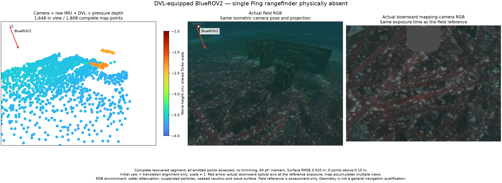

# Visual/IMU factor ownership / 시각·IMU 관측 관리

Camera/IMU estimation and combinations with optional sensors use the same
optimizer and marginalization ownership after visual landmarks are created.
The complete state order includes a feature's host even when that host remains
a full IMU state. Retiring a lost feature preserves its information in the
correlated prior and consumes each observation once. Optional Ping, sonar,
DVL and pressure stores can be empty; an empty store supplies no measurement.

Native `max_recent_states` accepts 3–64 and is acknowledged in the ready event.
The ordinary camera default is three states. Increasing this number consumes
more computation and memory and does not ensure an informative map.
Adding single-time DVL or pressure measurements preserves that default. Their
retired factors enter the common correlated prior; their original measurement
timestamps do not require the longer window used to initialize multiview
acoustic tracks. The native camera/DVL regression covers both three and sixteen
recent states, including several velocity observations between images.
The [DVL window evidence](../validation/dvl-factor-window-20261028/README.md)
retains paired computation controls, seven original-time ROS loss/recovery cases
and all-point evaluations of fourteen complete maps.
`native/basalt/test_visual_window_native.py` checks young lost-feature hosts,
121 translated-texture images and bounded retirement in a 16-state window
with no auxiliary sensors. It is an ownership regression, not a map-accuracy
or inertial-observability certificate.

The [recorded controls](../validation/common-visual-window-20261028/README.md)
include complete maps, all-point assessments and matching RGB figures. With
the same retained startup proposal, three states export 24 points and sixteen
export 146; both miss required scene geometry. The camera/IMU/Ping ROS control
passes bounded IMU-loss recovery. Retained-startup controls are two-pass
experiments, not a live initialization API. Provider and field acceptance
remain separate.

The [DVL-without-Ping record](../validation/dvl-without-ping-20261029/README.md)
adds two DVL-only original-time ROS loss cases and three pressure-loss baselines,
plus two native BlueROV starts with the single Ping physically absent. The second
native run exports 1,855/1,808 initial/returned points; every point is assessed.
Its recovered surface RMSE is 1.02 cm, maximum 9.94 cm. Sparse obstacle coverage,
initialization uncertainty and general navigation remain unqualified. The first
initial map has incomplete reference coverage and is retained unassessed. Both
native DVL receiver children require forced shutdown; fourteen isolated signal
controls do not reproduce it. The independent library remains composable; mutual
exclusion is the integrating application's selected-payload policy.

Both isometric panels use the same actual camera pose and perspective. The third
panel is simultaneous downward-camera RGB; arrows mark the vehicle and optical
axis. RGB includes underwater attenuation, particles, caustics and wave surface.
All emitted points remain; 64 pt² markers use Turbo from −4 to −1.5 m. Evaluation
uses initial yaw/translation only, scale 1; reference truth never enters estimation.

## 한국어

카메라·IMU 추정과 선택 센서 결합은 시각 특징점 생성 뒤 같은 최적화·관측
정리 경로를 사용합니다. 특징점을 소유한 프레임이 IMU 상태로 남아 있어도
전체 계산 순서에 포함합니다. 유실 특징점을 정리할 때 관측 정보는 상관관계를
포함한 사전정보로 남으며 각 관측을 한 번씩 반영합니다. Ping·소나·DVL·수압
저장소가 비어 있으면 해당 센서의 측정값을 공급하지 않습니다.

네이티브 `max_recent_states`는 3~64를 허용하고 ready 이벤트로 실제 값을
확인합니다. 일반 카메라 기본값은 3입니다. 큰 값은 계산량·메모리를 늘리며
충분한 지도 정보를 보장하지 않습니다. 단일 시각의 DVL·수압 측정을 추가해도
이 기본값을 유지합니다. 정리된 요인은 공통 주변화 사전정보로 전달되며,
여러 시점의 음향 트랙 초기화와 같은 긴 이력을 요구하지 않습니다. 카메라·DVL
회귀시험은 영상 사이의 여러 속도 관측을 포함해 이력 3개와 16개를 확인합니다.
[DVL 상태 창 검증 기록](../validation/dvl-factor-window-20261028/README.md)은
계산량 비교와 원래 속도의 ROS 상실·복귀 일곱 사례, 전체 지도 14개의 점별
평가를 보존합니다.
위 시각 회귀시험은 선택 센서 없이 영상
121장과 이력 16개의 특징점 소유·정리를 검증합니다. 지도 정확도나 IMU
관측가능성을 인증하는 시험은 아닙니다.

위 기록에는 전체 점군·모든 점의 오차·같은 시점 방향의 RGB가 있습니다.
같은 초기값의 대조 시험에서 이력 3개는 24점, 16개는 146점이지만 필요한
장면이 빠집니다. 카메라·IMU·Ping ROS 시험은 제한된 IMU 유실·복구를
통과합니다. 초기 관측 유지 시험은 기록을 두 번 처리하는 수치 실험이며,
실제 운영 초기화 API와 배포·현장 검증은 별도입니다.

[Ping 없는 DVL 검증 기록](../validation/dvl-without-ping-20261029/README.md)은
DVL만 사용하는 원래 속도 ROS 상실 시험 두 개와 수압 대조군 세 개, Ping을
물리적으로 제거한 BlueROV 네이티브 시작 두 번을 추가합니다. 두 번째 초기·복구
지도 1,855/1,808점은 모두 평가하며 복구 표면 RMSE는 1.02cm, 최대 거리는
9.94cm입니다. 장애물 관측 범위·초기화 불확실성·일반 항법은 미검증입니다.
첫 초기 지도는 참조 기록이 부족해 평가하지 못한 채 보존합니다. 두 네이티브
DVL 자식 수신기는 강제 종료가 필요했고 독립 신호 재현 14개는 정상 종료합니다.
독립 라이브러리의 센서 결합은 유지하며 상호 배제는 앱의 장착 선택 정책입니다.

위 그림의 등각 패널은 같은 실제 카메라 위치·자세와 원근 투영을 사용합니다.
세 번째는 같은 노출 시각의 하향 RGB이며 화살표는 차량·광축을 표시합니다.
RGB는 수중 감쇠·입자·집광무늬·수면 파도를 포함하고, 전체 점은 64 pt²와
−4~−1.5m Turbo로 표시합니다. 평가는 초기 방위각·위치만 정렬하고 축척 1을
유지하며 참조 정답은 추정기에 입력하지 않습니다.
