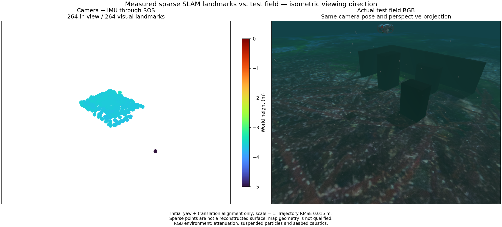

# Experimental moving visual-inertial seed

`src/posim_slam/visual_inertial_seed.py` estimates initial metric velocity and
gravity from calibrated camera bearings and raw-IMU preintegrals. It is an
independent experimental calculation, not automatically invoked by the live owner.

In the first IMU frame, position at time t is initial velocity times t, plus
half gravity times t squared, plus preintegrated specific-force displacement.
Each tracked bearing constrains its unknown landmark to a camera ray. The
camera lever arm and gyro-integrated rotation transform that ray. Per-landmark
orthogonal elimination removes landmark coordinates; a six-variable linear
system estimates velocity and gravity. No known object size, depth, pose or
metric visual trajectory is an input. Constant-velocity and zero-parallax
degeneracies are rejected. Input bounds are 4–32 frames, 8–256 tracks and at
most 10 seconds; each track needs at least three observations.

This calculation conditions on supplied gyro/accelerometer biases and relative
rotations. It reports numerical conditioning, residuals and positive depths;
these are not a calibrated covariance or an observability certificate. Gravity
magnitude is unconstrained in this linear seed. Robust feature selection,
gravity-magnitude-constrained nonlinear refinement, bias uncertainty and live
worker integration remain required. Do not enable navigation from this result.

The moving BlueROV recording starting at 69.2 s uses actual native optical-flow
pixels, including tracks not yet triangulated by the failing VIO worker. Only
pixel coordinates and IDs enter the seed; existing estimated map coordinates
are ignored. Pixel-centre scaling matches native camera preprocessing. After
three seconds (177 tracks), an independent truth comparison gives initial
velocity error 0.00578 m/s and gravity-direction error 0.0140 degrees. Truth is
used only after estimation. This is one offline record, not trajectory or
product acceptance. Five synthetic tests include raw-IMU integration, nonzero
camera extrinsics and rejection of constant-velocity/no-parallax inputs.

The approach is established visual-inertial initialization work, not a novelty
claim. [OpenVINS's dynamic initialization description](https://docs.openvins.com/classov__init_1_1DynamicInitializer.html)
discusses bearing/IMU initialization with velocity/gravity estimation and
subsequent refinement/covariance recovery. This module is an independent
implementation of projective kinematics; no external implementation was copied.

## Native state handoff experiment

The native worker advertises `first_imu_state_v1`. `LiveClient.inertial_seed`
accepts the exact first-state timestamp, up direction and velocity in that IMU
frame, and gyro/accelerometer biases in sensor axes. The worker rotates velocity
into its gravity-aligned world frame. It rejects repeated/nonfinite seeds and
timestamp mismatches. This is a numerical starting state; no covariance or
readiness claim is carried. The previous direction-only protocol is retained.

In a two-pass recorded test, tracks and IMU from 66.2–69.2 s supply a seed at
69.2 s. No later measurement or simulator truth enters this seed. The estimator
then processes the original subsequent camera/IMU packets. Over the same 37
states and 7.2 seconds, position RMSE changes from 19.9522 m with the ordinary
seed to 0.01538 m with the measured state seed (maximum 0.04216 m). A second
start at 72.2 s improves from 0.02848 m to 0.01445 m RMSE; that control already
tracks successfully. Both controls and both seeded results are retained.

The 264 visual points show a small observed seabed patch, not a completed object
or terrain reconstruction. The real RGB field uses matching isometric camera
pose/projection, with underwater attenuation, suspended particles and seabed
caustics. The display uses Turbo height colors and four-times-diameter markers.
This figure does not qualify map geometry. Twenty-six native regression tests
and sixteen client-input tests pass, including flipped-IMU velocity rotation,
sensor bias preservation and invalid/duplicate seed rejection.

An online feature bootstrap, robust refinement and uncertainty evaluation remain
required. The two-pass recording experiment is not live automatic initialization,
mixed sonar recovery, installed application acceptance, or navigation readiness.

## 한국어

이 실험 모듈은 보정된 영상 특징점 방향과 원시 IMU 적분값으로 초기 속도와
중력을 계산합니다. 첫 IMU 좌표계에서 이동 방정식과 카메라 광선 제약을
구성하고, 특징점 위치를 소거한 선형 시스템을 풉니다. 물체의 크기·거리,
시뮬레이터 위치·자세, 기존 SLAM 지도 좌표는 입력하지 않습니다.
카메라의 회전·위치 외부 보정을 포함하며, 일정 속도 이동과 시차가 없는
경우는 거부합니다. 입력은 4–32개 프레임, 8–256개 특징점, 최대 10초이고
각 특징점은 세 프레임 이상에서 관측되어야 합니다.

69.2초부터 시작하는 BlueROV 기록의 3초 구간에서는 177개 특징점으로
초기 속도 오차 0.00578m/s, 중력 방향 오차 0.0140°를 얻었습니다.
정답은 계산 후 평가에만 사용했습니다. 합성 검사 5개에는 원시 IMU 적분,
카메라 외부 보정, 일정 속도·시차 부족 거부가 포함됩니다.

현재는 실시간 실행 경로에 연결하지 않은 독립 초기값 계산입니다.
바이어스와 상대 회전은 주어진 값으로 취급하며 중력 크기는 아직 제약하지
않습니다. 이상 특징점 처리, 중력 크기를 제약한 비선형 보정, 바이어스
불확실성과 공분산 평가, 실제 재시작 연결·궤적 검증이 남아 있습니다.
수치 조건과 잔차가 좋다는 이유만으로 관측 가능성이나 항법 준비 완료를
인정하지 않습니다. 기존 시각·관성 초기화 방법에 해당하며 연구 신규성을
주장하지 않습니다.

네이티브 추정기는 `first_imu_state_v1` 초기값 전송을 지원합니다.
`LiveClient.inertial_seed`에는 첫 상태의 정확한 시각, 그 IMU 좌표계의 위쪽
방향·속도, 센서 축의 자이로·가속도계 바이어스를 전달합니다. 속도는 지도
좌표계로 회전합니다. 중복·비유한 값과 시각 불일치는 거부하며, 기존 방향만
전송하는 방식도 유지합니다. 이 입력은 공분산이나 준비 완료 판정을 담지 않습니다.

기록을 두 번 처리하는 시험에서 66.2–69.2초의 특징점·IMU로 초기값을 만든
뒤 69.2초부터 추정기를 실행했습니다. 이후 관측이나 정답은 초기값에 넣지
않았습니다. 동일한 37개 상태·7.2초 구간에서 위치 RMSE는 19.9522m에서
0.01538m로 줄었고 최대 오차는 0.04216m였습니다. 별도의 72.2초 시작에서는
0.02848m에서 0.01445m로 줄었습니다. 이 대조군은 기존 초기화로도 정상
추적하므로 실패 복구 사례와 구분합니다. 두 대조군과 두 개선 결과를 모두 보존했습니다.

위 비교 그림의 264개 점은 짧게 관측한 해저 일부입니다. 실제 RGB와 동일한
등각 시선·투영을 사용하며 수중 감쇠·부유 입자·해저 집광무늬를 포함합니다.
Turbo 높이 색상과 지름 4배 표시를 유지합니다. 지도 형상은 아직 합격하지
않았습니다. 네이티브 회귀 검사 26개와 클라이언트 입력 검사 16개가 통과했습니다.
뒤집힌 IMU의 속도 회전, 바이어스 유지, 잘못된 초기값 거부를 확인합니다.

실시간 특징점 초기화, 강건한 보정과 불확실성 평가가 남아 있습니다.
현재 결과를 실시간 자동 초기화·혼합 소나 복구·설치형 앱·항법 준비 완료의
검증으로 확대하지 않습니다.
