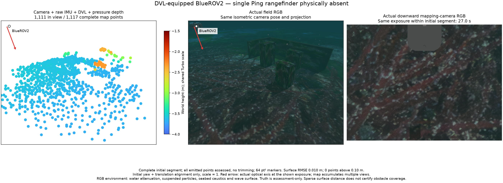
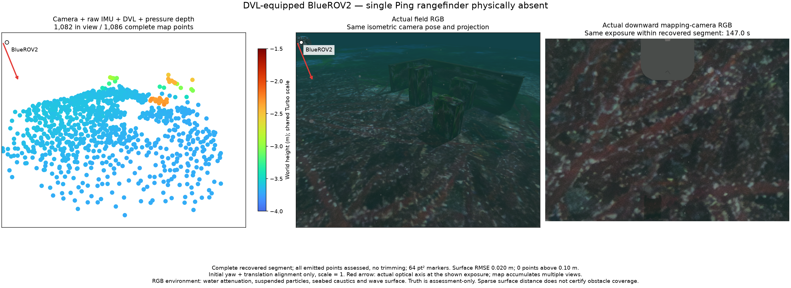

# World gravity reaches the inertial estimators

The generated world supplies its downward gravity magnitude to common IMU calibration, the IMU/DVL owner, VIO initialization/state prediction and the camera-free sonar command. The previous application constant is no longer substituted for the world's value in these generated sessions. The SDFormat default is 9.8 m/s². The direct ROS CLI retains its explicit 9.80665 m/s² default. Z-up Earth-gravity input is validated. Development qualification records and matches the gravity value; an old profile is not silently relabelled.

The physical world, native binary, noise densities, map admission, input queues and freshness limits are unchanged. The pressure plugin still generates and converts hydrostatic height using its separate 9.80665 m/s² reference constant. That is distinct from the IMU's physical acceleration model. The independent [forward-input control](../forward-inputs-20261029/README.md) shows that the small gravity inconsistency does not explain its poor forward map.

## Original-time input regression

Five source-bound ROS cases use the existing canonical input record and the actual live owner at speed one. They verify loss/return, export eligibility, source fingerprints, exact event times and shutdown. DVL cases have no Ping input. Alternate Ping cases have no DVL factor. No camera pixels, timestamps, noise or admission limits are changed to pass.

| Case | Initial / returned full points | Initial / returned surface RMSE | Above 10 cm |
| --- | ---: | ---: | ---: |
| DVL communication loss | 1,375 / 1,459 | 1.40 / 1.20 cm | 5 / 1 |
| DVL bottom-lock loss | 1,425 / 2,897 | 1.14 / 1.12 cm | 3 / 5 |
| Camera/IMU/pressure, no Ping | 1,346 / 995 | 1.94 / 1.73 cm | 3 / 2 |
| Camera/IMU/pressure, Ping fused | 1,136 / 1,142 | 1.79 / 1.31 cm | 2 / 3 |
| Camera/IMU/pressure, Ping received only | 1,346 / 995 | 1.94 / 1.73 cm | 3 / 2 |

All 14,116 emitted vertices and 29 distances above 10 cm remain. Maximum nearest authored surface distance is 23.82 cm. Every worker and writer stops. Protocol success is separate from physical feature identity, obstacle coverage and uncertainty calibration. The retained ROS comparison metadata uses the existing record's scene reference; the fresh native images below are the per-segment simultaneous views.

## Actual BlueROV field

A fresh native start selects only the downward camera and DVL, retaining IMU and pressure. The single Ping link, joint, sensor, topic, autopilot range input and worker arguments are absent. It reuses the explicit geographic field from the camera comparison, with a fresh nonce and normal route/body-clearance checks. Physical targets and sensor mounts are unchanged.

The actual final world declares `0 0 -9.8`. Generated common IMU calibration, IMU/DVL calibration, the VIO CLI argument and both native segment calibrations all contain **9.8 m/s²**. [Gravity chain](native/gravity-chain.json) retains their source hashes.

| Segment | Full points | Surface RMSE | Maximum | Above 10 cm | Position RMSE |
| --- | ---: | ---: | ---: | ---: | ---: |
| Initial | 1,117 | 1.03 cm | 6.31 cm | 0 | 5.69 cm |
| DVL returned | 1,086 | 2.02 cm | 8.85 cm | 0 | 8.24 cm |

All 2,203 points remain and are assessed. Exactly one deliberate communication loss produces `dvl_stale` and a new frame; DVL/pressure are fused in both segments. Both checked physical routes complete. The parent exits 0 without escalation, all four owned process groups are empty and minimum observed authored-object clearance is 0.837 m against a 0.5 m body margin.

Each field/input image pair shares its actual exposure inside the exported segment. The cloud and field use the same isometric pose/projection; red arrows identify the camera optical axis. All vertices participate, with out-of-view counts shown. Markers are 64 pt² and the Turbo height scale is −4 to −1.5 m. RGB includes attenuation, suspended particles, caustics and the wave surface. Initial yaw/translation alignment keeps scale one. Truth is assessment-only.

Small every-point distances do not certify obstacle completeness. In the returned segment, the second box has no archive point within 5 cm of its geometrically visible face samples. Conditional visibility is an upper bound; sparse camera support and the planned view footprint remain open. This run does not fix the failed forward-camera regime, certify initialization uncertainty or qualify an installed package.

## Verification scope

The common physics, metadata/launch, initialization, source-profile, staging and documentation checks pass. The standalone group passes 47/47. English/Korean specifications and SLAM guides are regenerated and checked at 1280 × 900 and 390 × 844 without horizontal overflow.

Camera-free sonar gravity transport has source/launch checks. A new camera-free native qualification and the deferred POSIM sonar PR integration remain pending. No sonar PR is merged or modified by this change. No private application implementation is copied into POSIM-SLAM; the library already accepts an explicit gravity calibration.

Run `python3 summarize.py` to check the retained complete maps, assessment arithmetic, event/source receipts, gravity chain, same-segment images and cleanup. It does not rerun the simulator or independently reconstruct scene truth. [Source identity](source-identity.json) records application base `6fef5319` plus exact candidate file hashes, measured component `d5d7a81`, engine/SDK `8c47601`, the unchanged native binary and explicit development shader/asyncio sources. Historical records retain their original gravity/configuration identities.
