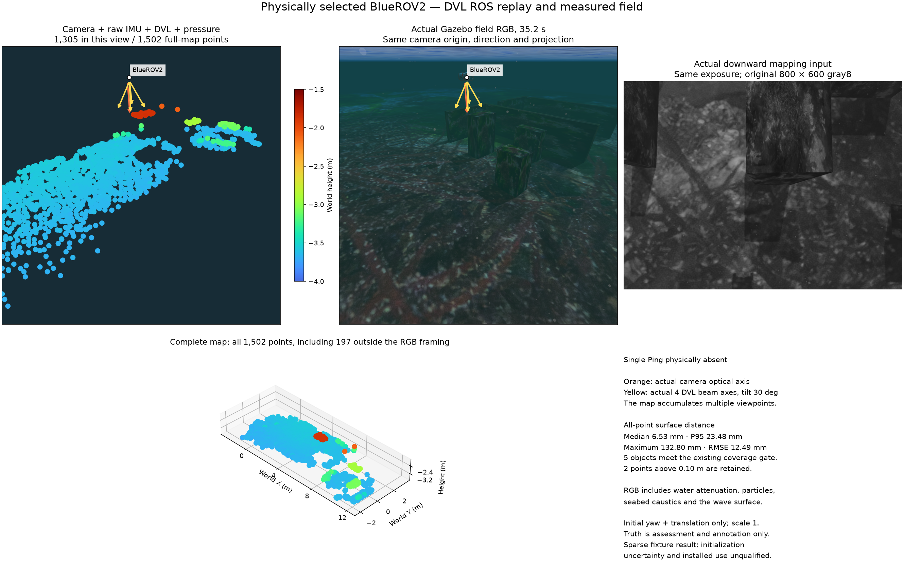

# 카메라·IMU·DVL·수압 지도

네이티브 Basalt 경로는 카메라 관측·원본 IMU·해저 기준 DVL 속도·수압
수심을 한 추정기에서 결합합니다. 희소 지도는 카메라 랜드마크로 구성합니다.
그림의 DVL 음선 방향은 실제 장착을 설명하며, DVL 고도 측정을 지도점으로
추가하지 않습니다. 이 예시에는 단일 Ping이 없고 시뮬레이션 DVL은 1Hz입니다.

현장 RGB와 원본 800×600 gray8 입력은 같은 35.2초 노출입니다. 왼쪽 지도는
RGB 카메라의 원점·방향·원근 투영을 사용하며 여러 시각의 관측을 누적합니다.
주황은 실제 카메라 축, 노랑은 30° 기울어진 DVL의 음선 축 4개입니다.
RGB에는 수중 감쇠·입자·해저 집광무늬·수면 파도가 적용됩니다. 아래 지도는
RGB 범위 밖의 197점을 포함한 전체 1,502점을 보존합니다. 점 크기는 64pt²,
공통 Turbo 높이 범위는 −4~−1.5m입니다.

이 기록 예시는 POSIM-SLAM 0.1.0, 어댑터 소스 `7f3941e`, Basalt
`0f3b2b52c807f70ff4e2973ce253c73329eea7bc`를 사용합니다. 전 점 표면 거리는
중앙값 6.53mm·95백분위 23.48mm·최대 132.80mm·RMSE 12.49mm입니다.
10cm 초과 2점을 그대로 보존합니다. 평가는 초기 방위각·위치만 정렬하고
축척은 1로 유지하며 진실값은 추정에 입력하지 않습니다. 이 희소 장면
예시만으로 초기화 불확실성의 보정·물리적 bottom-lock 상실 복구·반복성·
설치형 앱 수용을 입증하지 않습니다.

DVL 상태가 무효하면 해당 융합을 중단합니다. 최신 카메라·IMU가 있으면
같은 좌표계에서 시각 상태와 지도 보존을 이어갈 수 있으며, 내보내기에는
최신 보조 센서 측정이 필요합니다. 통신 무응답과 명시적인 무효 lock 상태는
별도 조건이며 소프트웨어 장애 주입이 물리적인 bottom-lock 상실을
입증하는 것은 아닙니다.

[English](camera-dvl.md) · [방법 비교](../comparison.md) ·
[그림 원본과 고지](../../THIRD_PARTY.md#documentation-imagery--문서-이미지)
