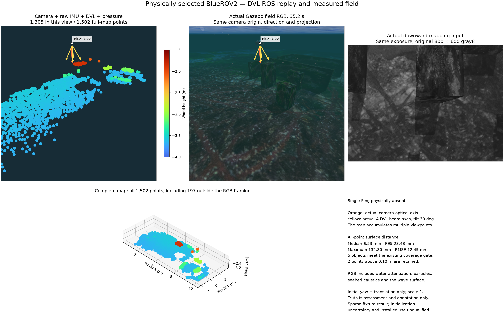

# Camera, IMU, DVL and pressure mapping

The native Basalt path combines camera observations, raw IMU, bottom-relative
DVL velocity and pressure depth in one estimator. Camera landmarks form the
sparse map. The DVL beam directions below explain the mounted sensor; its
altitude readings are not added as mapped points. A single Ping is absent
from this example. The simulation's DVL update rate is 1 Hz.

The field RGB and original 800 × 600 gray8 input share the 35.2-second exposure.
The left map uses the RGB camera's origin, direction and perspective projection;
it accumulates observations from multiple times. Orange marks the actual camera
axis; yellow marks the four DVL beam axes, tilted 30 degrees. Water attenuation,
particles, seabed caustics and surface waves affect RGB rendering. The lower
panel retains all 1,502 points, including 197 outside the RGB framing. Markers
are 64 pt² with a shared −4 to −1.5 m Turbo height scale.

This recorded example uses POSIM-SLAM 0.1.0, adapter source `7f3941e`, and Basalt
`0f3b2b52c807f70ff4e2973ce253c73329eea7bc`. All-point surface distance is
6.53 mm median, 23.48 mm at the 95th percentile, 132.80 mm maximum and
12.49 mm RMSE. Two points beyond 10 cm remain in the map. Assessment aligns
initial yaw and translation only, with scale fixed at one; simulator truth
does not enter estimation. This sparse fixture example does not establish
calibrated initialization uncertainty, physical bottom-lock-loss recovery,
repeatability or installed-application acceptance.

An invalid DVL status suspends its fusion. With recent camera/IMU input the
visual state and map archive can continue in the same frame, while export
requires fresh auxiliary measurements. Communication silence and explicit
invalid lock status are separate conditions; software fault injection does
not establish physical loss of bottom lock.

[Korean / 한국어](camera-dvl.ko.md) ·
[Method comparisons](../comparison.md) ·
[Image sources and notices](../../THIRD_PARTY.md#documentation-imagery--문서-이미지)
