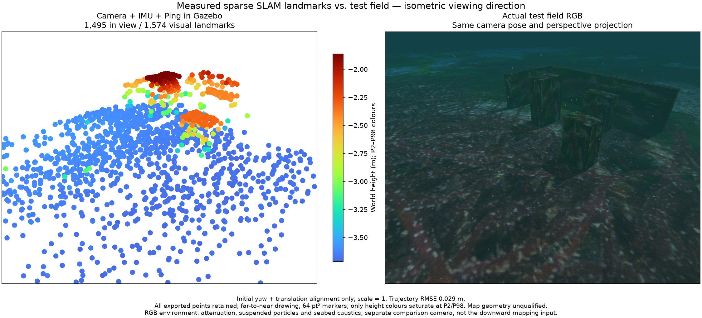
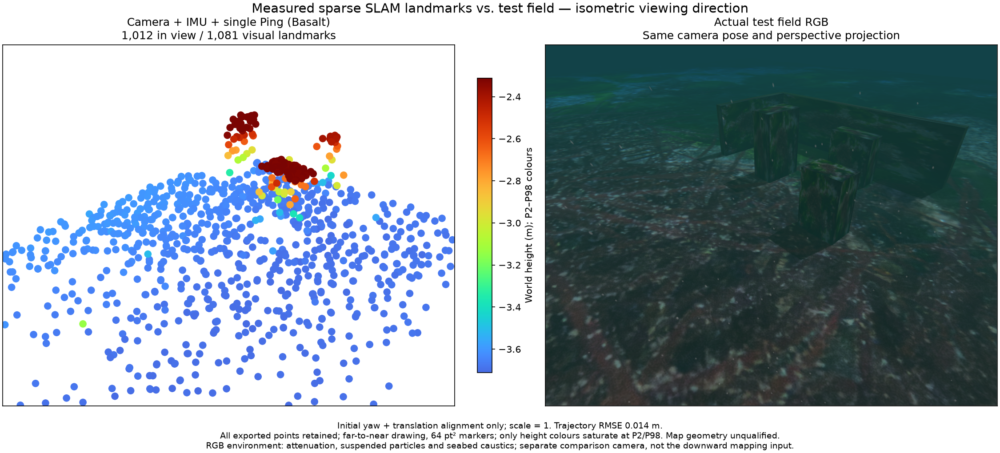
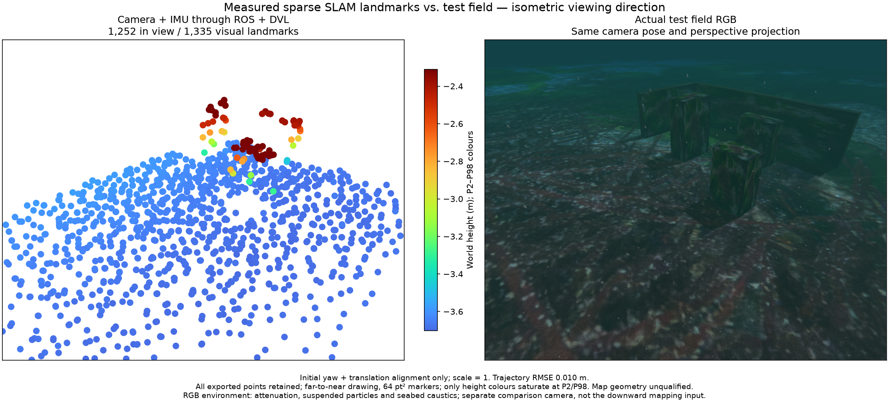
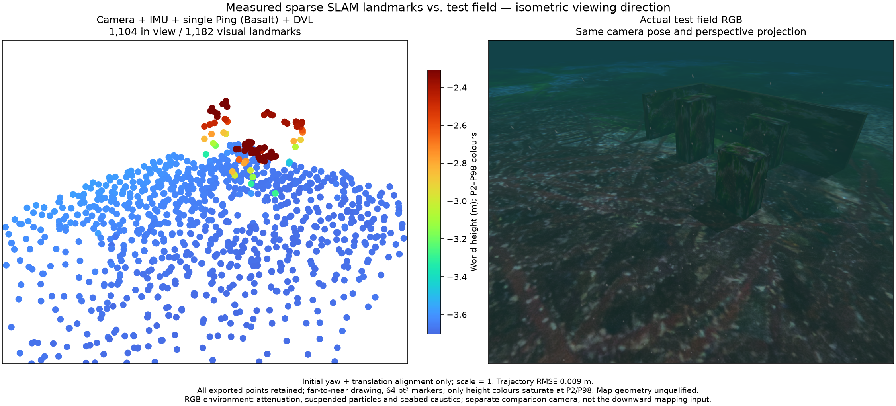
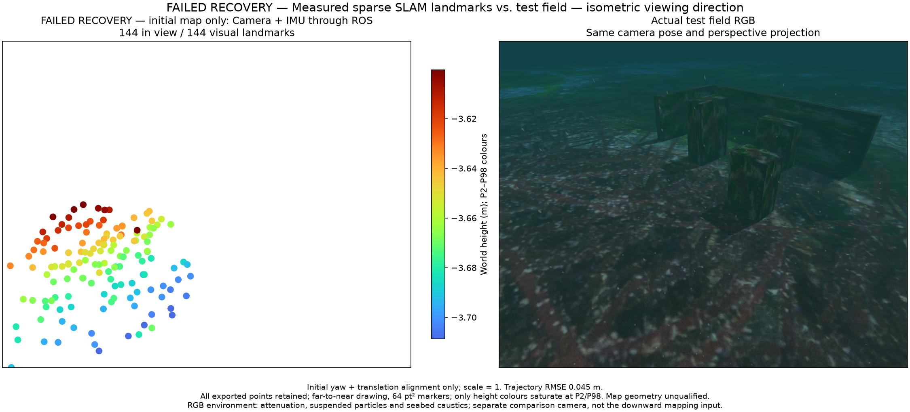

# Camera/IMU timing and input profiles / 영상·IMU 시각과 입력 조합

2026-10-28. **Delivery/recovery and map accuracy have separate results.** The
camera/IMU-only recovery and the native camera/IMU/Ping map remain failed.
This record does not qualify an installed app or a general SLAM product.

## Timing contract

An image could reach startup before the raw IMU sample at the same timestamp.
Immediate processing discarded that exposure before IMU coverage was available.
Exact image/Ping pairing happened to delay images and mask the problem.
The isolated pre-fix camera/IMU control produces no native poses or map.

The independent `posim_slam.image_imu_queue.ImageImuQueue` now releases an
exposure only after received raw IMU covers its original timestamp. Its limits
are 32 images, a 64 MiB payload estimate and two seconds of original receipt
age. Reset clears the preceding context. No image or IMU sample is retimed,
predicted or duplicated; measurement-gap and map-precision limits are unchanged.
Four independent controls cover receipt order, future IMU, clock zero and
capacity/stale/reset handling.

The host reports the actual POSIM-SLAM version **0.1.0**, independently of the
Basalt revision `0f3b2b52c807f70ff4e2973ce253c73329eea7bc`.
One source-bound provider can contain multiple exact input profiles. Each fixes
Ping input/factors, sonar, DVL, camera rate and initialization setting. A failed
recovery cannot register a profile. Registration proves the measured execution
path; it does not certify map accuracy.

## Measured results

All replay cases retain the same source recording and original measurement
times. Ping-only uses 10 Hz images; DVL cases use 5 Hz. Outage timing and
reinitialization differ, so these are not a controlled causal ablation.
The native field is a separate physical recording.

| Execution / fused inputs | Recovery | Exported points | P95 surface error | Maximum | Points >10 cm |
| --- | --- | ---: | ---: | ---: | ---: |
| Native camera + IMU + Ping | Worker restart passes | 1,574 | 2.03 cm | **267.60 cm** | **16** |
| ROS camera + IMU + Ping | Camera outage passes | 1,081 | 1.58 cm | **92.46 cm** | **7** |
| ROS camera + IMU + DVL | DVL outage passes | 1,335 | 1.59 cm | 6.08 cm | 0 |
| ROS camera + IMU + Ping + DVL | DVL outage passes | 1,182 | 1.36 cm | 6.16 cm | 0 |
| ROS camera + IMU, no Ping input | **IMU recovery fails** | 144 initial / 0 recovered | 1.23 cm initial | 7.83 cm initial | 0 initial |

The DVL-only factor case retains Ping transport, with **zero** optimized Ping
states; it is not a Ping-absent experiment. The camera/IMU-only case has no Ping
subscription, publication, reception or factor. It now initializes and builds
144 initial points. After the intended `imu_stale` reset it recovers 549 visual
poses, but no point passes the existing precision budget during the retained
60-second source interval. Its initial snapshot is explicitly labelled failed
recovery and cannot stand in for a recovered map.

The two DVL cases recover 267 poses each; first admitted map points appear
6.37 s after resumption. The Ping case recovers 559 poses and its first map at
7.87 s. Each records exactly its intended stale-sensor event. Actual ROS
domains are 88, 87, 90 and 89 respectively. All record zero inbox rejections,
no queue fault and stopped worker threads after cleanup.

Two earlier parallel commands supplied only `ROS_DOMAIN_ID`; the SDK wrapper
overrode it to 73 and mixed their input topics. Those runs are excluded from
SLAM assessment. Isolated tests now set `WWW_POSIM_NATIVE_ROS_DOMAIN_ID`, check
the actual rclpy context with `--expected-ros-domain`, and record it in the proof.
See [excluded controls](excluded-domain-controls.json).

## Matched RGB and complete clouds

Every exported point enters projection and surface assessment. Alignment is
initial yaw/translation only, with scale one. Simulator geometry is used only
after estimation; no truth-based trimming is applied. RGB and PCL use the same
observer camera and projection. The observer is separate from the downward
estimator camera. RGB includes attenuation, suspended particles and seabed
caustics. Markers are 64 pt², drawn far to near; P2/P98 affects Turbo colours
only. Sparse coverage is not a dense reconstruction or area-coverage measure.

The native survey completes in **73.68 s**. Its 120-second observation retains
1,195 poses in one segment after intentional worker recovery. Position RMSE is
2.89 cm, with scale fixed at one. The complete 1,574-point map has 16 points
farther than 10 cm from a physical surface. Good trajectory error and small
linearized uncertainty therefore do not establish correct landmark identity.
Exit is 0; no forced stop or owned process remains. The final synchronization
queue releases all 1,364 received images, with a one-image peak. The native
worker actually optimizes 46 Ping states; not every received range is fused.

## Evidence and remaining work

Each figure has a matching `*-comparison.json`, complete `*-map.ply`,
`*-surface.json` with every assessed vertex, and `*-summary.json` with the
original full-receipt hash. Full original recordings remain private. The
[source manifest](source-manifest.json) contains 72 component and eight runtime
fingerprints, without private application source. The same comparison record is
preserved in WWW-POSIM and POSIM-SLAM.

The independent wheel imports after relocation to a path with spaces under
`python -I`, without ROS/application imports. Its SHA-256 and import control are
in [wheel relocation](wheel-relocation.json). Six affected application test
scripts pass. Fresh staging uses APFS clones and a separate component snapshot;
the SDK is reused. [Staging](staging.json), [registered profiles](qualified-profiles.json),
[failed-registration control](failed-registration-control.json),
[failed-snapshot provenance controls](failed-snapshot-controls.json) and
[startup controls](startup-controls.json) retain their distinct scopes.

Remaining work includes physical/static landmark association, camera/IMU-only
map recovery under representative motion, sonar echo identity and terrain
mapping, all requested GUI combinations, and installed/platform qualification.
Changing map thresholds or filtering points with simulator truth is not an
accuracy fix. Timing queues and standard joint-information calculations carry
no research novelty claim.

## 한국어

영상이 같은 시각의 IMU보다 먼저 도착하면 초기화에 필요한 관측이 버려지는
근본 원인을 수정했습니다. Ping의 정확한 짝 맞춤이 우연히 이 문제를 가리고
있었습니다. 독립 큐는 실제 IMU가 노출 시각을 덮은 뒤 원래 영상·시각을 전달합니다.
한도는 32장·64MiB·수신 후 2초이며 초기화 시 이전 문맥을 비웁니다. 측정 시각,
IMU·영상 간격 검사와 지도 정밀도 문턱은 유지합니다. 버전은 실제 POSIM-SLAM
**0.1.0**을 표시합니다. 공급자 기록은 센서 조합별 소스·처리 주기·복구 근거를
보존하며 실패한 복구 기록은 등록할 수 없습니다.

카메라·IMU·Ping 네이티브 실행은 항로를 **73.68초**에 완료하고 1,195개 자세와
전체 1,574점을 내보냅니다. 위치 RMSE는 **2.89cm**지만 표면 오차 최대값은
**2.68m**, 10cm 초과는 **16점**이므로 지도 정확도는 실패입니다. ROS 재생도
Ping 조합은 복구를 통과하지만 전체 1,081점 중 **7점**이 10cm를 초과합니다.
DVL 융합 두 조합은 각각 1,335점·1,182점이며 이 기록의 표면 오차 최대값은
**6.08cm·6.16cm**입니다. DVL 단독 융합 시험에도 Ping 수신은 남아 있지만 Ping
최적화는 0회입니다. 처리 주기·재초기화가 달라 DVL의 인과 효과를 증명하지는 않습니다.

Ping 입력이 전혀 없는 카메라·IMU 조합은 수정 후 초기 지도 144점을 만듭니다.
IMU 중단 후 시각 자세 549개를 복구해도 정밀도 기준을 만족하는 점이 없으므로
전체 복구는 실패입니다. 위의 144점 그림은 실패 전 초기 지도임을 명시합니다.
모든 점과 실패 기록을 보존하며 실제 지형으로 틀린 점을 제거하지 않습니다.

앞선 병렬 시험 두 건은 SDK 연결부가 ROS 도메인을 73으로 덮어써 입력이 섞였으므로
평가에서 제외했습니다. 현재 시험은 실제 도메인을 확인하고 서로 격리합니다.
정상 수신·실행 복구와 지도 정확도, 설치형 앱·플랫폼 검증은 서로 구분합니다.
각 그림은 동일한 등각 방향 관찰 카메라의 RGB와 전체 점군을 비교합니다. RGB에는
수중 감쇠·부유 입자·해저 집광무늬가 적용되며 점 크기는 64pt²입니다. 전체 점의
표면 평가·PLY·원본 검증 해시를 두 저장소에 함께 보존합니다. 물리적 특징 대응,
소나 지형 지도와 대표 움직임에서의 복구는 후속 작업이며 완료로 인정하지 않습니다.
