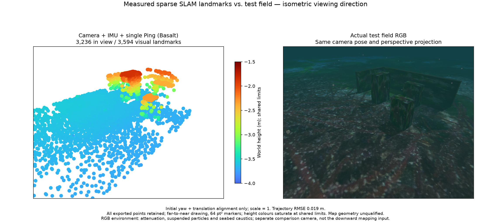
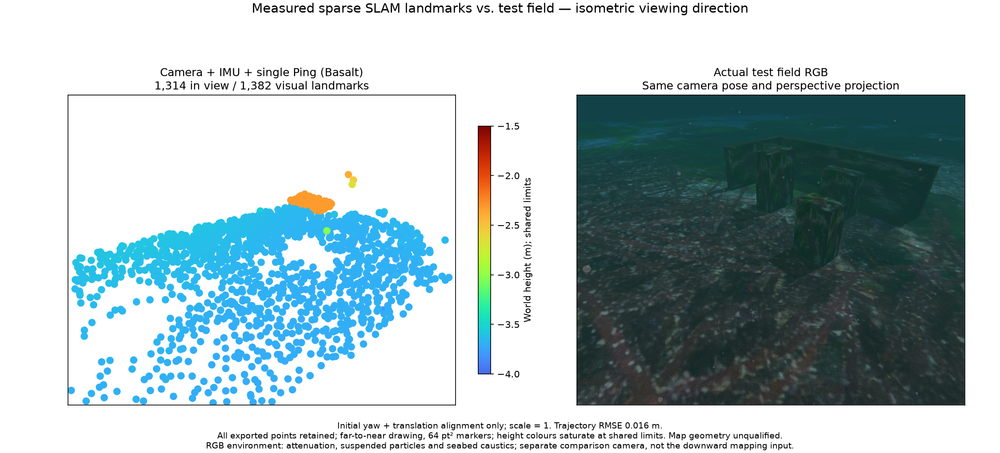

# Common camera/IMU factor ownership / 카메라·IMU 공통 관측 관리

## Result

Camera/IMU-only estimation now uses the same complete optimizer and
marginalization ownership as combinations with optional sensors. The former
partial marginalization order omitted young lost-feature hosts that were still
retained IMU states. A 16-state window then aborted after 15 poses. No lost
observations are silently discarded to bypass the assertion. An empty optional
factor store does not mean a Ping measurement was supplied or optimized.

The deterministic translated-texture regression fails on the retained old
worker and passes on the new worker. It exercises 121 images, real visual
landmarks and bounded retirement without Ping, sonar, DVL or pressure.
It is a lifecycle fixture, not an accuracy certificate. Native checks run
54 tests: 40 pass and 14 optional probe tests skip. Initial-bias-prior and
map-information probes also pass. Logs and the source/binary build receipt
are included.

| Recorded control | Points | Surface RMSE | Trajectory RMSE | Judgment |
| --- | ---: | ---: | ---: | --- |
| Camera/IMU, retained startup, 3 states | 24 | 33.02 mm | 57.18 mm | Missing scene geometry |
| Camera/IMU, retained startup, 16 states | 146 | 32.57 mm | 39.12 mm | Missing scene geometry |
| Camera/IMU, endpoint start, 16 states | 2 | 53.39 mm | 71.86 mm | Missing scene geometry |
| Camera/IMU/Ping ROS, initial | 3,594 | 13.41 mm | 19.17 mm | Bounded integration passes |
| Camera/IMU/Ping ROS, recovered | 1,382 | 8.08 mm | 16.49 mm | Bounded integration passes |

The camera/IMU controls are two-pass numerical experiments over the same
recording. Their early seed uses 16 measured images from 69.3–72.3 s; the
estimator consumes retained images and raw IMU once from 69.3–129.2 s.
The endpoint control begins at 73.6 s with the separately recorded endpoint
proposal and continues to 129.2 s. These are not a live retained-startup API,
a new provider profile or a covariance-qualified initializer. Truth is only
used after estimation. Processing/export success is separate from map quality.

The 16-state early control covers only the first target and nearby seabed.
It still misses two targets and both walls. Default state retention stays at
three; point admission, image/feature budgets and GUI display limits stay
unchanged. The larger window does not qualify this combination. Whole-replay
`time -l` logs include the harness and child processes: the 3-state control
records 29.69 s and 154 MB peak RSS; the 16-state early control records 144.35 s
and 346 MB. The larger-window runs shared the host with other checks, so these
are resource observations, not a controlled speed ratio or real-time guarantee.

Actual ROS domain116 replays the camera/IMU/Ping input at 1× with the same
original measurement times. IMU interruption clears the old map and rejects
stale exports; recovery creates a fresh segment. The initial map retains eight
points beyond 10 cm, maximum 47.19 cm. The recovered map retains one, maximum
13.15 cm. Both workers and input threads stop. The proof binds 74 component
and nine runtime source files. It does not activate an installed provider,
qualify the default image budget, or exercise the GUI, VRX or sonar-only mode.

All figures preserve complete exported points and use the same isometric
perspective camera, metre extent, −4 to −1.5 m Turbo height limits and 64 pt²
markers. Visible/total counts disclose camera clipping. RGB includes underwater
attenuation, suspended particles and seabed caustics. Only initial yaw and
translation align evaluation, at scale one. The accepted earlier 6,213-point
record and its three threshold exceedances remain unchanged.

`python summarize.py` verifies checksums and recomputes all-point statistics,
export counts and no-auxiliary-fusion evidence. This compact kit contains full
PLYs, losslessly compressed assessments/receipts and native control events.
Raw image/IMU recordings, SDKs, executables and private application sources
are not duplicated here. Remaining work is useful camera/IMU and sonar maps,
managed field/GUI acceptance, VRX practice acceptance and the WAM-V survey.

## 한국어

카메라·IMU만 사용하는 추정도 선택 센서를 결합한 경우와 같은 최적화·관측
정리 경로를 사용합니다. 기존 경로는 아직 유지 중인 IMU 상태가 소유한
유실 특징점을 계산 순서에서 빠뜨려, 이력 16개에서 자세 15개 뒤 중단됐습니다.
관측을 버리거나 단언문을 무시하지 않고 전체 소유 관계를 유지합니다.
선택 센서 저장소가 비어 있으면 실제 Ping을 입력하거나 결합하지 않습니다.

121장 이동 무늬 회귀시험은 기존 바이너리에서 중단을 재현하고 새 바이너리에서
통과합니다. 실제 시각 특징점 생성과 이력 정리를 검사하며 정확도를 인증하는
장면은 아닙니다. 네이티브 시험 54개 중 40개가 통과하고 선택 프로브 시험
14개는 건너뜁니다. 초기 바이어스 사전정보·지도 정보량 프로브도 통과합니다.

표의 카메라·IMU 대조 시험은 기록을 두 번 처리하는 수치 실험입니다.
초기 관측을 유지하는 실제 운영 API를 구현한 결과는 아닙니다. 같은 초기값과
원본 입력에서 이력 3개는 24점, 16개는 146점을 내보내지만, 후자도 첫 물체와
해저 일부만 있어 두 물체와 두 벽이 빠집니다. 기본 이력 3개와 점 채택·영상·특징
예산, GUI 표시 한도는 유지합니다. 큰 이력이 이 조합의 합격을 뜻하지 않습니다.
자원 로그는 다른 시험과 호스트를 공유한 전체 재생 기록이므로 배속 성능의
공정한 비교나 실시간 처리 보장은 아닙니다.

실제 ROS domain116의 카메라·IMU·단일 Ping 1배속 시험은 IMU 유실 때 지도를
비우고 이전 지도의 다운로드를 거부한 뒤 새 구간을 생성합니다. 초기 지도는
3,594점, 복구 지도는 1,382점입니다. 10cm 초과점은 각각 8개·1개이며 최대
47.19cm·13.15cm를 그대로 보존합니다. 두 워커와 입력 스레드가 종료됐으며
구성요소 74개·런타임 9개 파일 해시를 기록했습니다. 설치형 앱·기본 영상 예산·
GUI·VRX·소나 전용 조합의 검증은 별도입니다.

그림은 전체 점, 같은 등각 방향의 원근 카메라와 미터 범위, −4~−1.5m Turbo,
64 pt² 점을 사용합니다. RGB에는 수중 감쇠·입자·해저 집광무늬가 있습니다.
평가는 초기 방위각·위치만 정렬하며 축척은 1입니다. 앞서 수용한 6,213점
기록과 10cm 초과점 세 개는 변경하지 않습니다.

위 명령은 체크섬, 전체 점 통계와 내보내기 점 수, 선택 센서가 결합되지 않은
대조 시험을 재검증합니다. 유용한 카메라·IMU 및 소나 지도, 관리형 현장·GUI,
VRX 연습장과 WAM-V 해저 측량 검증은 남아 있습니다.
