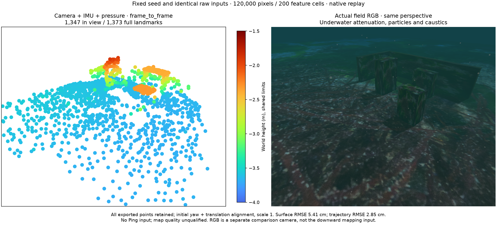
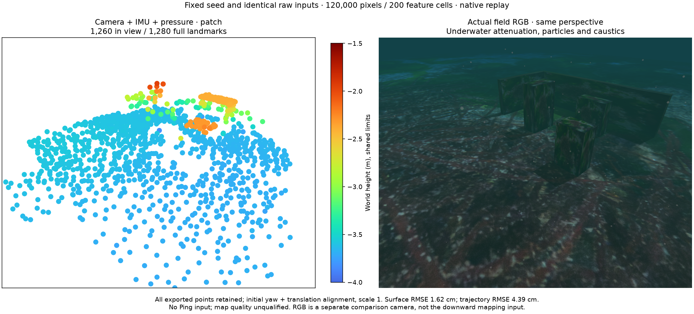
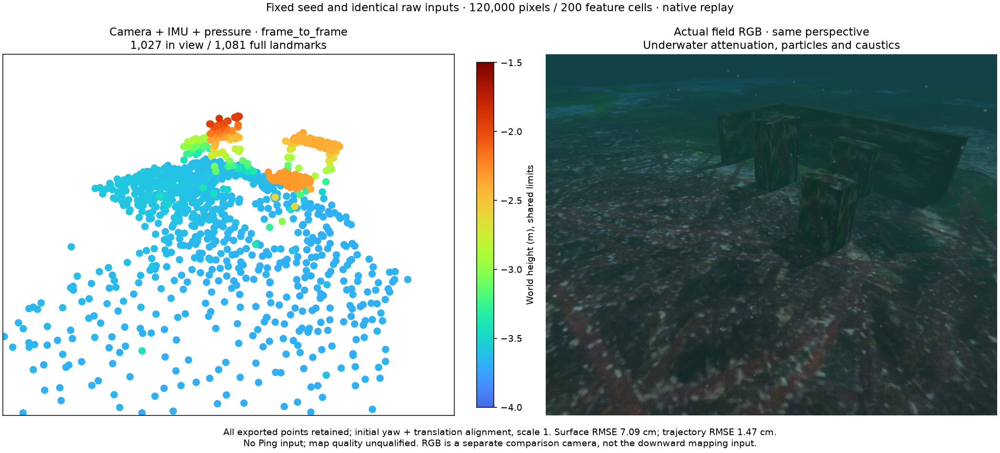
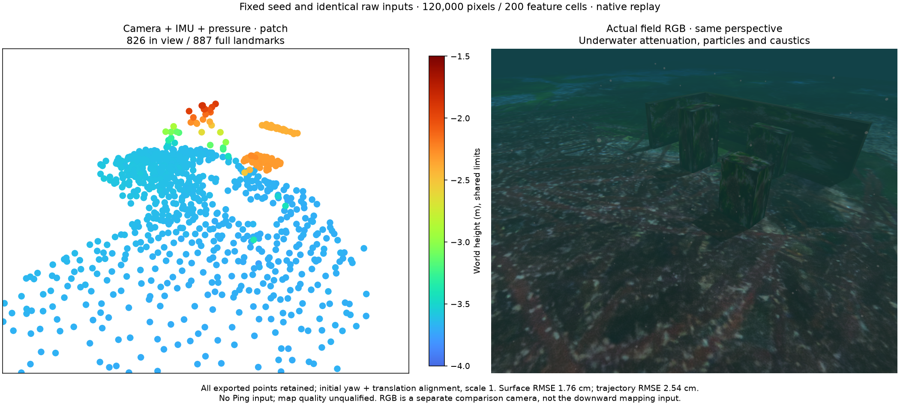
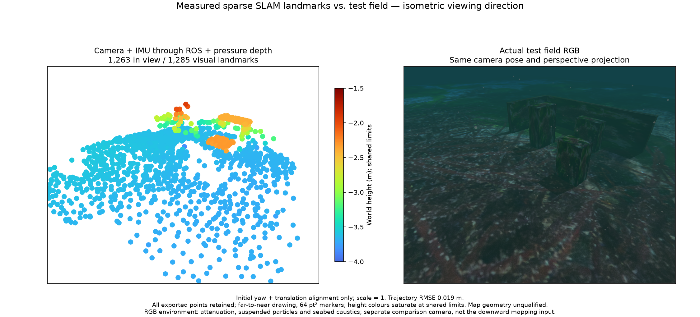
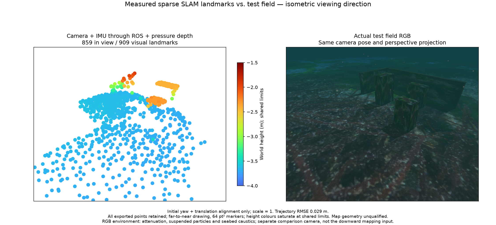
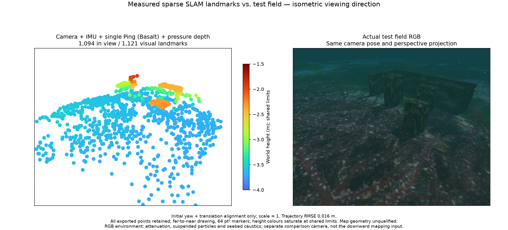
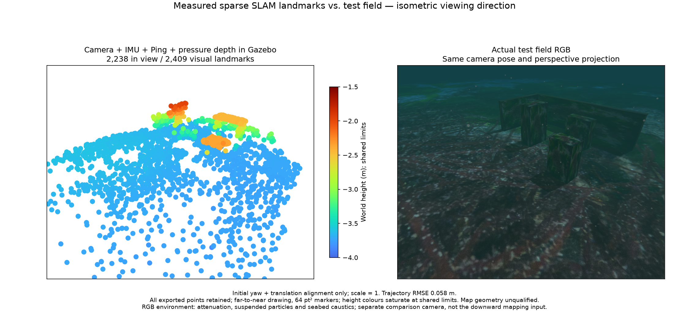

# Default-budget reference tracking — 2026-10-28

The application selects birth-reference Lucas–Kanade patch tracking with its existing 120,000-pixel, 200-cell and 10 Hz camera budgets. Viewer defaults remain 1,000 points. Native queue sizes, stale deadlines, sensor noise, world-position information budget and point culling are unchanged. The independent native API still accepts an explicit `frame_to_frame` profile.

## Equal-input controls

The controls use the same recorded camera/IMU/pressure measurements and the same measured first-state seed. Neither uses Ping. Both receive pressure on the same original event times. For each interval, the calibration JSON differs only in `optical_flow_type`; native readiness acknowledges that choice. The initial interval has 525 images and 53 optimized pressure states; the later interval has 506 images and 51 pressure states. Every exported point is retained.

The reference-patch result reduces large errors at the same processing budget in both intervals. This is consistent with reducing accumulated previous-frame tracking drift; it does not establish the physical cause of every rejected or retained feature. Counts differ because feature tracking differs. The live and ROS results below have separately measured startup seeds and are not equal-seed controls.

| Initial interval, previous frame | Initial interval, reference patch |
| --- | --- |
|  |  |

| Later interval, previous frame | Later interval, reference patch |
| --- | --- |
|  |  |

## Actual ROS input and recovery

Both tests run at 1× wall-clock delivery with the default 120,000 pixels, 200 cells and reference-patch frontend. Camera + IMU + pressure has no Ping subscription, publication, pairing or factor. IMU loss clears its old map and a new segment recovers. The camera + IMU + Ping + pressure test interrupts pressure instead, rejects old exports, and recovers in a new frame. Each test has 52 initial optimized pressure states; restored segments have 50/51. The Ping test also verifies actual range optimization. Every worker reader/writer thread stops, and source hashes remain fixed.

| Input | Before loss | After recovery |
| --- | --- | --- |
| Camera + IMU + pressure |  |  |
| Camera + IMU + Ping + pressure |  |  |

No-Ping initial/recovered trajectory RMSE is 1.88/2.87 cm; Ping trajectory RMSE is 1.60/1.52 cm. These are recorded ROS integrations, not installed-app qualification.

## Actual managed field

The checked 7 m × 4 m, two-lane, two-cycle survey uses 0.6/1.2 m depths, fixed heading and terminal surfacing. After deliberate worker termination, one restored segment retains 1,125 poses, completes the mission and exports all 2,409 points. Pressure is optimized in 113 states. Observed authored-target clearance is 0.866 m against a 0.5 m body margin; terrain is checked separately. Native transmitted IMU leads its event by at most 10 ms. All four owned process groups stop normally.

This managed run uses the same default budget, with attached Ping. Surface RMSE is 4.69 cm; trajectory RMSE is 5.82 cm. Nine points exceed 10 cm and maximum surface error is 28.63 cm. They remain in the PLY and assessment. The scene has points near all three targets and both walls; nearest-surface counts do not prove landmark identity or reconstructed area.

All RGB/cloud figures use the same isometric viewing direction and perspective, shared Turbo height limits and 64 pt² markers. The actual RGB includes underwater attenuation, suspended particles and seabed caustics. It uses an explicit development shader override, not the selected engine's default. The comparison camera is separate from the downward mapping input. Alignment uses initial yaw and translation at scale 1; there is no trajectory fit or truth-based point removal. Simulator geometry is evaluation-only. Terrain texture and dependency notices remain in POSIM-SLAM's NOTICE.md.

## Every-point results

| Case | Full points | Surface RMSE | P95 | P99 | Maximum | Above 10 cm |
| --- | ---: | ---: | ---: | ---: | ---: | ---: |
| Fixed seed, initial, previous frame | 1,373 | 5.41 cm | 3.07 cm | 26.57 cm | 76.62 cm | 24 |
| Fixed seed, initial, reference patch | 1,280 | 1.62 cm | 2.51 cm | 5.93 cm | 16.81 cm | 5 |
| Fixed seed, later, previous frame | 1,081 | 7.09 cm | 1.77 cm | 19.23 cm | 199.21 cm | 14 |
| Fixed seed, later, reference patch | 887 | 1.76 cm | 1.80 cm | 3.58 cm | 32.82 cm | 3 |
| ROS, no Ping, initial | 1,285 | 1.17 cm | 1.65 cm | 4.46 cm | 17.93 cm | 2 |
| ROS, no Ping, recovered | 909 | 1.67 cm | 2.82 cm | 3.93 cm | 21.33 cm | 1 |
| ROS, Ping, initial | 1,121 | 1.56 cm | 2.02 cm | 5.73 cm | 23.59 cm | 3 |
| ROS, Ping, recovered | 1,238 | 1.24 cm | 1.85 cm | 3.43 cm | 23.04 cm | 2 |
| Managed Gazebo, Ping | 2,409 | 4.69 cm | 5.81 cm | 7.88 cm | 28.63 cm | 9 |

The full PLYs, source-bound receipts, every vertex's surface assessment, pose CSVs for the controlled intervals, camera metadata and clean shutdown records are retained. `python3 summarize.py` verifies hashes, exact vertex coverage, every-point statistics, equal-input/seed/configuration controls and recovery. It does not rerun the estimator or reconstruct the geometry oracle. Private raw recordings and the SDK are reused rather than copied into either repository.

These tests support the selected application frontend and the measured demo integrations. General map accuracy, initialization uncertainty, acoustic SLAM, all GUI switches, installed-platform qualification, VRX practice and the later WAM-V survey remain separate work. Existing failures and the accepted 6,213-point review are preserved; zero outliers are not required.

## 한국어

앱은 기존 120,000픽셀·200개 검출 셀·10Hz 예산에서 기준 패치 Lucas–Kanade 추적을 기본으로 선택합니다. 같은 원본 입력·같은 초기값을 사용하는 두 구간 대조에서 큰 이상점이 줄었습니다. 큐·잡음·점 채택 기준을 완화하지 않았고 모든 점을 보존했습니다.

실제 ROS1배속 시험은 Ping 없는 카메라·IMU·압력과 Ping을 추가한 조합의 유실·복구를 각각 검증했습니다. 별도의 실제 Gazebo 임무는 복구 뒤 한 구간을 유지해 자세1,125개·전체2,409점을 보존하고 종료했습니다. 표의 모든 이상점과 점별 오차도 그대로 공개합니다.

비교 그림의 RGB와 점군은 같은 등각 방향·투영이며, RGB에는 수중 감쇠·부유 입자·해저 집광무늬가 있습니다. 실험용 셰이더를 사용한 비교 카메라와 실제 하향 추정 카메라를 구분합니다. 입력·임무 통과를 일반적인 지도 정확도·항법·설치형 앱 합격으로 확대하지 않습니다.
