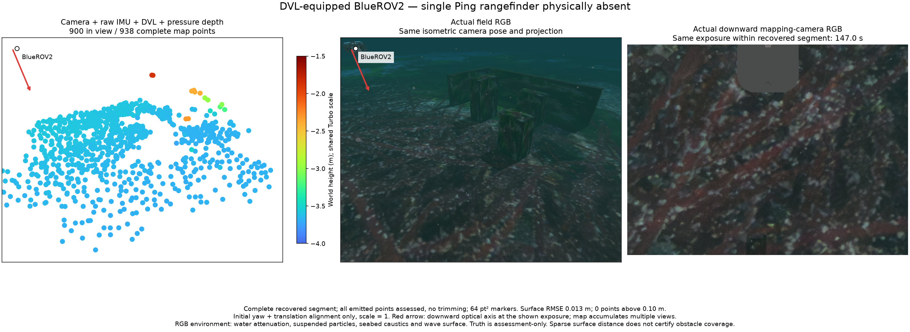

# DVL/no-Ping turning survey / Ping 없는 DVL 회전 조사

2026-10-29 development evidence, mirrored into WWW-POSIM and public Apache-2.0 POSIM-SLAM. Run `python3 summarize.py` in this directory to verify hashes, every retained vertex, assessment rows, sensor/fusion boundaries, per-segment image clocks and cleanup. This verifies artifacts, not navigation or installed packages. No private application implementation is copied into the library.

## Physical run and complete maps

One cold native BlueROV2 start completes two checked 7×4 m, two-depth, two-cycle surveys with camera + raw IMU + DVL + pressure. Single Ping hardware, raw topics and estimator arguments are absent. Deliberately stopping/resuming only the owned DVL receiver produces exactly one `dvl_stale` reset and a different map frame. This is communication silence, not physical bottom-lock loss. The actual worker uses 120,000 pixels, 200 spatial feature cells, at most 10 Hz and three recent full states. Physical downward RGB is 800×600 at 5 Hz. No noise, admission, freshness or queue limits change; no emitted vertices are removed.

| Segment | Complete / in-view points | Surface RMSE | Maximum distance | Above 10 cm | Trajectory RMSE |
| --- | ---: | ---: | ---: | ---: | ---: |
| Initial | 863 / 829 | 1.27 cm | 13.89 cm | 2 | 5.35 cm |
| Returned DVL | 938 / 900 | 1.30 cm | 9.42 cm | 0 | 4.83 cm |

Every one of the 1,801 emitted points has an assessment row. Distances are to the nearest authored seabed/box/wall surface; proximity does not establish feature identity, obstacle detection or coverage. Alignment uses only initial yaw and translation, fixed scale 1, with no whole-trajectory fit. Independent truth is assessment-only; interpolation brackets stay within 50 ms. Minimum observed centreline distance to authored boxes/walls is 0.670 m against a 0.5 m spherical body envelope. Terrain safety is checked separately by the controller. All four owned groups become empty; supervisor exits 0 with no launch escalation.

Each segment has its own synchronized field and mapping-camera exposure: 27 s inside initial 4.6–124 s, and 147 s inside recovered 132–244 s. The renderer rejects another frame, unequal RGB stamps, an out-of-interval exposure or states newer than export. Both isometric panels share the same actual camera pose/projection. Arrows identify BlueROV2 and its downward optical axis. RGB includes attenuation, suspended particles, seabed caustics and wave surface. Markers are 64 pt² with a shared −4 to −1.5 m Turbo scale. Original Orca5 sensor geometry is retained, including the hull visible in raw downward RGB; no image masking is applied. Orca5 reference assets retain their [MIT license](https://github.com/clydemcqueen/orca5/blob/main/LICENSE).

## Coverage and limits

Following the route bearing instead of holding heading produces about 1,535° unwrapped heading span in each segment. These are repeated turns, not 1,535° independent viewing directions. The earlier fixed-heading record spans only 2.28°/1.12° and is retained in `previous-fixed-heading-coverage.json`. The current run has different starting conditions and a reconciled physics derivative; it is not a paired equal-input accuracy comparison.

`coverage.json` samples box-face interiors at 0.1 m, tests the measured optical frustum/front faces and box occlusion, then reports sample-to-cloud distance. It excludes terrain/hull/particle occlusion and photometric feature quality, so geometric visibility is only an upper bound. In the initial/returned maps, wall-0 samples within 5 cm number 10/5 and wall-1 5/1. The three target boxes have 8/3, 5/2 and 2/5 nearby samples. This sparse support does not demonstrate useful obstacle reconstruction. Turning alone does not resolve the coverage problem. Both final statuses still report `provisional_observability_not_qualified`; low residuals or surface error do not close initialization uncertainty. Next separate vertical-leg heading behaviour, camera viewing geometry and track information before enlarging the suite or claiming navigation readiness.

## Runtime reconciliation and failed preflights

Measured source baseline is application 35fb319b / main 0c1c724e, POSIM/SDK 8c47601, POSIM-SLAM 839a0b1, development shader 0d075c9 and the recorded native binary. Main's current-aware Wave Sim derivative is built from checked upstream sources with source identity `22b8ea23…` and library SHA-256 `ddff52c0…`. Its original GPL sources and build receipt remain in the local build; `hydrodynamics.json` records their hashes. The private asyncio-only overlay applies official CPython [23dc7c9](https://github.com/python/cpython/commit/23dc7c9f05c6e85033dba4ca7a0c807cbede2a8f), as documented in the [shutdown evidence](../dvl-without-ping-20261029/README.md#shutdown-investigation-and-sdk-correction). The ordinary SDK and installations are unchanged.

Two earlier preflights omit the new hydrodynamics binary while reusing an older SDK. Gazebo logs failure to load `wwos-competition-hydrodynamics`; the body rests near the seabed and default preview rejects `start_near_surface_required`. An explicit ascent preview rejects `route_start_unsafe`. No survey map is produced. Both incomplete attempts and normal cleanup remain under `preflight-failures/`. Rebuilding and staging the checked derivative restores buoyancy and permits the measured surveys. No navigation guard or estimator deadline is bypassed. This stage uses the same source/engine/hash checks as application packaging; fresh archive acceptance remains open.

## 한국어

Ping을 물리적으로 제거한 BlueROV2를 새로 시작해 카메라·원본 IMU·DVL·수압으로 두 차례 회전 조사를 마쳤습니다. DVL 수신기만 일시정지·복귀시켜 통신 단절을 만들었으며, 예상한 `dvl_stale` 한 번 뒤 새 지도 구간이 시작됩니다. 바닥 추적 상실 시험과는 구분합니다. 초기 863점과 복구 938점을 모두 보존·평가하며, 표면 RMSE는 1.27/1.30cm, 최대 거리는 13.89/9.42cm입니다. 10cm 초과점 2/0개도 삭제하지 않습니다. 최초 방위각·위치만 정렬하고 축척·기울기 오차는 유지합니다. 점과 가장 가까운 표면의 거리는 물체 인식이나 완전한 장애물 지도를 뜻하지 않습니다.

RGB는 각 구간에서 별도로 촬영합니다. 초기 4.6~124초 구간의 27초 영상, 복구 132~244초 구간의 147초 영상입니다. 시험장·지도 입력 영상의 노출과 구간 프레임을 확인하며, 다른 구간이나 시간 범위 밖 영상은 렌더링 단계에서 거부합니다. 등각 투영·기체·광축·수중 감쇠·입자·집광무늬·수면 파도와 공통 Turbo 범례를 함께 표시합니다. 원본 Orca5 카메라 형상과 화면에 보이는 선체는 유지합니다.

회전 범위는 구간마다 펼친 각도 약 1,535°이지만 장애물 점은 여전히 드뭅니다. 반복 회전량을 독립 관측 방향 수로 해석하지 않습니다. 두 벽의 5cm 이내 표면 표본은 초기/복구 각각 10/5개와 5/1개입니다. 이 진단은 카메라 시야·앞면·상자 간 가림만 계산하므로 실제 특징점 관측 범위의 상한입니다. 회전만으로 유용한 장애물 지도가 되지는 않습니다. 최종 초기화 상태도 `provisional_observability_not_qualified`이므로 초기 자세 불확실성은 미해결입니다. 다음에는 수직 구간의 방위각 처리와 카메라 관측 방향·트랙 정보를 분리해 확인합니다.

처음 두 시도는 최신 main의 해류용 유체역학 바이너리가 시험 런타임에서 빠져 기체가 해저에 내려앉았습니다. 정상적인 미션 사전 검사가 이를 거부했고 조사 지도는 생성되지 않았습니다. 소스·엔진·파일 해시를 확인한 플러그인을 조립한 뒤 두 실제 조사를 완료했습니다. 안전 여유나 SLAM 기준을 완화하지 않았습니다. CPython 공식 종료 수정은 별도 개발용 오버레이이며, 공유 SDK·설치 앱·LIVE·러너는 변경하지 않습니다. 실제 종료는 부모 코드 0, 강제 종료 없이 소유 그룹 네 개가 모두 비었습니다. 설치 파일·일반 항법 승인은 별도입니다.
