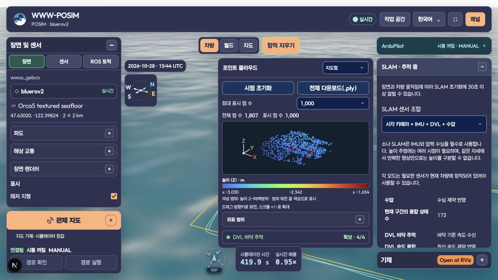

# DVL without a single Ping / 단일 Ping 없는 DVL

2026-10-29 development evidence. This dated record is mirrored into WWW-POSIM and the independent Apache-2.0 POSIM-SLAM repository. No private application implementation is included. It retains ten complete ROS maps and four complete native maps, not viewer subsamples. Run `python3 summarize.py` here to verify hashes, full binary PLYs, point assessments, input identities, loss contracts and cleanup records. This verifier does not rerun Gazebo or certify navigation.

## Selection and input contract

The application treats DVL and single Ping as alternative payloads. Selecting either replaces the other; the server rejects a conflicting request. The BlueROV2 demo uses the shared selected-sensor composer, forward/downward cameras, raw IMU, DVL and pressure. The physical Ping link/joint, sensor, autopilot sonar input, range bridge and estimator arguments are absent. `sensor-summary.json`, `sensor-topics.json`, the second run’s `worker-command.json` and zero Ping reception/fusion counts capture these independent boundaries. A disabled `visual_ping/status` estimator status publisher remains advertised; no raw Ping range topic is present. Core navigation GNSS, hull inertia and propulsion remain present. This application policy does not prevent independent library users composing measurements.

Mounted DVL and pressure automatically request their qualified estimator profile; no DVL/Ping environment override is used in the native runs. Source-bound ROS profiles were regenerated after the application launcher change. The native binary and estimator noise, map-admission criteria, queues and freshness limits remain unchanged. Common selected downward RGB is 800×600 at 5 Hz, 80.2° horizontal FOV, near 0.1 m / far 100 m. The estimator processing budget remains 120,000 pixels, 200 spatial detector cells, 10 Hz maximum and three retained recent states. Recorded ROS input is 10 Hz; native versus replay results are not equal-input accuracy comparisons. `source-identity.json` records SDK/engine 8c47601, explicit development shader 0d075c9 and binary identity. Installed packages are unqualified.

## Original-time ROS controls

Five profiles reuse the identical 120.06-second measured input, preserving original timestamps at 1×. All ten maps retain all 14,038 vertices and an assessment entry per vertex. DVL cases have no Ping subscription or measurement. Bottom-lock loss is a timed invalid-lock status and preserves the frame; communication silence yields exactly one `dvl_stale` reset and a new frame. Three no-DVL pressure-loss baselines each yield exactly one `pressure_stale` reset. All native workers and status writers stop; receipts preserve termination codes.

| Profile | Initial / returned points | Surface RMSE, cm | Points above 10 cm |
| --- | ---: | ---: | ---: |
| DVL communication silence | 1,373 / 1,459 | 1.46 / 1.20 | 5 / 1 |
| DVL invalid bottom lock | 1,425 / 2,897 | 1.14 / 1.13 | 3 / 5 |
| No DVL or Ping | 1,273 / 994 | 1.72 / 1.73 | 3 / 2 |
| Ping fused; no DVL | 1,135 / 1,142 | 1.80 / 1.31 | 2 / 3 |
| Ping received; no DVL | 1,346 / 994 | 1.94 / 1.73 | 3 / 2 |

All outliers remain. `ros/map-summary.json` records exact metrics. Each phase includes the full PLY, compressed per-point assessment and matched RGB/cloud figure. Earlier sixteen-state throughput failures and combined-sensor evidence remain in the [DVL window record](../dvl-factor-window-20261028/README.md).

## Actual native model, mission and browser

Two separate native starts run checked 7×4 m, two-depth physical ArduSub surveys against the canonical seabed, three boxes and two walls. Minimum observed body-envelope clearance is 0.858 m and 0.869 m against the authored targets, with a 0.5 m requirement. Actual DVL receiver SIGSTOP/SIGCONT creates four seconds of communication silence, not physical bottom-lock loss. Each case has exactly one intentional reset, zero Ping measurements, DVL/pressure fusion and a full recovered export.

| Native map | Complete vertices | Surface RMSE | Maximum distance | Above 10 cm |
| --- | ---: | ---: | ---: | ---: |
| First, initial | 1,897 | Assessment incomplete | Unassessed | Unassessed |
| First, recovered | 1,870 | 1.52 cm | 31.66 cm | 3 |
| Second, initial | 1,855 | 1.44 cm | 28.07 cm | 4 |
| Second, recovered | 1,808 | 1.02 cm | 9.94 cm | 0 |

The first independent observer leaves 12 of 601 initial states without bracketing truth; `native-first/assessment-limit.json` preserves the failure and all original points. The second observer collects direct Gazebo truth before pose subscription and retains a deeper diagnostic ROS queue. Both second-run maps have complete coverage under the unchanged 50 ms evaluation bracket limit. Truth remains evaluation-only. Alignment uses initial yaw and translation, scale 1; it preserves tilt/scale errors and performs no whole-trajectory fit or coordinate trimming. Assessed native vertices total 5,533 of 7,430 retained vertices.

The cloud and field RGB share the actual isometric camera pose and perspective; the third panel is actual mapping-camera RGB at the same exposure as the field image. The original observer captures once per start. In the second run, that exposure is 138.0 s: inside the initial interval 115.2–238.0 s but before the recovered interval 245.8–361.0 s. The recovered figure therefore uses a static scene reference, not an input image from its own segment. `reference_provenance` records this distinction; the maps and assessment numbers are unchanged. Red arrows mark the BlueROV and downward optical axis. RGB includes underwater attenuation, suspended particles, seabed caustics and wave surface. All complete points are submitted to plotting; perspective clipping is reported separately. Markers are 64 pt², Turbo −4 to −1.5 m. This sparse map covers seabed and some object tops; wall/obstacle coverage, dense reconstruction, general navigation, startup uncertainty and installed-platform acceptance remain open. A zero-outlier result is not an acceptance requirement. Orca5 camera geometry is preserved; the physical hull visible at the top of raw RGB is not masked. Orca5 reference assets retain their [MIT notice](https://github.com/clydemcqueen/orca5/blob/main/LICENSE).

The actual browser selects camera + IMU + DVL + pressure, has no Ping-fusion selector, shows green 4/4 DVL lock and retains the 1,000 / 2,000 / 5,000 / all viewport choices. `ui/demo-choice.jpg` shows the default demo sensor description. EN/KO guide/specification pages fit 1,280 px desktop and 390 px mobile widths; snapshots are under `ui/`.

## Shutdown investigation and SDK correction

Both original operating trials leave all owned groups empty. ROS launch logs SIGKILL escalation for the DVL child, and the first supervisor reaches its forced-stop deadline. These logs alone do not prove the child stayed alive. A later ROS-only launch probe records normal main/atexit completion and a zombie child while launch continues logging termination deadlines. The earlier native sample was scheduled from shutdown intent, without a captured signal-delivery timestamp; its `rcl_wait` stack cannot establish post-signal behavior.

Fourteen initial isolated controls exit normally. A narrower launch/pause/group-signal comparison reproduces the failure with both ROS alone and the DVL bridge; signaling the child alone succeeds. The SDK's CPython 3.14.7 lacks upstream [gh-158287, correction 23dc7c9](https://github.com/python/cpython/commit/23dc7c9f05c6e85033dba4ca7a0c807cbede2a8f): Darwin can report a stopped child to `waitid(WEXITED)`, blocking asyncio's reaping path. A separate source-only asyncio overlay applies that correction. The ordinary SDK remains unchanged; no DVL or estimator workaround is added.

The unchanged SDK fails a bounded actual-child heartbeat probe (watchdog rescue at three seconds); the corrected overlay completes all three heartbeat ticks and exits normally. All four corrected ROS-launch controls exit 0 without forced termination. A further actual BlueROV native start receives valid physical DVL, pauses/returns the receiver for a measured 4.10-second receipt gap, then stops with parent exit 0, no termination escalation and every owned group empty. The DVL child is logged as finished cleanly. This is lifecycle evidence only; it does not rerun or requalify the original maps. An earlier attempt's observer starts before the final model file exists; its failed helper result and clean cleanup are preserved separately.

`shutdown-followup/` retains both sides of the comparison, phase/zombie evidence, exact source hashes, the real native lifecycle and Python's original license. The build-time correction is guarded and idempotent, and the SDK assembler, archive override checks and relocation acceptance verify the corrected source and actual heartbeat. Fresh archive/installed acceptance remains pending; a development overlay is not a qualified release.

## 한국어

DVL과 단일 Ping은 앱의 대체 장착 옵션입니다. 선택 화면·서버·최종 모델·토픽·추정기 인자가 같은 규약을 따릅니다. 기본 BlueROV2는 카메라·원본 IMU·DVL·수압을 사용하며 Ping 센서·링크·조인트·자동조종 거리 입력도 제거합니다. 독립 라이브러리의 센서 결합 기능은 유지합니다.

원래 속도의 ROS 다섯 사례는 전체 지도 열 개, 14,038점을 모두 보존·평가합니다. 유효하지 않은 바닥 추적 상태는 같은 구간을 유지하고, 통신 단절은 한 번의 `dvl_stale` 뒤 새 구간을 만듭니다. Ping만 사용하는 수압 상실 대조군도 남습니다. 이상점을 제거하거나 잡음·시간 제한·점 채택 기준을 완화하지 않습니다.

실제 모델로 두 번 시작해 물리 조사와 통신 복구를 실행합니다. 첫 초기 지도는 참조 기록이 부족해 평가하지 못했으며, 나머지 세 지도 5,533점은 모두 평가합니다. 두 번째 복구 지도의 1,808점은 표면 RMSE 1.02cm, 최대 9.94cm입니다. 초기 지도에는 큰 오차가 남습니다. 상자·벽 관측 범위, 초기화 불확실성, 일반 항법·설치형 앱의 검증은 별도입니다. 그림은 같은 등각 카메라와 실제 하향 RGB, 기체·광축, 수중 감쇠·입자·집광무늬·파도를 보여줍니다. 원래 관찰기는 시작마다 한 번 촬영했습니다. 두 번째 기록의 138초 영상은 초기 구간에 속하지만 245.8~361초 복구 구간에는 속하지 않습니다. 복구 그림의 RGB는 정적 장면 참고이며 해당 구간의 입력 영상으로 해석하지 않습니다. 지도와 오차 수치는 그대로 보존합니다.

초기 종료 로그의 강제 종료 메시지만으로 DVL 수신기가 살아 있었다고 단정할 수는 없습니다. 이후 ROS만 사용하는 최소 재현에서는 정상 종료한 자식이 좀비 상태로 남고 launch가 회수하지 못했습니다. CPython의 macOS 대기 처리 문제 gh-158287과 공식 수정 23dc7c9를 확인했습니다. 별도 asyncio 소스 오버레이에서 네 재현과 실제 BlueROV DVL 일시정지·복귀 후 종료가 정상 완료됩니다. DVL 추정 코드는 바꾸지 않습니다. SDK 조립·압축·재배치에 소스 해시와 실제 자식 heartbeat 검사를 연결하며, 새 설치 파일의 승인은 아직 별도입니다. 해저 및 RGB 원본에는 Orca5 MIT 고지가 적용되며 비공개 앱 구현은 이 공개 기록에 포함하지 않습니다.
